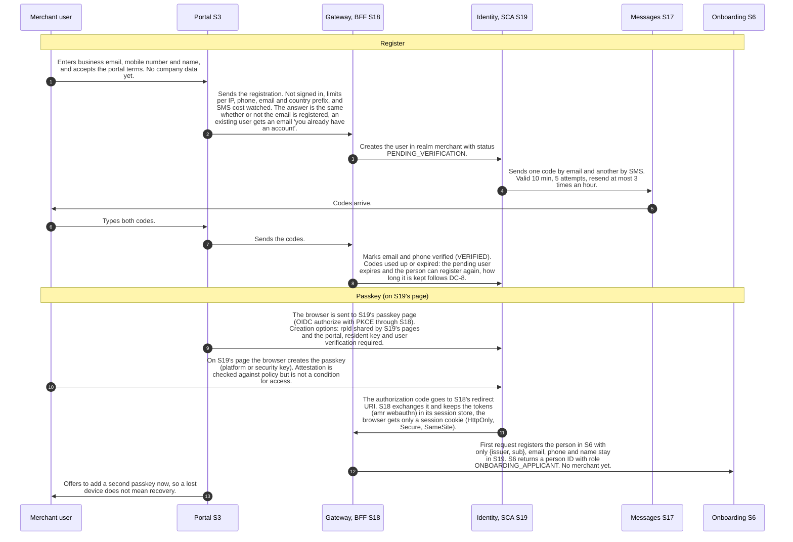
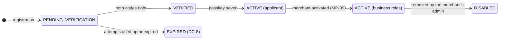

<!-- Generated from src/ by tools/build-docs.ps1. Edit src/workflows.js or src/model.js, not this file. -->

# MP-01 Register and create a passkey

[All workflows](../README.md) | Next: [MP-02 Sign in, switch business and check rights](MP-02-sign-in-switch-business-and-check-rights.md)

No passwords. The person proves an email and a phone, saves a passkey, and gets the applicant role. Company data comes later in the application.

| | |
|---|---|
| Status | In v8.7 |
| For | Every merchant |
| Area | Access |
| Source | WF02a steps 1 to 12 |
| Starts when | A representative opens the portal for the first time. |
| Object | PortalUser (S19 realm merchant), person in S6 |
| Systems | Merchant (user), Portal (S3), Gateway, BFF (S18), Identity, SCA (S19), Messages (S17), Onboarding (S6) |
| Portal screens | Registration |

## Sequence

## Steps

| # | From | To | Step | Call | Notes |
|---|---|---|---|---|---|
| | | | **Register** | | |
| 1 | Merchant (user) | Portal (S3) | Enters business email, mobile number and name, and accepts the portal terms. No company data yet. |  | WF02a 1 |
| 2 | Portal (S3) | Gateway, BFF (S18) | Sends the registration. Not signed in; limits per IP, phone, email and country prefix, and SMS cost watched. The answer is the same whether or not the email is registered; an existing user gets an email "you already have an account". | `POST /v1/portal/users/register {email, phone, name, consentVersion}` | WF02a 2 Time: 2 s **If it fails:** 429 on a limit **Decided:** [MP-Q02](../open-questions.md#mp-q02) |
| 3 | Gateway, BFF (S18) | Identity, SCA (S19) | Creates the user in realm merchant with status PENDING_VERIFICATION. |  | WF02a 3 **If it fails:** S19 down: 503, nothing is stored |
| 4 | Identity, SCA (S19) | Messages (S17) | Sends one code by email and another by SMS. Valid 10 min, 5 attempts, resend at most 3 times an hour. |  | WF02a 4 Time: delivery 30 s |
| 5 | Messages (S17) | Merchant (user) | Codes arrive. |  | WF02a 5 |
| 6 | Merchant (user) | Portal (S3) | Types both codes. |  | WF02a 6 |
| 7 | Portal (S3) | Gateway, BFF (S18) | Sends the codes. | `POST /v1/portal/users/verify {userId, emailCode, smsCode}` | WF02a 7 **If it fails:** attempts used up: register again |
| 8 | Gateway, BFF (S18) | Identity, SCA (S19) | Marks email and phone verified (VERIFIED). Codes used up or expired: the pending user expires and the person can register again; how long it is kept follows DC-8. |  | WF02a 8 |
| | | | **Passkey (on S19's page)** | | |
| 9 | Portal (S3) | Identity, SCA (S19) | The browser is sent to S19's passkey page (OIDC authorize with PKCE through S18). Creation options: rpId shared by S19's pages and the portal, resident key and user verification required. |  | WF02a 9 **If it fails:** browser without WebAuthn: message, no password fallback (supported browsers: question 36) |
| 10 | Merchant (user) | Identity, SCA (S19) | On S19's page the browser creates the passkey (platform or security key). Attestation is checked against policy but is not a condition for access. |  | WF02a 10 Time: 60 s **If it fails:** authenticator refused: try another |
| 11 | Identity, SCA (S19) | Gateway, BFF (S18) | The authorization code goes to S18's redirect URI. S18 exchanges it and keeps the tokens (amr webauthn) in its session store; the browser gets only a session cookie (HttpOnly, Secure, SameSite). | `A10` | WF02a 11 |
| 12 | Gateway, BFF (S18) | Onboarding (S6) | First request registers the person in S6 with only {issuer, sub}; email, phone and name stay in S19. S6 returns a person ID with role ONBOARDING_APPLICANT. No merchant yet. |  | WF02a 12 **If it fails:** S6 down: 503 |
| 13 | Portal (S3) | Merchant (user) | Offers to add a second passkey now, so a lost device does not mean recovery. |  | **Open gap:** Proposed, not in v8.7 (MP-Q04) |

## States

| From | When | To |
|---|---|---|
| start | registration | PENDING_VERIFICATION |
| PENDING_VERIFICATION | both codes right | VERIFIED |
| PENDING_VERIFICATION | attempts used up or expired | EXPIRED (DC-8) |
| VERIFIED | passkey saved | ACTIVE (applicant) |
| ACTIVE (applicant) | merchant activated (MP-09) | ACTIVE (business roles) |
| ACTIVE (business roles) | removed by the merchant's admin | DISABLED |

## Rules

- S19 is built in house (self-hosted Keycloak and our own SCA module, ADR-0025); one IdP with realm customer (B2C) and realm merchant.
- Realms share no users, sessions or passkeys.
- Tokens never reach the browser: S18 holds them (ADR-0009).
- The account belongs to the person; one person can work for several merchants.
- KYC of the person happens in the application (MP-06), not here.
- S19 events go to SEC2.

## Questions

### MP-Q02

Registration with an email that already exists returned 409 in v8.1. That is an account lookup for anyone.

**Decision:** The same answer whatever the email; an existing user gets an email instead. Adopted by the CTO in WF02a step 2.

Decided, awaiting sign-off by: CTO

### MP-Q03

The BNB has not confirmed a passkey with dynamic linking as SCA on the web. For the portal it is the only method (no password, no push to the app).

**Proposed:** Ask the BNB in writing before build. Allow platform passkeys and security keys. Keep the design open for a push to S1 for people who have the app.

Owner: Compliance

### MP-Q04

One passkey per person makes lost phones a frequent recovery case.

**Proposed:** Prompt for a second passkey at registration. Require two for Admin and Finance after activation.

Owner: Product
