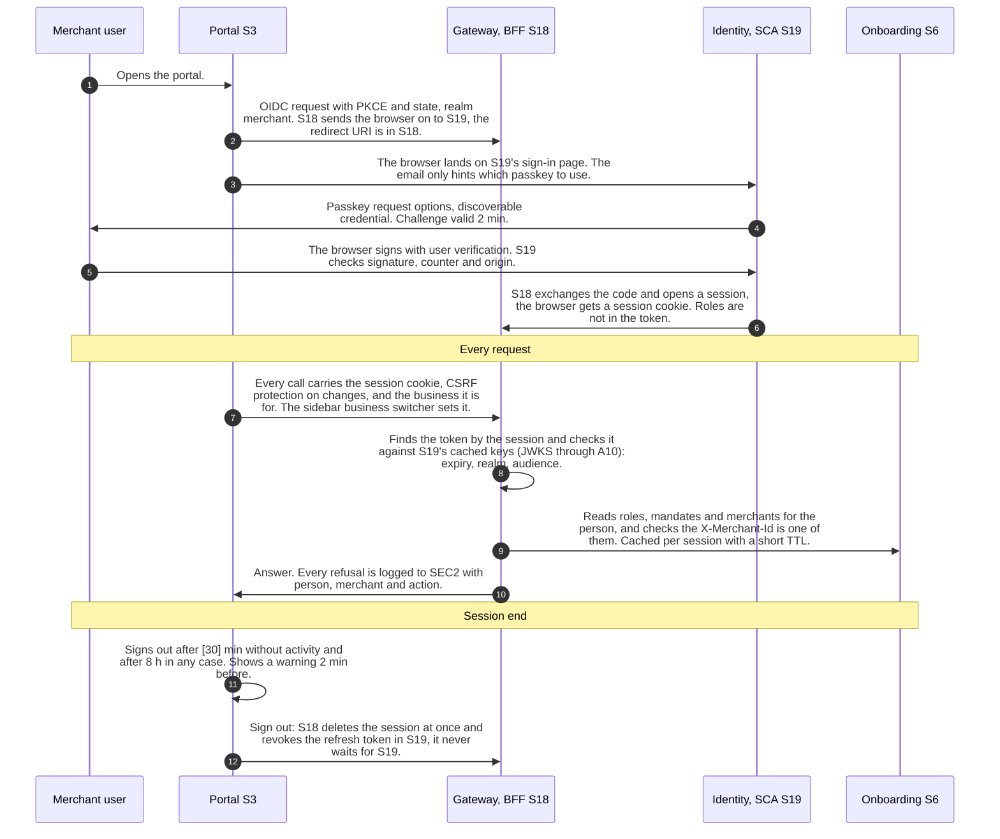
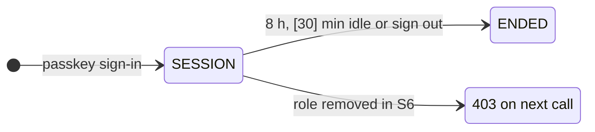

<!-- Generated from src/ by tools/build-docs.ps1. Edit src/workflows.js or src/model.js, not this file. -->

# MP-02 Sign in, switch business and check rights

[All workflows](../README.md) | Previous: [MP-01 Register and create a passkey](MP-01-register-and-create-a-passkey.md) | Next: [MP-03 Strong customer authentication for actions](MP-03-strong-customer-authentication-for-actions.md)

Passkey sign-in on S19's own page; S18 keeps the session and the browser holds only a cookie. Roles are not in the token: S18 asks S6 on every request which merchants and rights the person has.

| | |
|---|---|
| Status | v8.7, gaps closed |
| For | Every merchant |
| Area | Access |
| Source | WF02a steps 13 to 21 |
| Starts when | A person opens the portal without a valid session, or makes any request. |
| Object | Session (S18, token from S19), roles and mandates (S6) |
| Systems | Merchant (user), Portal (S3), Gateway, BFF (S18), Identity, SCA (S19), Onboarding (S6) |
| Portal screens | Home, Team |

## Sequence

## Steps

| # | From | To | Step | Call | Notes |
|---|---|---|---|---|---|
| 1 | Merchant (user) | Portal (S3) | Opens the portal. |  | WF02a 13 |
| 2 | Portal (S3) | Gateway, BFF (S18) | OIDC request with PKCE and state, realm merchant. S18 sends the browser on to S19; the redirect URI is in S18. |  | WF02a 14 Time: 1 s |
| 3 | Portal (S3) | Identity, SCA (S19) | The browser lands on S19's sign-in page. The email only hints which passkey to use. |  | WF02a 15 **Open gap:** Whether the portal later embeds S19's web SDK instead of the page (question 34) |
| 4 | Identity, SCA (S19) | Merchant (user) | Passkey request options, discoverable credential. Challenge valid 2 min. |  | WF02a 16 |
| 5 | Merchant (user) | Identity, SCA (S19) | The browser signs with user verification. S19 checks signature, counter and origin. |  | WF02a 17 **If it fails:** 5 failures: locked 15 min and an email (MP-04). A phishing domain fails on rpId. |
| 6 | Identity, SCA (S19) | Gateway, BFF (S18) | S18 exchanges the code and opens a session; the browser gets a session cookie. Roles are not in the token. | `A10` | WF02a 18 |
| | | | **Every request** | | |
| 7 | Portal (S3) | Gateway, BFF (S18) | Every call carries the session cookie, CSRF protection on changes, and the business it is for. The sidebar business switcher sets it. | `Cookie, X-Merchant-Id: M-…` | WF02a 19 **Decided:** [MP-Q07](../open-questions.md#mp-q07) |
| 8 | Gateway, BFF (S18) | Gateway, BFF (S18) | Finds the token by the session and checks it against S19's cached keys (JWKS through A10): expiry, realm, audience. |  | WF02a 19 Time: 5 ms **If it fails:** invalid: 401, then sign in |
| 9 | Gateway, BFF (S18) | Onboarding (S6) | Reads roles, mandates and merchants for the person, and checks the X-Merchant-Id is one of them. Cached per session with a short TTL. |  | WF02a 20 Time: 20 ms **If it fails:** no right: 403. No merchant yet: only application endpoints. |
| 10 | Gateway, BFF (S18) | Portal (S3) | Answer. Every refusal is logged to SEC2 with person, merchant and action. |  | WF02a 21 |
| | | | **Session end** | | |
| 11 | Portal (S3) | Portal (S3) | Signs out after [30] min without activity and after 8 h in any case. Shows a warning 2 min before. |  | **Decided:** [MP-Q06](../open-questions.md#mp-q06) |
| 12 | Portal (S3) | Gateway, BFF (S18) | Sign out: S18 deletes the session at once and revokes the refresh token in S19; it never waits for S19. |  | WF02a 23 |

## States

| From | When | To |
|---|---|---|
| start | passkey sign-in | SESSION |
| SESSION | 8 h, [30] min idle or sign out | ENDED |
| SESSION | role removed in S6 | 403 on next call |

## Rules

- The menu shows only what the role can use; S18 still checks every call (the screen is not the control).
- A person with several businesses picks one in the sidebar; data never mixes on one screen.
- Portal requests: 1 s p95 (depends on the BPC API).

## Changes v8.7 needs

For the CTO's next version of the architecture.

- WF02a 19: v8.7 says each business request carries the merchant ID; name it: an X-Merchant-Id header, checked by S18 against the person's merchants in S6 on every call (MP-Q07).
- WF02a: session times in S18 are still open in v8.7; set [30] min idle and 8 h absolute (MP-Q06).

## Questions

### MP-Q06

Session times in S18 are open in v8.7 (S18 and Security).

**Decision:** [30] min idle, 8 h absolute, the refresh token used only while active. Money actions need SCA anyway.

Decided, awaiting sign-off by: CTO

### MP-Q07

How does a call say which business it is for, when one person serves several? v8.7 says the request carries the merchant ID but not how.

**Decision:** Header X-Merchant-Id on every call; S18 checks it against S6. The sidebar business switcher sets it.

Decided, awaiting sign-off by: CTO
