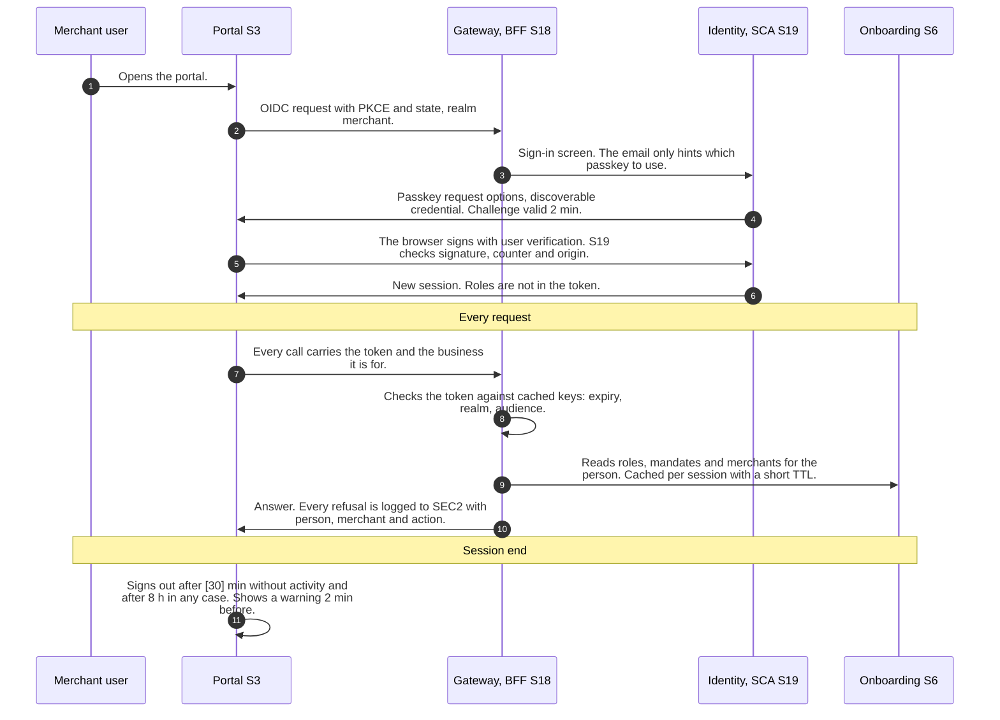
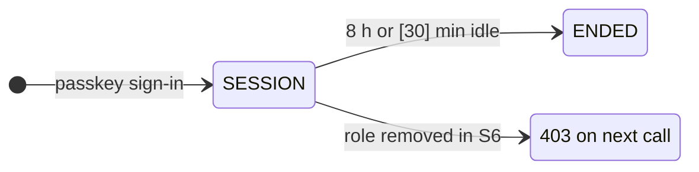

<!-- Generated from src/ by tools/build-docs.ps1. Edit src/workflows.js or src/model.js, not this file. -->

# MP-02 Sign in, switch business and check rights

[All workflows](../README.md) | Previous: [MP-01 Register and create a passkey](MP-01-register-and-create-a-passkey.md) | Next: [MP-03 Strong customer authentication for actions](MP-03-strong-customer-authentication-for-actions.md)

Passkey sign-in. Roles are not in the token: S18 asks S6 on every request which merchants and rights the person has.

| | |
|---|---|
| Status | v8.1 with gaps |
| Area | Access |
| Source | WF02a steps 13 to 21 |
| Starts when | A person opens the portal without a valid session, or makes any request. |
| Object | Session (S19), roles and mandates (S6) |
| Systems | Merchant (user), Portal (S3), Gateway, BFF (S18), Identity, SCA (S19), Onboarding (S6) |
| Portal screens | Home, Team |

## Sequence

## Steps

| # | From | To | Step | Call | Notes |
|---|---|---|---|---|---|
| 1 | Merchant (user) | Portal (S3) | Opens the portal. |  | WF02a 13 |
| 2 | Portal (S3) | Gateway, BFF (S18) | OIDC request with PKCE and state, realm merchant. |  | WF02a 14 Time: 1 s |
| 3 | Gateway, BFF (S18) | Identity, SCA (S19) | Sign-in screen. The email only hints which passkey to use. |  | WF02a 15 |
| 4 | Identity, SCA (S19) | Portal (S3) | Passkey request options, discoverable credential. Challenge valid 2 min. |  | WF02a 16 |
| 5 | Portal (S3) | Identity, SCA (S19) | The browser signs with user verification. S19 checks signature, counter and origin. |  | WF02a 17 **If it fails:** 5 failures: locked 15 min and an email (MP-04). A phishing domain fails on rpId. |
| 6 | Identity, SCA (S19) | Portal (S3) | New session. Roles are not in the token. |  | WF02a 18 |
| | | | **Every request** | | |
| 7 | Portal (S3) | Gateway, BFF (S18) | Every call carries the token and the business it is for. | `Authorization: Bearer, X-Merchant-Id: M-…` | WF02a 19 **Gap:** v8.1 does not say how the portal names the business when a person works for several (MP-Q07). |
| 8 | Gateway, BFF (S18) | Gateway, BFF (S18) | Checks the token against cached keys: expiry, realm, audience. |  | WF02a 19 Time: 5 ms **If it fails:** invalid: 401, refresh, then sign in |
| 9 | Gateway, BFF (S18) | Onboarding (S6) | Reads roles, mandates and merchants for the person. Cached per session with a short TTL. |  | WF02a 20 Time: 20 ms **If it fails:** no right: 403. No merchant yet: only application endpoints. |
| 10 | Gateway, BFF (S18) | Portal (S3) | Answer. Every refusal is logged to SEC2 with person, merchant and action. |  | WF02a 21 |
| | | | **Session end** | | |
| 11 | Portal (S3) | Portal (S3) | Signs out after [30] min without activity and after 8 h in any case. Shows a warning 2 min before. |  | **Gap:** Idle timeout not in v8.1 (MP-Q06) |

## States

| From | When | To |
|---|---|---|
| start | passkey sign-in | SESSION |
| SESSION | 8 h or [30] min idle | ENDED |
| SESSION | role removed in S6 | 403 on next call |

## Rules

- The menu shows only what the role can use; S18 still checks every call (the screen is not the control).
- A person with several businesses picks one in the sidebar; data never mixes on one screen.
- Portal requests: 1 s p95 (depends on the BPC API).

## Open questions

### MP-Q06

No idle timeout is defined (only 8 h session and 30 day refresh).

**Proposed:** [30] min idle, 8 h absolute, refresh only while active. Money actions need SCA anyway.

Owner: CTO

### MP-Q07

How does a call say which business it is for, when one person serves several?

**Proposed:** Header X-Merchant-Id on every call; S18 checks it against S6. The sidebar business switcher sets it.

Owner: CTO
