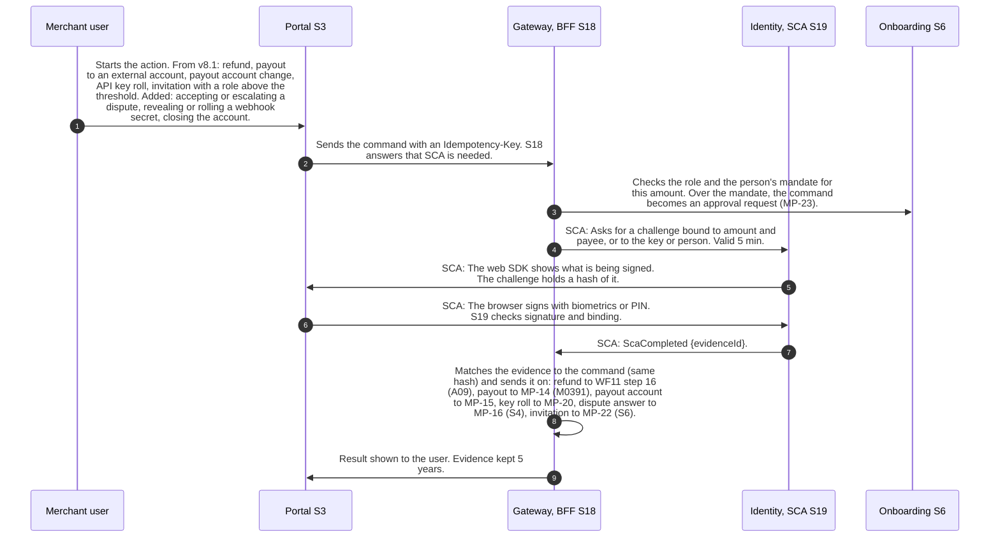
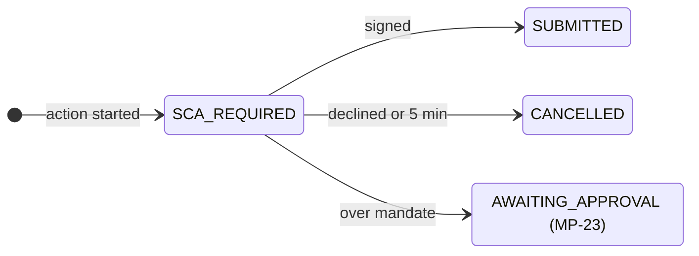

<!-- Generated from src/ by tools/build-docs.ps1. Edit src/workflows.js or src/model.js, not this file. -->

# MP-03 Strong customer authentication for actions

[All workflows](../README.md) | Previous: [MP-02 Sign in, switch business and check rights](MP-02-sign-in-switch-business-and-check-rights.md) | Next: [MP-04 Lockout and lost passkey](MP-04-lockout-and-lost-passkey.md)

The passkey signs exactly what the user sees (amount and payee, or the key, or the person). S18 matches the evidence to the command before sending it on.

| | |
|---|---|
| Status | v8.1, gaps closed |
| Area | Access |
| Source | WF02a steps 22 to 26 |
| Starts when | A user starts an action that moves money or changes who gets it or who can act. |
| Object | SCA challenge (S19), evidence ID |
| Systems | Merchant (user), Portal (S3), Gateway, BFF (S18), Identity, SCA (S19), Onboarding (S6) |
| Portal screens | One payment, Payouts, Developers, Team, Disputes |

## Sequence

## Steps

| # | From | To | Step | Call | Notes |
|---|---|---|---|---|---|
| 1 | Merchant (user) | Portal (S3) | Starts the action. From v8.1: refund, payout to an external account, payout account change, API key roll, invitation with a role above the threshold. Added: accepting or escalating a dispute, revealing or rolling a webhook secret, closing the account. |  | WF02a 22 **Decided:** [MP-Q14](../open-questions.md#mp-q14) |
| 2 | Portal (S3) | Gateway, BFF (S18) | Sends the command with an Idempotency-Key. S18 answers that SCA is needed. | `POST /v1/… → 202 {scaRequired, challengeId}` |  |
| 3 | Gateway, BFF (S18) | Onboarding (S6) | Checks the role and the person's mandate for this amount. Over the mandate, the command becomes an approval request (MP-23). |  | Rule: Mandates in S6 |
| 4 | Gateway, BFF (S18) | Identity, SCA (S19) | Asks for a challenge bound to amount and payee, or to the key or person. Valid 5 min. |  | WF02a 23 **SCA** |
| 5 | Identity, SCA (S19) | Portal (S3) | The web SDK shows what is being signed. The challenge holds a hash of it. |  | WF02a 24 **SCA** **If it fails:** user declines: nothing is sent |
| 6 | Portal (S3) | Identity, SCA (S19) | The browser signs with biometrics or PIN. S19 checks signature and binding. |  | WF02a 25 **SCA** |
| 7 | Identity, SCA (S19) | Gateway, BFF (S18) | ScaCompleted {evidenceId}. |  | WF02a 26 **SCA** |
| 8 | Gateway, BFF (S18) | Gateway, BFF (S18) | Matches the evidence to the command (same hash) and sends it on: refund to WF11 step 16 (A09), payout to MP-14 (M0391), payout account to MP-15, key roll to MP-20, dispute answer to MP-16 (S4), invitation to MP-22 (S6). |  | **If it fails:** challenge expired: start again; hash differs: 409, logged **Decided:** [MP-Q08](../open-questions.md#mp-q08) |
| 9 | Gateway, BFF (S18) | Portal (S3) | Result shown to the user. Evidence kept 5 years. |  | Rule: SCA evidence retention 5 years |

## States

| From | When | To |
|---|---|---|
| start | action started | SCA_REQUIRED |
| SCA_REQUIRED | signed | SUBMITTED |
| SCA_REQUIRED | declined or 5 min | CANCELLED |
| SCA_REQUIRED | over mandate | AWAITING_APPROVAL (MP-23) |

## Rules

- Dynamic linking: changing the amount or payee after signing voids the signature.
- For an approval, the requester signs the request and the approver signs the approval; it runs after both.
- One evidence ID per command; reuse is refused.

## Changes v8.1 needs

For the CTO's next version of the architecture (v8.2).

- WF02a 22: add dispute Accept and Escalate (MP-Q14), webhook secret reveal or roll (MP-Q11) and account closure to the SCA list.
- WF02a 26: replace "WF10 step 14, WF11 step 7" with the targets listed in step 8 here (MP-Q08).

## Questions

### MP-Q08

WF02a step 26 continues to "WF10 step 14, WF11 step 7". WF10 14 is a read and WF11 7 is issuing.

**Decision:** Refund continues to WF11 step 16; payout to MP-14; payout account to MP-15; key roll to MP-20. Fix in v8.2.

Decided, awaiting sign-off by: CTO

### MP-Q14

Accepting a dispute is final and costs money, but it is not on the SCA list in WF02a 22. WF11 15 says SCA for actions with a money effect.

**Decision:** Require SCA for Accept and Escalate. Add to the WF02a 22 list.

Decided, awaiting sign-off by: CTO
