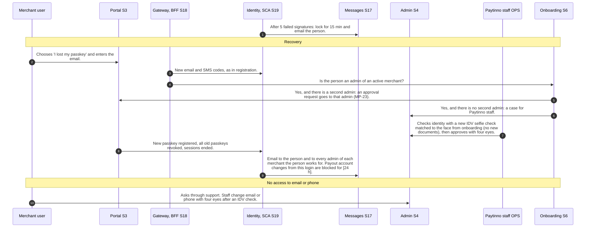
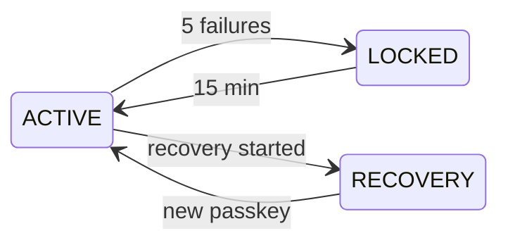

<!-- Generated from src/ by tools/build-docs.ps1. Edit src/workflows.js or src/model.js, not this file. -->

# MP-04 Lockout and lost passkey

[All workflows](../README.md) | Previous: [MP-03 Strong customer authentication for actions](MP-03-strong-customer-authentication-for-actions.md) | Next: [MP-05 Fill in and send the application](MP-05-fill-in-and-send-the-application.md)

Recovery re-proves email and phone. For an admin of a live merchant, another admin approves; otherwise Paytinno staff check identity.

| | |
|---|---|
| Status | v8.1, gaps closed |
| For | Every merchant |
| Area | Access |
| Source | WF02a steps 17 and 27 |
| Starts when | Five failed signatures, or a person who lost every passkey. |
| Object | PortalUser LOCKED or RECOVERY |
| Systems | Merchant (user), Portal (S3), Gateway, BFF (S18), Identity, SCA (S19), Messages (S17), Admin (S4), Paytinno staff (OPS), Onboarding (S6) |
| Portal screens | Security |

## Sequence

## Steps

| # | From | To | Step | Call | Notes |
|---|---|---|---|---|---|
| 1 | Identity, SCA (S19) | Messages (S17) | After 5 failed signatures: lock for 15 min and email the person. |  | WF02a 17 |
| | | | **Recovery** | | |
| 2 | Merchant (user) | Portal (S3) | Chooses "I lost my passkey" and enters the email. |  | WF02a 27 |
| 3 | Gateway, BFF (S18) | Identity, SCA (S19) | New email and SMS codes, as in registration. |  | Time: codes 10 min |
| 4 | Gateway, BFF (S18) | Onboarding (S6) | Is the person an admin of an active merchant? |  |  |
| 5 | Onboarding (S6) | Portal (S3) | Yes, and there is a second admin: an approval request goes to that admin (MP-23). |  | Rule: Second admin approves |
| 6 | Onboarding (S6) | Admin (S4) | Yes, and there is no second admin: a case for Paytinno staff. |  |  |
| 7 | Paytinno staff (OPS) | Admin (S4) | Checks identity with a new IDV selfie check matched to the face from onboarding (no new documents), then approves with four eyes. |  | **Decided:** [MP-Q05b](../open-questions.md#mp-q05b) |
| 8 | Portal (S3) | Identity, SCA (S19) | New passkey registered; all old passkeys revoked; sessions ended. |  |  |
| 9 | Identity, SCA (S19) | Messages (S17) | Email to the person and to every admin of each merchant the person works for. Payout account changes from this login are blocked for [24 h]. |  | **Decided:** [MP-Q05b](../open-questions.md#mp-q05b) Added to v8.1 |
| | | | **No access to email or phone** | | |
| 10 | Merchant (user) | Admin (S4) | Asks through support. Staff change email or phone with four eyes after an IDV check. |  | WF02a 27 |

## States

| From | When | To |
|---|---|---|
| ACTIVE | 5 failures | LOCKED |
| LOCKED | 15 min | ACTIVE |
| ACTIVE | recovery started | RECOVERY |
| RECOVERY | new passkey | ACTIVE |

## Rules

- Recovery never restores the old passkey.
- A recovered admin cannot change the payout account for [24 h] (account takeover pattern).

## Changes v8.1 needs

For the CTO's next version of the architecture (v8.2).

- WF02a 27: without a second admin, the identity check is an IDV selfie matched to onboarding, then four eyes in S4 (MP-Q05b).
- WF02a 27: after recovery, notify the person and every admin, and block payout account changes for [24 h].

## Questions

### MP-Q05b

How do staff check identity in recovery without a second admin?

**Decision:** IDV selfie check matched to the face from onboarding (no new documents), then four eyes in S4. Block payout account changes for [24 h] after.

Decided, awaiting sign-off by: Compliance
