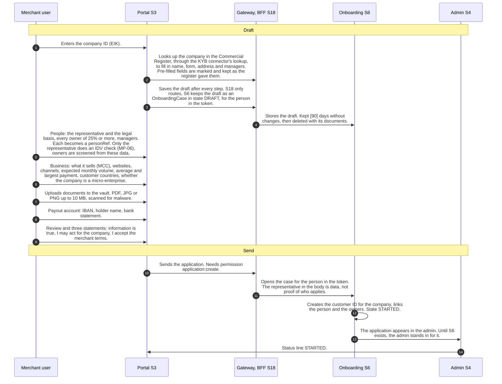
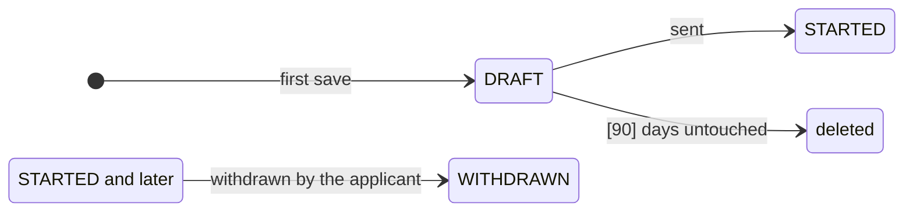

<!-- Generated from src/ by tools/build-docs.ps1. Edit src/workflows.js or src/model.js, not this file. -->

# MP-05 Fill in and send the application

[All workflows](../README.md) | Previous: [MP-04 Lockout and lost passkey](MP-04-lockout-and-lost-passkey.md) | Next: [MP-06 Company checks, identity and screening](MP-06-company-checks-identity-and-screening.md)

Six steps: company, people, business, documents, payout account, review. Saved as a draft on every step; sent once complete.

| | |
|---|---|
| Status | v8.1, gaps closed |
| Area | Onboarding |
| Source | WF02b steps 1 to 4; admin spec application.submitted |
| Starts when | An applicant (MP-01) starts an application. |
| Object | OnboardingCase (S6, type MERCHANT), from DRAFT |
| Systems | Merchant (user), Portal (S3), Gateway, BFF (S18), Onboarding (S6), Admin (S4) |
| Portal screens | Application |

## Sequence

## Steps

| # | From | To | Step | Call | Notes |
|---|---|---|---|---|---|
| | | | **Draft** | | |
| 1 | Merchant (user) | Portal (S3) | Enters the company ID (EIK). |  |  |
| 2 | Portal (S3) | Gateway, BFF (S18) | Looks up the company in the Commercial Register, through the KYB connector's lookup, to fill in name, form, address and managers. Pre-filled fields are marked and kept as the register gave them. | `GET /v1/registry/companies/{eik}` | **If it fails:** not found: the applicant types it **Decided:** [MP-Q15](../open-questions.md#mp-q15) |
| 3 | Portal (S3) | Gateway, BFF (S18) | Saves the draft after every step. S18 only routes; S6 keeps the draft as an OnboardingCase in state DRAFT, for the person in the token. | `PUT /v1/merchants/applications/drafts/{draftId} → S6` | **Decided:** [MP-Q16](../open-questions.md#mp-q16) |
| 4 | Gateway, BFF (S18) | Onboarding (S6) | Stores the draft. Kept [90] days without changes, then deleted with its documents. |  | **Decided:** [MP-Q16](../open-questions.md#mp-q16) |
| 5 | Merchant (user) | Portal (S3) | People: the representative and the legal basis; every owner of 25% or more; managers. Each becomes a personRef. Only the representative does an IDV check (MP-06); owners are screened from these data. |  | Rule: Owners listed must explain 100% of ownership or say why not **Decided:** [MP-Q17](../open-questions.md#mp-q17) |
| 6 | Merchant (user) | Portal (S3) | Business: what it sells (MCC), websites, channels, expected monthly volume, average and largest payment, customer countries, whether the company is a micro-enterprise. |  | Rule: Micro-enterprise status sets the notice period for tariff changes (MP-19) **Decided:** [MP-Q33](../open-questions.md#mp-q33) |
| 7 | Merchant (user) | Portal (S3) | Uploads documents to the vault. PDF, JPG or PNG up to 10 MB, scanned for malware. | `POST /v1/documents (multipart) → {docRef}` | Rule: Documents stay in the vault; the admin sees references only |
| 8 | Merchant (user) | Portal (S3) | Payout account: IBAN, holder name, bank statement. |  | Rule: Checked in MP-15 rules: in the merchant's name |
| 9 | Merchant (user) | Portal (S3) | Review and three statements: information is true; I may act for the company; I accept the merchant terms. |  |  |
| | | | **Send** | | |
| 10 | Portal (S3) | Gateway, BFF (S18) | Sends the application. Needs permission application:create. | `POST /v1/merchants/applications {legalName, eik, representativeRole, ubos[], mcc, expectedVolume, channels[], documents[]}` | WF02b 2 Time: 2 s **If it fails:** 401, 403, 4xx |
| 11 | Gateway, BFF (S18) | Onboarding (S6) | Opens the case for the person in the token. The representative in the body is data, not proof of who applies. |  | WF02b 3 |
| 12 | Onboarding (S6) | Onboarding (S6) | Creates the customer ID for the company; links the person and the owners. State STARTED. |  | WF02b 4 |
| 13 | Onboarding (S6) | Admin (S4) | The application appears in the admin. Until S6 exists, the admin stands in for it. | `webhook application.submitted` | admin spec 6 |
| 14 | Admin (S4) | Portal (S3) | Status line STARTED. | `POST /admin/v1/applications/{appId}/status` | admin spec 5.1 |

## States

| From | When | To |
|---|---|---|
| start | first save | DRAFT |
| DRAFT | sent | STARTED |
| DRAFT | [90] days untouched | deleted |
| STARTED and later | withdrawn by the applicant | WITHDRAWN |

## Rules

- No acceptance before the whole onboarding is done.
- Sales do not send applications for merchants at launch.
- The applicant can withdraw until a decision is made.

## Changes v8.1 needs

For the CTO's next version of the architecture (v8.2).

- WF02b states: add DRAFT before STARTED, kept by S6 for [90] days (MP-Q16).
- WF02b 1: Commercial Register pre-fill through the KYB connector's lookup (MP-Q15).
- WF02b 1: ask whether the company is a micro-enterprise; S6 keeps it for tariff notices (MP-Q33).
- WF02b 5: IDV check for the representative only; owners screened from data, IDV for owners only when high risk or the data disagree (MP-Q17).

## Questions

### MP-Q15

Should the portal pre-fill from the Commercial Register?

**Decision:** Yes. S18 routes to the register lookup the KYB connector already has. Pre-filled fields are marked and kept as the register said.

Decided, awaiting sign-off by: CTO

### MP-Q16

Where is the draft kept before it is sent? v8.1 starts the case only at submission.

**Decision:** Draft in S6 as an OnboardingCase in state DRAFT, keyed by person, kept [90] days. S18 only routes (it holds no business logic). Documents uploaded to the draft are deleted with it.

Decided, awaiting sign-off by: CTO

### MP-Q17

Who must do an identity check: only the representative (v8.1), or every owner (the design prototype)?

**Decision:** Representative always. Owners are screened from data; an IDV check for owners only for high-risk merchants or when the register and the declaration disagree.

Decided, awaiting sign-off by: Compliance
