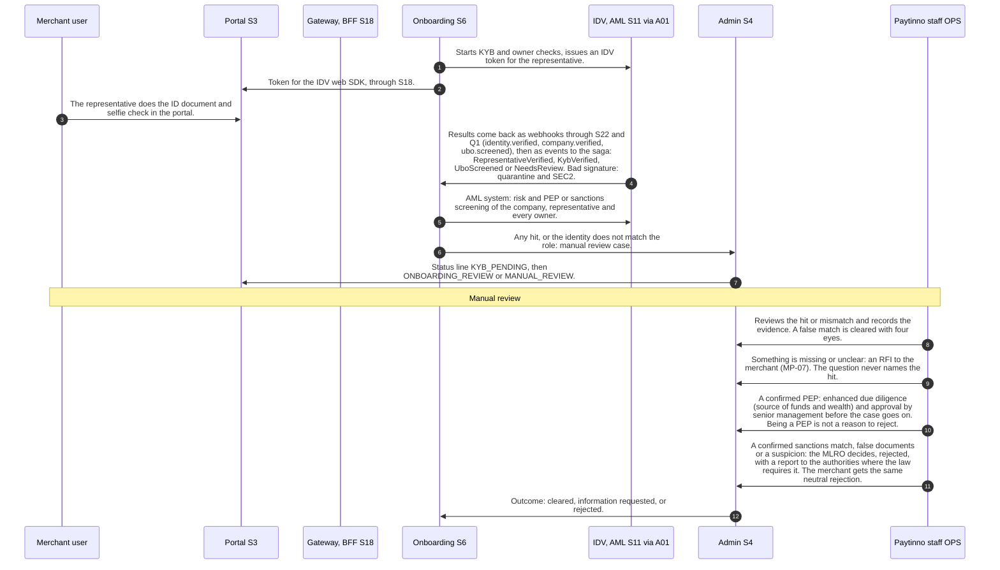
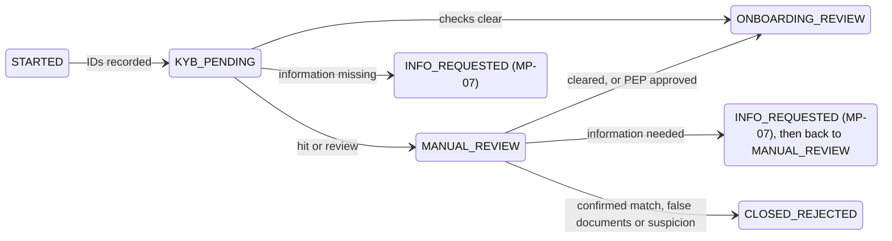

<!-- Generated from src/ by tools/build-docs.ps1. Edit src/workflows.js or src/model.js, not this file. -->

# MP-06 Company checks, identity and screening

[All workflows](../README.md) | Previous: [MP-05 Fill in and send the application](MP-05-fill-in-and-send-the-application.md) | Next: [MP-07 Request for information and the answer](MP-07-request-for-information-and-the-answer.md)

The representative does an IDV check inside the portal. The company and owners are checked and screened. A hit goes to manual review, which ends in one of three ways: cleared, more information, or rejected. The portal only ever says "Checking documents" or "In review".

| | |
|---|---|
| Status | v8.7 with gaps |
| For | Every merchant |
| Area | Onboarding |
| Source | WF02b steps 5 to 9 |
| Starts when | An application is sent (MP-05). |
| Object | OnboardingCase KYB_PENDING |
| Systems | Merchant (user), Portal (S3), Gateway, BFF (S18), Onboarding (S6), IDV, AML (S11 via A01), Admin (S4), Paytinno staff (OPS) |
| Portal screens | Application |

## Sequence

## Steps

| # | From | To | Step | Call | Notes |
|---|---|---|---|---|---|
| 1 | Onboarding (S6) | IDV, AML (S11 via A01) | Starts KYB and owner checks; issues an IDV token for the representative. |  | WF02b 5 Time: async |
| 2 | Onboarding (S6) | Portal (S3) | Token for the IDV web SDK, through S18. |  |  |
| 3 | Merchant (user) | Portal (S3) | The representative does the ID document and selfie check in the portal. |  | WF02b 5 |
| 4 | IDV, AML (S11 via A01) | Onboarding (S6) | Results come back as webhooks through S22 and Q1 (identity.verified, company.verified, ubo.screened), then as events to the saga: RepresentativeVerified, KybVerified, UboScreened or NeedsReview. Bad signature: quarantine and SEC2. |  | WF02b 6 to 8 |
| 5 | Onboarding (S6) | IDV, AML (S11 via A01) | AML system: risk and PEP or sanctions screening of the company, representative and every owner. |  | WF02b 9 Time: 1 s per person, 3 attempts |
| 6 | Onboarding (S6) | Admin (S4) | Any hit, or the identity does not match the role: manual review case. |  | Rule: A hit makes manual review mandatory |
| 7 | Admin (S4) | Portal (S3) | Status line KYB_PENDING, then ONBOARDING_REVIEW or MANUAL_REVIEW. | `application.status` | Rule: Fixed texts, never the reason |
| | | | **Manual review** | | |
| 8 | Paytinno staff (OPS) | Admin (S4) | Reviews the hit or mismatch and records the evidence. A false match is cleared with four eyes. |  | Time: [5] business days **Decided:** [MP-Q67](../open-questions.md#mp-q67) Added to v8.7 |
| 9 | Paytinno staff (OPS) | Admin (S4) | Something is missing or unclear: an RFI to the merchant (MP-07). The question never names the hit. |  | **Decided:** [MP-Q67](../open-questions.md#mp-q67) Added to v8.7 |
| 10 | Paytinno staff (OPS) | Admin (S4) | A confirmed PEP: enhanced due diligence (source of funds and wealth) and approval by senior management before the case goes on. Being a PEP is not a reason to reject. |  | Rule: Senior management approval for a PEP **Decided:** [MP-Q67](../open-questions.md#mp-q67) Added to v8.7 |
| 11 | Paytinno staff (OPS) | Admin (S4) | A confirmed sanctions match, false documents or a suspicion: the MLRO decides; rejected, with a report to the authorities where the law requires it. The merchant gets the same neutral rejection. |  | Rule: No tipping off **Decided:** [MP-Q67](../open-questions.md#mp-q67) Added to v8.7 |
| 12 | Admin (S4) | Onboarding (S6) | Outcome: cleared, information requested, or rejected. |  | Added to v8.7 |

## States

| From | When | To |
|---|---|---|
| STARTED | IDs recorded | KYB_PENDING |
| KYB_PENDING | checks clear | ONBOARDING_REVIEW |
| KYB_PENDING | hit or review | MANUAL_REVIEW |
| KYB_PENDING | information missing | INFO_REQUESTED (MP-07) |
| MANUAL_REVIEW | cleared, or PEP approved | ONBOARDING_REVIEW |
| MANUAL_REVIEW | information needed | INFO_REQUESTED (MP-07), then back to MANUAL_REVIEW |
| MANUAL_REVIEW | confirmed match, false documents or suspicion | CLOSED_REJECTED |

## Rules

- No tipping off: the portal never names a screening hit, PEP, sanctions, MATCH or VMAS.
- The portal maps each state to its own fixed text (CONFIG.APP_STATES); the admin's label is a hint only.
- Manual review always ends in a decision; a case never waits in MANUAL_REVIEW without an owner and a due date.

## Changes v8.7 needs

For the CTO's next version of the architecture.

- WF02b states: add the exits from MANUAL_REVIEW: cleared to UNDERWRITING (our ONBOARDING_REVIEW), information needed to an RFI, confirmed match or suspicion to CLOSED_REJECTED (MP-Q67).

## Questions

### MP-Q09

Should the portal show the admin's free-text status label, or its own fixed text per state? (admin spec P7)

**Proposed:** Fixed texts per state in the portal, in Bulgarian and English. Free text only inside an RFI, which staff write knowingly.

Owner: Compliance

### MP-Q67

v8.7 sends a case to MANUAL_REVIEW but never says where it goes next. What are the exits?

**Decision:** Three: cleared (false match with four eyes, or a PEP approved by senior management after enhanced due diligence) to ONBOARDING_REVIEW; information needed to an RFI (MP-07) and back; confirmed sanctions match, false documents or suspicion to CLOSED_REJECTED, decided by the MLRO, with a report to the authorities where required. Target [5] business days.

Decided, awaiting sign-off by: Compliance
