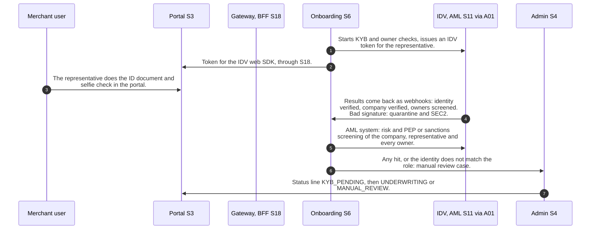
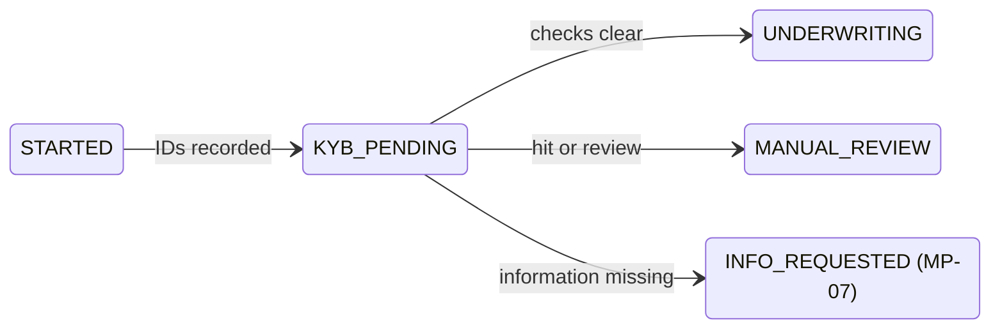

<!-- Generated from src/ by tools/build-docs.ps1. Edit src/workflows.js or src/model.js, not this file. -->

# MP-06 Company checks, identity and screening

[All workflows](../README.md) | Previous: [MP-05 Fill in and send the application](MP-05-fill-in-and-send-the-application.md) | Next: [MP-07 Request for information and the answer](MP-07-request-for-information-and-the-answer.md)

The representative does an IDV check inside the portal. The company and owners are checked and screened. The portal only ever says "Checking documents" or "In review".

| | |
|---|---|
| Status | In v8.1 |
| For | Every merchant |
| Area | Onboarding |
| Source | WF02b steps 5 to 9 |
| Starts when | An application is sent (MP-05). |
| Object | OnboardingCase KYB_PENDING |
| Systems | Merchant (user), Portal (S3), Gateway, BFF (S18), Onboarding (S6), IDV, AML (S11 via A01), Admin (S4) |
| Portal screens | Application |

## Sequence

## Steps

| # | From | To | Step | Call | Notes |
|---|---|---|---|---|---|
| 1 | Onboarding (S6) | IDV, AML (S11 via A01) | Starts KYB and owner checks; issues an IDV token for the representative. |  | WF02b 5 Time: async |
| 2 | Onboarding (S6) | Portal (S3) | Token for the IDV web SDK, through S18. |  |  |
| 3 | Merchant (user) | Portal (S3) | The representative does the ID document and selfie check in the portal. |  | WF02b 5 |
| 4 | IDV, AML (S11 via A01) | Onboarding (S6) | Results come back as webhooks: identity verified, company verified, owners screened. Bad signature: quarantine and SEC2. |  | WF02b 6 to 8 |
| 5 | Onboarding (S6) | IDV, AML (S11 via A01) | AML system: risk and PEP or sanctions screening of the company, representative and every owner. |  | WF02b 9 Time: 1 s per person, 3 attempts |
| 6 | Onboarding (S6) | Admin (S4) | Any hit, or the identity does not match the role: manual review case. |  | Rule: A hit makes manual review mandatory |
| 7 | Admin (S4) | Portal (S3) | Status line KYB_PENDING, then UNDERWRITING or MANUAL_REVIEW. | `application.status` | Rule: Fixed texts, never the reason |

## States

| From | When | To |
|---|---|---|
| STARTED | IDs recorded | KYB_PENDING |
| KYB_PENDING | checks clear | UNDERWRITING |
| KYB_PENDING | hit or review | MANUAL_REVIEW |
| KYB_PENDING | information missing | INFO_REQUESTED (MP-07) |

## Rules

- No tipping off: the portal never names a screening hit, PEP, sanctions, MATCH or VMAS.
- The portal maps each state to its own fixed text (CONFIG.APP_STATES); the admin's label is a hint only.

## Questions

### MP-Q09

Should the portal show the admin's free-text status label, or its own fixed text per state? (admin spec P7)

**Proposed:** Fixed texts per state in the portal, in Bulgarian and English. Free text only inside an RFI, which staff write knowingly.

Owner: Compliance
