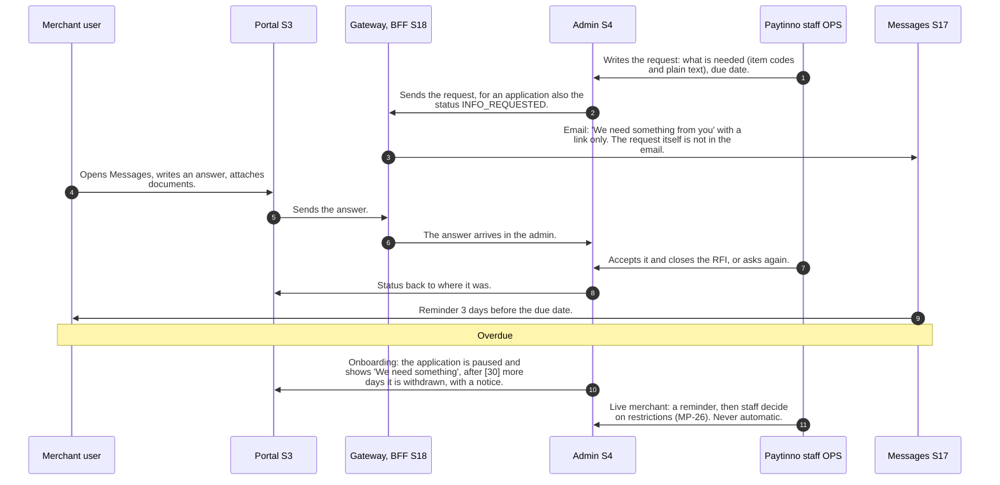
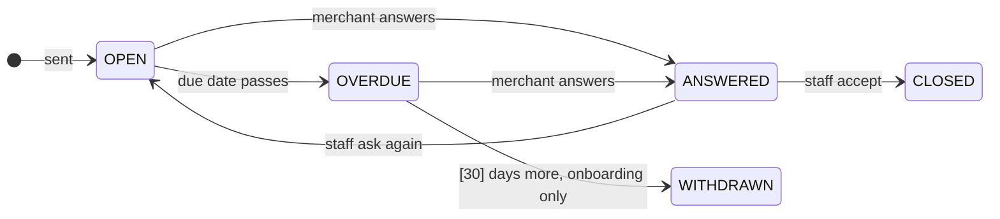

<!-- Generated from src/ by tools/build-docs.ps1. Edit src/workflows.js or src/model.js, not this file. -->

# MP-07 Request for information and the answer

[All workflows](../README.md) | Previous: [MP-06 Company checks, identity and screening](MP-06-company-checks-identity-and-screening.md) | Next: [MP-08 Onboarding review and the offer](MP-08-onboarding-review-and-the-offer.md)

Staff ask, the merchant answers in the portal with text and documents. The application status shows "We need something" while it is open.

| | |
|---|---|
| Status | v8.1, gaps closed |
| For | Every merchant |
| Area | Onboarding |
| Source | Admin spec 5.2 rfi.send and merchant.message; not a v8.1 workflow |
| Starts when | Staff need a document or an answer, during onboarding or for a live merchant. |
| Object | RFI (S4), message thread |
| Systems | Merchant (user), Portal (S3), Gateway, BFF (S18), Admin (S4), Paytinno staff (OPS), Messages (S17) |
| Portal screens | Messages, Application |

## Sequence

## Steps

| # | From | To | Step | Call | Notes |
|---|---|---|---|---|---|
| 1 | Paytinno staff (OPS) | Admin (S4) | Writes the request: what is needed (item codes and plain text), due date. |  |  |
| 2 | Admin (S4) | Gateway, BFF (S18) | Sends the request; for an application also the status INFO_REQUESTED. | `POST /admin/v1/rfi {appId \| merchantId, text, items[], dueAt}` | admin spec 5.2 |
| 3 | Gateway, BFF (S18) | Messages (S17) | Email: "We need something from you" with a link only. The request itself is not in the email. |  | Rule: Emails carry a link, never the content Added to v8.1 |
| 4 | Merchant (user) | Portal (S3) | Opens Messages, writes an answer, attaches documents. |  |  |
| 5 | Portal (S3) | Gateway, BFF (S18) | Sends the answer. | `POST /v1/messages {inReplyTo: rfiId, text, attachments[docRef]}` |  |
| 6 | Gateway, BFF (S18) | Admin (S4) | The answer arrives in the admin. | `webhook merchant.message` | admin spec 6 |
| 7 | Paytinno staff (OPS) | Admin (S4) | Accepts it and closes the RFI, or asks again. |  |  |
| 8 | Admin (S4) | Portal (S3) | Status back to where it was. | `application.status` |  |
| 9 | Messages (S17) | Merchant (user) | Reminder 3 days before the due date. | `merchant.notify rfi_reminder` |  |
| | | | **Overdue** | | |
| 10 | Admin (S4) | Portal (S3) | Onboarding: the application is paused and shows "We need something"; after [30] more days it is withdrawn, with a notice. |  | **Decided:** [MP-Q18](../open-questions.md#mp-q18) |
| 11 | Paytinno staff (OPS) | Admin (S4) | Live merchant: a reminder, then staff decide on restrictions (MP-26). Never automatic. |  | **Decided:** [MP-Q18](../open-questions.md#mp-q18) |

## States

| From | When | To |
|---|---|---|
| start | sent | OPEN |
| OPEN | merchant answers | ANSWERED |
| ANSWERED | staff accept | CLOSED |
| ANSWERED | staff ask again | OPEN |
| OPEN | due date passes | OVERDUE |
| OVERDUE | merchant answers | ANSWERED |
| OVERDUE | [30] days more, onboarding only | WITHDRAWN |

## Rules

- The merchant is told not to type ID or card numbers in messages; documents are attached as files.
- Text up to 4,000 characters.

## Changes v8.1 needs

For the CTO's next version of the architecture (v8.2).

- Add the RFI to v8.1 as a sub-flow of WF02b and of periodic reviews, as in the admin spec 5.2 (rfi.send, merchant.message).
- Overdue RFI: onboarding withdrawn after [30] days; for a live merchant staff decide (MP-Q18).

## Questions

### MP-Q18

What happens when an RFI is overdue?

**Decision:** Onboarding: application paused, withdrawn after [30] days with notice. Live merchant: reminder, then a restriction decision in S4 (MP-26), never automatic.

Decided, awaiting sign-off by: Compliance
