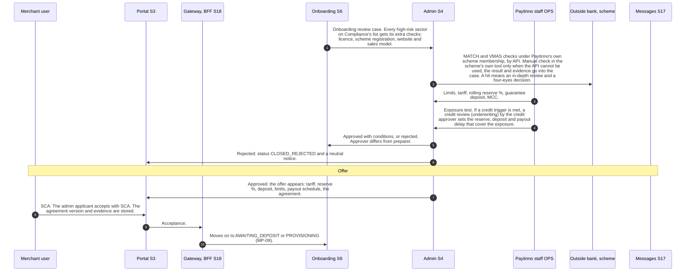
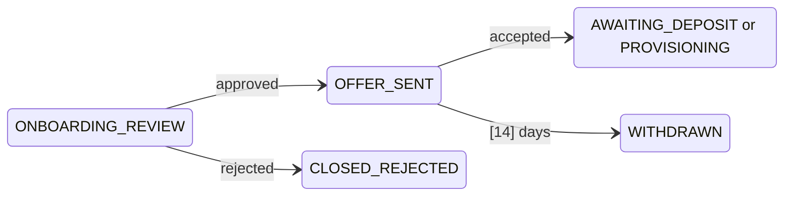

<!-- Generated from src/ by tools/build-docs.ps1. Edit src/workflows.js or src/model.js, not this file. -->

# MP-08 Onboarding review and the offer

[All workflows](../README.md) | Previous: [MP-07 Request for information and the answer](MP-07-request-for-information-and-the-answer.md) | Next: [MP-09 Deposit, set-up and activation](MP-09-deposit-set-up-and-activation.md)

Staff review the merchant and set limits, tariff, reserve and deposit with four eyes. A credit review (underwriting) is added only when the merchant creates credit exposure for Paytinno. Then the merchant sees the offer and accepts it with SCA before set-up starts.

| | |
|---|---|
| Status | v8.7, gaps closed |
| For | Every merchant |
| Area | Onboarding |
| Source | WF02b steps 10 to 12 (v8.7 calls it underwriting) |
| Starts when | Checks are complete (MP-06). |
| Object | Onboarding review case (S4), offer |
| Systems | Merchant (user), Portal (S3), Gateway, BFF (S18), Onboarding (S6), Admin (S4), Paytinno staff (OPS), Outside (bank, scheme), Messages (S17) |
| Portal screens | Application |

## Sequence

## Steps

| # | From | To | Step | Call | Notes |
|---|---|---|---|---|---|
| 1 | Onboarding (S6) | Admin (S4) | Onboarding review case. Every high-risk sector on Compliance's list gets its extra checks: licence, scheme registration, website and sales model. |  | WF02b 10 **Decided:** [MP-Q61](../open-questions.md#mp-q61) |
| 2 | Admin (S4) | Outside (bank, scheme) | MATCH and VMAS checks under Paytinno's own scheme membership, by API. Manual check in the scheme's own tool only when the API cannot be used; the result and evidence go into the case. A hit means an in-depth review and a four-eyes decision. |  | WF02b 11 **Decided:** [MP-Q65](../open-questions.md#mp-q65) |
| 3 | Paytinno staff (OPS) | Admin (S4) | Limits, tariff, rolling reserve %, guarantee deposit, MCC. |  | WF02b 11 Time: 2 business days Rule: Four eyes above a threshold or for high-risk sectors |
| 4 | Paytinno staff (OPS) | Admin (S4) | Exposure test. If a credit trigger is met, a credit review (underwriting) by the credit approver sets the reserve, deposit and payout delay that cover the exposure. |  | Rule: Without a trigger there is no credit review **Decided:** [MP-Q60](../open-questions.md#mp-q60) Added to v8.7 |
| 5 | Admin (S4) | Onboarding (S6) | Approved with conditions, or rejected. Approver differs from preparer. |  | WF02b 12 |
| 6 | Admin (S4) | Portal (S3) | Rejected: status CLOSED_REJECTED and a neutral notice. | `merchant.notify application_rejected` | **If it fails:** No reason is given in the portal |
| | | | **Offer** | | |
| 7 | Admin (S4) | Portal (S3) | Approved: the offer appears: tariff, reserve %, deposit, limits, payout schedule, the agreement. |  | **Decided:** [MP-Q19](../open-questions.md#mp-q19) Added to v8.7 |
| 8 | Merchant (user) | Portal (S3) | The admin applicant accepts with SCA. The agreement version and evidence are stored. |  | **SCA** **Decided:** [MP-Q19](../open-questions.md#mp-q19) |
| 9 | Portal (S3) | Gateway, BFF (S18) | Acceptance. | `POST /v1/merchants/applications/{appId}/offer/accept` |  |
| 10 | Gateway, BFF (S18) | Onboarding (S6) | Moves on to AWAITING_DEPOSIT or PROVISIONING (MP-09). |  |  |

## States

| From | When | To |
|---|---|---|
| ONBOARDING_REVIEW | approved | OFFER_SENT |
| OFFER_SENT | accepted | AWAITING_DEPOSIT or PROVISIONING |
| OFFER_SENT | [14] days | WITHDRAWN |
| ONBOARDING_REVIEW | rejected | CLOSED_REJECTED |

## Rules

- The rejection text is the same whatever the reason.
- The decision record keeps rationale, policy version, tariff, reserve and approvers, and the credit approver when there was a credit review (WF02b 18).
- "Underwriting" means only the credit review. The rest is the onboarding review.

## Changes v8.7 needs

For the CTO's next version of the architecture.

- WF02b 10 to 12: call it the onboarding review and the state ONBOARDING_REVIEW, not UNDERWRITING. Underwriting is only the credit review, when a credit trigger is met (MP-Q60).
- WF02b 10: extra sector checks for every high-risk sector on Compliance's list, not only MCC 7995 (MP-Q61).
- WF02b 11: MATCH and VMAS checks by API; manual only as a fallback, with evidence in the case (MP-Q65).
- WF02b: add state OFFER_SENT between approval (step 12) and set-up (step 13); the representative accepts the offer and agreement with SCA; the offer lapses after [14] days (MP-Q19).

## Questions

### MP-Q19

Where does the merchant agree to the tariff, reserve and agreement? v8.7 goes from approval straight to set-up.

**Decision:** Add OFFER_SENT: the offer in the portal, accepted with SCA by the applicant who is the representative. Qualified e-signature only if Legal requires it.

Decided, awaiting sign-off by: Legal

### MP-Q60

When does onboarding need a credit review (underwriting), and who signs it?

**Decision:** Only when a credit trigger is met: goods or services delivered later (travel, tickets, events, pre-orders, memberships of more than [3] months); expected monthly volume above [€250,000]; payouts faster than the schemes pay Paytinno; or reserve and deposit below the estimated exposure (volume times days to delivery plus the refund and chargeback window). The CRO or a delegated credit approver signs; the onboarding review team cannot approve its own credit decision.

Decided, awaiting sign-off by: CRO

### MP-Q65

How are MATCH and VMAS checked: through BPC, directly with Mastercard and Visa, or by hand?

**Decision:** By API, directly or through BPC, whichever the schemes and BPC allow. A manual check in the scheme's own tool only when the API cannot be used, with a screenshot or export kept in the case.

Decided, awaiting sign-off by: CTO

### MP-Q61

Which sectors are high risk, and what extra checks does each get? v8.7 names only gambling (MCC 7995).

**Decision:** Compliance keeps one list in the risk policy, the same list the AML system scores on. At least: gambling (National Revenue Agency licence), crypto (registration or MiCA licence), online pharmacy and medicines (Bulgarian Drug Agency permit), adult content, dating, tobacco, e-cigarettes and alcohol (age checks), forex and CFDs (investment firm licence), nutraceuticals and free trials (subscription terms), travel and ticketing (credit review). Each gets a licence check where one applies, the scheme high-risk registration where Visa or Mastercard require it, a website and sales-model review, four eyes and KYB refresh every 12 months.

Decided, awaiting sign-off by: Compliance
