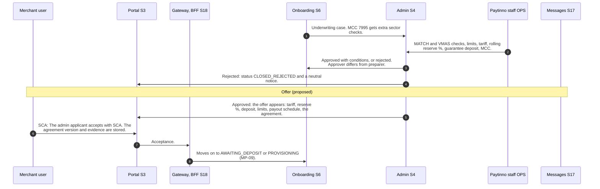
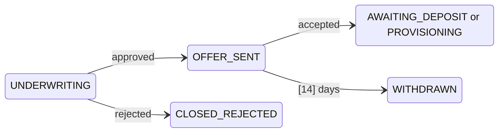

<!-- Generated from src/ by tools/build-docs.ps1. Edit src/workflows.js or src/model.js, not this file. -->

# MP-08 Underwriting decision and the offer

[All workflows](../README.md) | Previous: [MP-07 Request for information and the answer](MP-07-request-for-information-and-the-answer.md) | Next: [MP-09 Deposit, set-up and activation](MP-09-deposit-set-up-and-activation.md)

Staff set limits, tariff, reserve and deposit with four eyes. Proposed: the merchant sees the offer and accepts it with SCA before set-up starts.

| | |
|---|---|
| Status | v8.1 with gaps |
| Area | Onboarding |
| Source | WF02b steps 10 to 12 |
| Starts when | Checks are complete (MP-06). |
| Object | Underwriting case (S4), offer |
| Systems | Merchant (user), Portal (S3), Gateway, BFF (S18), Onboarding (S6), Admin (S4), Paytinno staff (OPS), Messages (S17) |
| Portal screens | Application |

## Sequence

## Steps

| # | From | To | Step | Call | Notes |
|---|---|---|---|---|---|
| 1 | Onboarding (S6) | Admin (S4) | Underwriting case. MCC 7995 gets extra sector checks. |  | WF02b 10 |
| 2 | Paytinno staff (OPS) | Admin (S4) | MATCH and VMAS checks; limits, tariff, rolling reserve %, guarantee deposit, MCC. |  | WF02b 11 Time: 2 business days Rule: Four eyes above a threshold or for high-risk MCCs |
| 3 | Admin (S4) | Onboarding (S6) | Approved with conditions, or rejected. Approver differs from preparer. |  | WF02b 12 |
| 4 | Admin (S4) | Portal (S3) | Rejected: status CLOSED_REJECTED and a neutral notice. | `merchant.notify application_rejected` | **If it fails:** No reason is given in the portal |
| | | | **Offer (proposed)** | | |
| 5 | Admin (S4) | Portal (S3) | Approved: the offer appears: tariff, reserve %, deposit, limits, payout schedule, the agreement. |  | **Gap:** v8.1 has no step where the merchant agrees to the terms (MP-Q19). |
| 6 | Merchant (user) | Portal (S3) | The admin applicant accepts with SCA. The agreement version and evidence are stored. |  | **SCA** |
| 7 | Portal (S3) | Gateway, BFF (S18) | Acceptance. | `POST /v1/merchants/applications/{appId}/offer/accept` |  |
| 8 | Gateway, BFF (S18) | Onboarding (S6) | Moves on to AWAITING_DEPOSIT or PROVISIONING (MP-09). |  |  |

## States

| From | When | To |
|---|---|---|
| UNDERWRITING | approved | OFFER_SENT |
| OFFER_SENT | accepted | AWAITING_DEPOSIT or PROVISIONING |
| OFFER_SENT | [14] days | WITHDRAWN |
| UNDERWRITING | rejected | CLOSED_REJECTED |

## Rules

- The rejection text is the same whatever the reason.
- The decision record keeps rationale, policy version, tariff, reserve and approvers (WF02b 18).

## Open questions

### MP-Q19

Where does the merchant agree to the tariff, reserve and agreement? v8.1 goes from approval straight to set-up.

**Proposed:** Add OFFER_SENT: the offer in the portal, accepted with SCA by the applicant who is the representative. Qualified e-signature only if Legal requires it.

Owner: Legal
