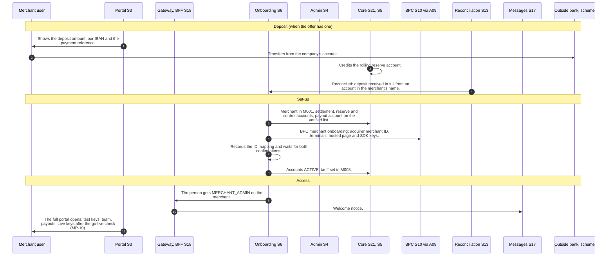
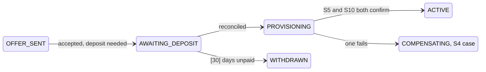

<!-- Generated from src/ by tools/build-docs.ps1. Edit src/workflows.js or src/model.js, not this file. -->

# MP-09 Deposit, set-up and activation

[All workflows](../README.md) | Previous: [MP-08 Underwriting decision and the offer](MP-08-underwriting-decision-and-the-offer.md) | Next: [MP-10 Go live: from test to live payments](MP-10-go-live-from-test-to-live-payments.md)

If a deposit is required, the merchant transfers it first. Then accounts in OraSYS and the merchant in BPC. Only when both confirm is the merchant active and the full portal opens.

| | |
|---|---|
| Status | v8.1, gaps closed |
| Area | Onboarding |
| Source | WF02b steps 13 to 17; PRD WF11 AWAITING_DEPOSIT; admin spec 5.4 access.grant |
| Starts when | The offer is accepted (MP-08). |
| Object | OnboardingCase PROVISIONING to ACTIVE |
| Systems | Merchant (user), Portal (S3), Gateway, BFF (S18), Onboarding (S6), Admin (S4), Core (S21, S5), BPC (S10 via A09), Reconciliation (S13), Messages (S17), Outside (bank, scheme) |
| Portal screens | Application, Home |

## Sequence

## Steps

| # | From | To | Step | Call | Notes |
|---|---|---|---|---|---|
| | | | **Deposit (when the offer has one)** | | |
| 1 | Portal (S3) | Merchant (user) | Shows the deposit amount, our IBAN and the payment reference. |  | **Decided:** [MP-Q20](../open-questions.md#mp-q20) |
| 2 | Merchant (user) | Outside (bank, scheme) | Transfers from the company's account. |  |  |
| 3 | Core (S21, S5) | Core (S21, S5) | Credits the rolling reserve account. |  |  |
| 4 | Reconciliation (S13) | Onboarding (S6) | Reconciled: deposit received in full from an account in the merchant's name. |  | Rule: S10 is not activated before the deposit is in and reconciled |
| | | | **Set-up** | | |
| 5 | Onboarding (S6) | Core (S21, S5) | Merchant in M001; settlement, reserve and control accounts; payout account on the verified list. | `A05 / M0391` | WF02b 13 |
| 6 | Onboarding (S6) | BPC (S10 via A09) | BPC merchant onboarding: acquirer merchant ID, terminals, hosted page and SDK keys. | `IF45 via A09` | WF02b 14 Time: 10 s, 3 attempts, idempotent **If it fails:** persistent error: COMPENSATING and an S4 case |
| 7 | Onboarding (S6) | Onboarding (S6) | Records the ID mapping and waits for both confirmations. |  | WF02b 15 |
| 8 | Onboarding (S6) | Core (S21, S5) | Accounts ACTIVE; tariff set in M008. |  | WF02b 16 |
| | | | **Access** | | |
| 9 | Onboarding (S6) | Gateway, BFF (S18) | The person gets MERCHANT_ADMIN on the merchant. | `POST /admin/v1/merchants/{merchantId}/access/grant` | WF02b 17, admin spec 5.4 |
| 10 | Gateway, BFF (S18) | Messages (S17) | Welcome notice. | `merchant.notify welcome` |  |
| 11 | Portal (S3) | Merchant (user) | The full portal opens: test keys, team, payouts. Live keys after the go-live check (MP-10). |  | WF02b 17 |

## States

| From | When | To |
|---|---|---|
| OFFER_SENT | accepted, deposit needed | AWAITING_DEPOSIT |
| AWAITING_DEPOSIT | reconciled | PROVISIONING |
| PROVISIONING | S5 and S10 both confirm | ACTIVE |
| PROVISIONING | one fails | COMPENSATING, S4 case |
| AWAITING_DEPOSIT | [30] days unpaid | WITHDRAWN |

## Rules

- No acceptance until both OraSYS and BPC confirm.
- The deposit is paid by transfer only, never taken from settlements.

## Changes v8.1 needs

For the CTO's next version of the architecture (v8.2).

- WF02b states: add AWAITING_DEPOSIT between OFFER_SENT and PROVISIONING, as PRD WF11 needs; unpaid after [30] days the offer lapses (MP-Q20).

## Questions

### MP-Q20

AWAITING_DEPOSIT (PRD WF11) is not in the WF02b state machine.

**Decision:** Add it between the offer and PROVISIONING. Show the deposit IBAN and reference in the portal. Unpaid after [30] days: offer lapses.

Decided, awaiting sign-off by: CTO
