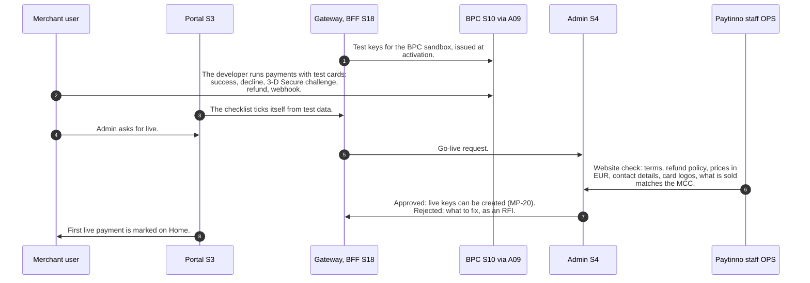
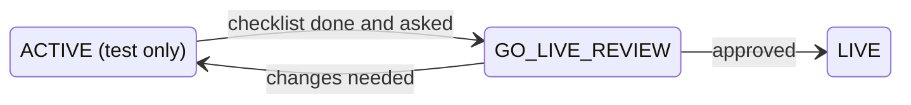

<!-- Generated from src/ by tools/build-docs.ps1. Edit src/workflows.js or src/model.js, not this file. -->

# MP-10 Go live: from test to live payments

[All workflows](../README.md) | Previous: [MP-09 Deposit, set-up and activation](MP-09-deposit-set-up-and-activation.md) | Next: [MP-11 See payments and one payment](MP-11-see-payments-and-one-payment.md)

The developer proves the integration with test cards; staff check the website; then live keys are issued.

| | |
|---|---|
| Status | Proposed |
| For | Every merchant |
| Area | Onboarding |
| Source | WF02b 17 ("sandbox first"); module spec v7.1 sandbox with test cards |
| Starts when | The merchant is active and wants live keys, or a new website is added. |
| Object | Go-live checklist |
| Systems | Merchant (user), Portal (S3), Gateway, BFF (S18), BPC (S10 via A09), Admin (S4), Paytinno staff (OPS) |
| Portal screens | Developers, Home |

## Sequence

## Steps

| # | From | To | Step | Call | Notes |
|---|---|---|---|---|---|
| 1 | Gateway, BFF (S18) | BPC (S10 via A09) | Test keys for the BPC sandbox, issued at activation. |  | **Open gap:** Does BPC give a sandbox per merchant? (CTO question 21, MP-Q21) |
| 2 | Merchant (user) | BPC (S10 via A09) | The developer runs payments with test cards: success, decline, 3-D Secure challenge, refund, webhook. |  |  |
| 3 | Portal (S3) | Gateway, BFF (S18) | The checklist ticks itself from test data. | `GET /v1/golive/checklist` |  |
| 4 | Merchant (user) | Portal (S3) | Admin asks for live. |  |  |
| 5 | Gateway, BFF (S18) | Admin (S4) | Go-live request. |  |  |
| 6 | Paytinno staff (OPS) | Admin (S4) | Website check: terms, refund policy, prices in EUR, contact details, card logos, what is sold matches the MCC. |  | Rule: Scheme rules require a website review |
| 7 | Admin (S4) | Gateway, BFF (S18) | Approved: live keys can be created (MP-20). Rejected: what to fix, as an RFI. |  |  |
| 8 | Portal (S3) | Merchant (user) | First live payment is marked on Home. |  |  |

## States

| From | When | To |
|---|---|---|
| ACTIVE (test only) | checklist done and asked | GO_LIVE_REVIEW |
| GO_LIVE_REVIEW | approved | LIVE |
| GO_LIVE_REVIEW | changes needed | ACTIVE (test only) |

## Rules

- Live keys are never issued before the website check.

## Questions

### MP-Q21

Can test keys be given as soon as the application is sent, so developers start during review (as the design prototype shows)?

**Proposed:** Yes, if BPC offers a sandbox merchant without onboarding. Otherwise at activation as v8.7 says.

Owner: CTO
