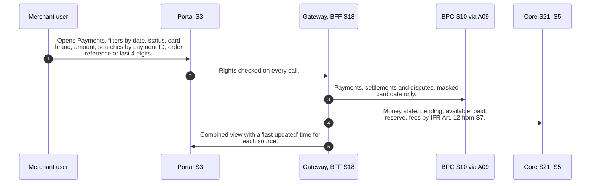
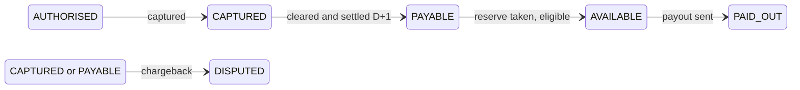

<!-- Generated from src/ by tools/build-docs.ps1. Edit src/workflows.js or src/model.js, not this file. -->

# MP-11 See payments and one payment

[All workflows](../README.md) | Previous: [MP-10 Go live: from test to live payments](MP-10-go-live-from-test-to-live-payments.md) | Next: [MP-12 Refund a payment](MP-12-refund-a-payment.md)

Payment records come from BPC through A09 (masked). Money comes from OraSYS through M0391. Each part says when it was last updated; when they disagree, OraSYS wins.

| | |
|---|---|
| Status | In v8.1 |
| Area | Payments |
| Source | WF10 steps 13 to 16 |
| Starts when | A user opens Payments or a payment. |
| Object | AcquiringTransaction (BPC), balances (S5) |
| Systems | Merchant (user), Portal (S3), Gateway, BFF (S18), BPC (S10 via A09), Core (S21, S5) |
| Portal screens | Payments, One payment, Home |

## Sequence

## Steps

| # | From | To | Step | Call | Notes |
|---|---|---|---|---|---|
| 1 | Merchant (user) | Portal (S3) | Opens Payments, filters by date, status, card brand, amount; searches by payment ID, order reference or last 4 digits. |  | WF10 13 |
| 2 | Portal (S3) | Gateway, BFF (S18) | Rights checked on every call. | `GET /v1/payments?from&to&status&q&cursor` | WF10 14 Time: 1 s p95 |
| 3 | Gateway, BFF (S18) | BPC (S10 via A09) | Payments, settlements and disputes, masked card data only. | `IF45 via A09` | WF10 15 **If it fails:** BPC down: the portal says payment data is unavailable; payments still work |
| 4 | Gateway, BFF (S18) | Core (S21, S5) | Money state: pending, available, paid, reserve; fees by IFR Art. 12 from S7. | `A05 / M0391` | WF10 16 Time: 500 ms p95 |
| 5 | Gateway, BFF (S18) | Portal (S3) | Combined view with a "last updated" time for each source. |  | Rule: S5 wins over BPC (R09) |

## States

| From | When | To |
|---|---|---|
| AUTHORISED | captured | CAPTURED |
| CAPTURED | cleared and settled D+1 | PAYABLE |
| PAYABLE | reserve taken, eligible | AVAILABLE |
| AVAILABLE | payout sent | PAID_OUT |
| CAPTURED or PAYABLE | chargeback | DISPUTED |

## Rules

- An authorisation is not money in the balance.
- D+1 is a service level, not a guarantee.
- A09 never reads balances and never writes the ledger.
- No full card number ever reaches the portal (SEC4 checks responses).

## Questions

### MP-Q22

Cache payment data in S18 when BPC is slow or down? (CTO question 22)

**Proposed:** Yes, a read copy of the last [90] days refreshed every [5] min, always shown with its time. Search beyond 90 days goes to BPC live.

Owner: CTO

### MP-Q23

Can the BPC API search by order reference, card last 4 and amount?

**Proposed:** Confirm with BPC (question 21). If not, search runs on the S18 read copy only.

Owner: BPC
