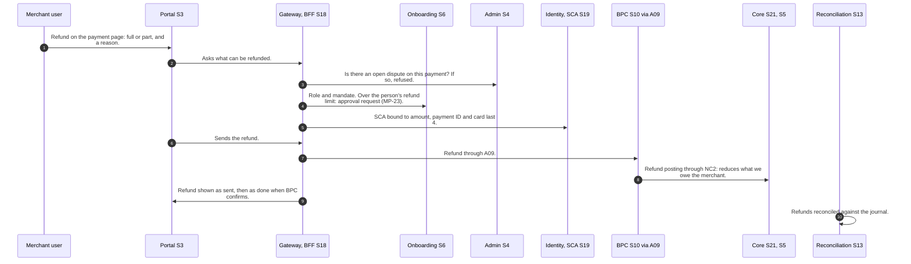
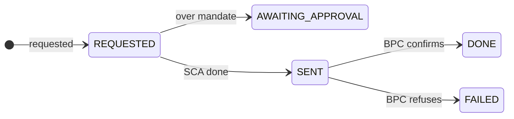

<!-- Generated from src/ by tools/build-docs.ps1. Edit src/workflows.js or src/model.js, not this file. -->

# MP-12 Refund a payment

[All workflows](../README.md) | Previous: [MP-11 See payments and one payment](MP-11-see-payments-and-one-payment.md) | Next: [MP-16 Answer a chargeback](MP-16-answer-a-chargeback.md)

Checks before sending: refundable amount, open dispute, the user's mandate. SCA binds amount and payment. The ledger effect comes only from NC2.

| | |
|---|---|
| Status | v8.1 with gaps |
| Area | Payments |
| Source | WF11 steps 15 to 17; PRD refund link to disputes |
| Starts when | A user refunds all or part of a captured payment. |
| Object | Refund (BPC), posting through NC2 |
| Systems | Merchant (user), Portal (S3), Gateway, BFF (S18), Onboarding (S6), Admin (S4), Identity, SCA (S19), BPC (S10 via A09), Core (S21, S5), Reconciliation (S13) |
| Portal screens | One payment, Refunds |

## Sequence

## Steps

| # | From | To | Step | Call | Notes |
|---|---|---|---|---|---|
| 1 | Merchant (user) | Portal (S3) | Refund on the payment page: full or part, and a reason. |  | WF11 15 |
| 2 | Portal (S3) | Gateway, BFF (S18) | Asks what can be refunded. | `GET /v1/payments/{id}/refundable` |  |
| 3 | Gateway, BFF (S18) | Admin (S4) | Is there an open dispute on this payment? If so, refused. |  | Rule: No refund on a payment with an open dispute **Gap:** PRD puts this block in S21a; v8.1 refunds never pass the core first (MP-Q24). |
| 4 | Gateway, BFF (S18) | Onboarding (S6) | Role and mandate. Over the person's refund limit: approval request (MP-23). |  |  |
| 5 | Gateway, BFF (S18) | Identity, SCA (S19) | SCA bound to amount, payment ID and card last 4. |  | **SCA** |
| 6 | Portal (S3) | Gateway, BFF (S18) | Sends the refund. | `POST /v1/payments/{id}/refunds {amount, reason} + Idempotency-Key` | WF11 16 Time: 2 s |
| 7 | Gateway, BFF (S18) | BPC (S10 via A09) | Refund through A09. | `IF45 via A09` | WF11 17 **If it fails:** answer lost: retry with the same key |
| 8 | BPC (S10 via A09) | Core (S21, S5) | Refund posting through NC2: reduces what we owe the merchant. |  | WF11 12 |
| 9 | Gateway, BFF (S18) | Portal (S3) | Refund shown as sent; then as done when BPC confirms. |  |  |
| 10 | Reconciliation (S13) | Reconciliation (S13) | Refunds reconciled against the journal. |  | R08 |

## States

| From | When | To |
|---|---|---|
| start | requested | REQUESTED |
| REQUESTED | over mandate | AWAITING_APPROVAL |
| REQUESTED | SCA done | SENT |
| SENT | BPC confirms | DONE |
| SENT | BPC refuses | FAILED |

## Rules

- Total refunds never exceed the captured amount.
- A payment not yet captured is cancelled, not refunded.
- The card holder sees the money in 5 to 10 business days (bank dependent).

## Open questions

### MP-Q24

Where does the "no refund while disputed" check run? The PRD says S21a; in v8.1 portal refunds go S18 to A09 to BPC.

**Proposed:** S18 asks S4 synchronously (DisputeCase by payment) before the A09 call. S4 also re-checks on every stage change (PRD).

Owner: CTO

### MP-Q25

What if the merchant's balance is lower than the refund?

**Proposed:** Allowed up to available plus pending; above that, refused with "top up by transfer". Never a negative balance.

Owner: Finance

### MP-Q26

Cancelling an authorisation that is not captured is not described anywhere.

**Proposed:** A "Cancel" action on authorised payments through A09, same rights as refund, no SCA (no money leaves).

Owner: CTO
