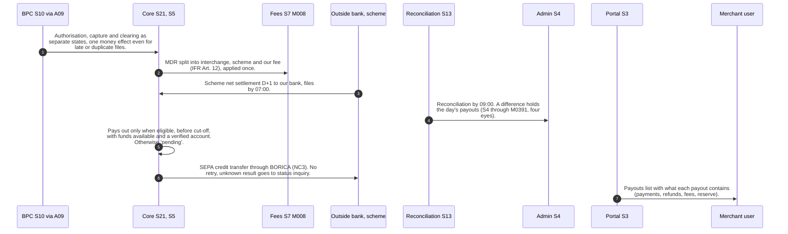
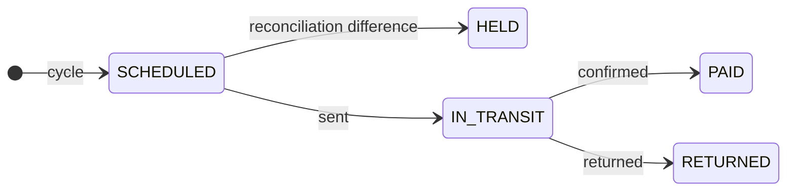

<!-- Generated from src/ by tools/build-docs.ps1. Edit src/workflows.js or src/model.js, not this file. -->

# MP-13 Balances, settlement and automatic payouts

[All workflows](../README.md) | Previous: [MP-17 Rolling reserve and reserve top-up](MP-17-rolling-reserve-and-reserve-top-up.md) | Next: [MP-14 Pay out now, and payout settings](MP-14-pay-out-now-and-payout-settings.md)

Captured payments become payable after settlement, available after the reserve, and are paid out to the verified account on the merchant's schedule, if reconciliation is clean.

| | |
|---|---|
| Status | In v8.1 |
| Area | Money |
| Source | WF10 steps 4 to 12 |
| Starts when | Daily settlement and payout cycle. |
| Object | MerchantPayout (S21) |
| Systems | BPC (S10 via A09), Core (S21, S5), Fees (S7 M008), Outside (bank, scheme), Reconciliation (S13), Admin (S4), Portal (S3), Merchant (user) |
| Portal screens | Balances, Payouts, Home |

## Sequence

## Steps

| # | From | To | Step | Call | Notes |
|---|---|---|---|---|---|
| 1 | BPC (S10 via A09) | Core (S21, S5) | Authorisation, capture and clearing as separate states; one money effect even for late or duplicate files. |  | WF10 4 to 5 |
| 2 | Core (S21, S5) | Fees (S7 M008) | MDR split into interchange, scheme and our fee (IFR Art. 12), applied once. |  | WF10 6 |
| 3 | Outside (bank, scheme) | Core (S21, S5) | Scheme net settlement D+1 to our bank; files by 07:00. |  | WF10 8 to 9 |
| 4 | Reconciliation (S13) | Admin (S4) | Reconciliation by 09:00. A difference holds the day's payouts (S4 through M0391, four eyes). |  | WF10 10 **If it fails:** Merchant sees "Held while we check" |
| 5 | Core (S21, S5) | Core (S21, S5) | Pays out only when eligible, before cut-off, with funds available and a verified account. Otherwise "pending". |  | WF10 11 |
| 6 | Core (S21, S5) | Outside (bank, scheme) | SEPA credit transfer through BORICA (NC3). No retry; unknown result goes to status inquiry. |  | WF10 12 **If it fails:** Returned by the bank: the amount is back in available and the account is marked for check (MP-15) |
| 7 | Portal (S3) | Merchant (user) | Payouts list with what each payout contains (payments, refunds, fees, reserve). |  |  |

## States

| From | When | To |
|---|---|---|
| start | cycle | SCHEDULED |
| SCHEDULED | reconciliation difference | HELD |
| SCHEDULED | sent | IN_TRANSIT |
| IN_TRANSIT | confirmed | PAID |
| IN_TRANSIT | returned | RETURNED |

## Rules

- Payouts only to a verified account in the merchant's name.
- Every money figure shows when it was last updated.

## Questions

### MP-Q28

Which payout schedules does M0391 support (daily, weekly, monthly, minimum amount)?

**Proposed:** Daily on business days as default; weekly and monthly as options; minimum [€100].

Owner: OraSYS
