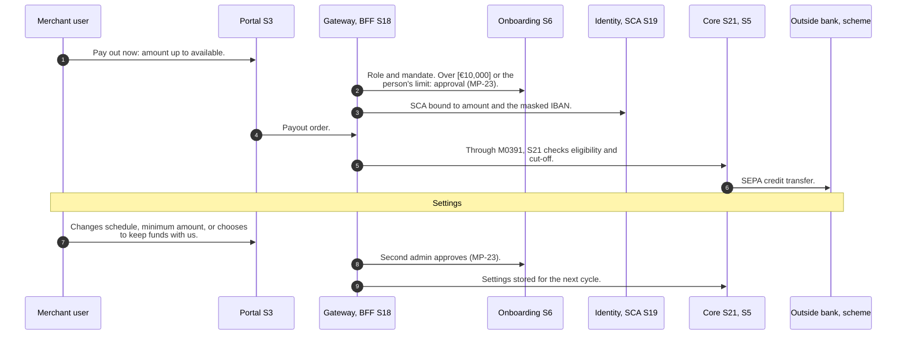
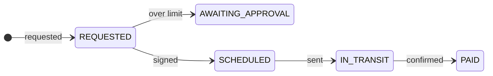

<!-- Generated from src/ by tools/build-docs.ps1. Edit src/workflows.js or src/model.js, not this file. -->

# MP-14 Pay out now, and payout settings

[All workflows](../README.md) | Previous: [MP-13 Balances, settlement and automatic payouts](MP-13-balances-settlement-and-automatic-payouts.md) | Next: [MP-15 Change the payout account](MP-15-change-the-payout-account.md)

Only to the verified payout account, only from available funds, with SCA. Over the person's limit a second person approves.

| | |
|---|---|
| Status | Proposed |
| Area | Money |
| Source | One-pager S3 item 5 ("payout to an external account through M0391"); WF10 12 ("funds stay with us by choice") |
| Starts when | A user pays out available funds outside the schedule, or changes the schedule. |
| Object | Payout order (S21) |
| Systems | Merchant (user), Portal (S3), Gateway, BFF (S18), Onboarding (S6), Identity, SCA (S19), Core (S21, S5), Outside (bank, scheme) |
| Portal screens | Balances, Payouts, Approvals |

## Sequence

## Steps

| # | From | To | Step | Call | Notes |
|---|---|---|---|---|---|
| 1 | Merchant (user) | Portal (S3) | Pay out now: amount up to available. |  |  |
| 2 | Gateway, BFF (S18) | Onboarding (S6) | Role and mandate. Over [€10,000] or the person's limit: approval (MP-23). |  |  |
| 3 | Gateway, BFF (S18) | Identity, SCA (S19) | SCA bound to amount and the masked IBAN. |  | **SCA** |
| 4 | Portal (S3) | Gateway, BFF (S18) | Payout order. | `POST /v1/payouts {amount, accountRef} + Idempotency-Key` |  |
| 5 | Gateway, BFF (S18) | Core (S21, S5) | Through M0391; S21 checks eligibility and cut-off. | `A05 / M0391` | **If it fails:** after cut-off: next business day, shown before signing |
| 6 | Core (S21, S5) | Outside (bank, scheme) | SEPA credit transfer. |  |  |
| | | | **Settings** | | |
| 7 | Merchant (user) | Portal (S3) | Changes schedule, minimum amount, or chooses to keep funds with us. |  |  |
| 8 | Gateway, BFF (S18) | Onboarding (S6) | Second admin approves (MP-23). |  |  |
| 9 | Gateway, BFF (S18) | Core (S21, S5) | Settings stored for the next cycle. | `PUT /v1/payouts/settings` |  |

## States

| From | When | To |
|---|---|---|
| start | requested | REQUESTED |
| REQUESTED | over limit | AWAITING_APPROVAL |
| REQUESTED | signed | SCHEDULED |
| SCHEDULED | sent | IN_TRANSIT |
| IN_TRANSIT | confirmed | PAID |

## Rules

- Never to any account other than the verified payout account.
- No payout while a reconciliation hold is on.

## Questions

### MP-Q29

"Funds stay with us by choice" (WF10 12): is that allowed, for how long, and how are those funds safeguarded?

**Proposed:** Allowed up to [30] days, safeguarded like other client funds, shown as "kept". Longer needs a payment account under a separate agreement.

Owner: Compliance
