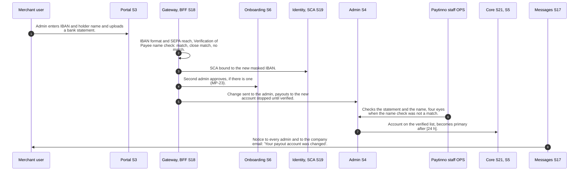
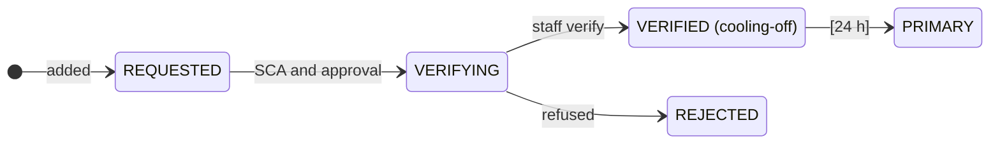

<!-- Generated from src/ by tools/build-docs.ps1. Edit src/workflows.js or src/model.js, not this file. -->

# MP-15 Change the payout account

[All workflows](../README.md) | Previous: [MP-14 Pay out now, and payout settings](MP-14-pay-out-now-and-payout-settings.md) | Next: [MP-18 Statements, invoices and fees](MP-18-statements-invoices-and-fees.md)

The highest-risk change in the portal. Name check, second admin, staff check, then a cooling-off period before the first payout. The old account stays in use until then.

| | |
|---|---|
| Status | Proposed |
| Area | Money |
| Source | WF02b invariant (verified account in the merchant's name, SCA); admin spec payout.account.changed |
| Starts when | An admin adds a new payout account. |
| Object | Payout account (S6, S21 verified list) |
| Systems | Merchant (user), Portal (S3), Gateway, BFF (S18), Onboarding (S6), Identity, SCA (S19), Admin (S4), Paytinno staff (OPS), Core (S21, S5), Messages (S17) |
| Portal screens | Payout account, Approvals |

## Sequence

## Steps

| # | From | To | Step | Call | Notes |
|---|---|---|---|---|---|
| 1 | Merchant (user) | Portal (S3) | Admin enters IBAN and holder name and uploads a bank statement. |  |  |
| 2 | Gateway, BFF (S18) | Gateway, BFF (S18) | IBAN format and SEPA reach; Verification of Payee name check: match, close match, no match. |  | **Gap:** v8.1 does not say how "in the merchant's name" is checked (MP-Q30). |
| 3 | Gateway, BFF (S18) | Identity, SCA (S19) | SCA bound to the new masked IBAN. |  | **SCA** |
| 4 | Gateway, BFF (S18) | Onboarding (S6) | Second admin approves, if there is one (MP-23). |  |  |
| 5 | Gateway, BFF (S18) | Admin (S4) | Change sent to the admin; payouts to the new account stopped until verified. | `webhook payout.account.changed {accountRef, ibanMasked, holderMatches, verified, scaEvidenceId}` | admin spec 6 |
| 6 | Paytinno staff (OPS) | Admin (S4) | Checks the statement and the name; four eyes when the name check was not a match. |  |  |
| 7 | Admin (S4) | Core (S21, S5) | Account on the verified list; becomes primary after [24 h]. | `M0391` |  |
| 8 | Messages (S17) | Merchant (user) | Notice to every admin and to the company email: "Your payout account was changed". | `merchant.notify payout_account_verified` |  |

## States

| From | When | To |
|---|---|---|
| start | added | REQUESTED |
| REQUESTED | SCA and approval | VERIFYING |
| VERIFYING | staff verify | VERIFIED (cooling-off) |
| VERIFIED (cooling-off) | [24 h] | PRIMARY |
| VERIFYING | refused | REJECTED |

## Rules

- Payouts go only to a verified account in the merchant's name.
- No change for [24 h] after passkey recovery (MP-04).
- The old account stays primary until the new one is.

## Open questions

### MP-Q30

How is "account in the merchant's name" verified?

**Proposed:** Verification of Payee name check plus a bank statement; no test transfer. A "no match" needs four eyes.

Owner: Compliance

### MP-Q31

Cooling-off before the first payout to a new account?

**Proposed:** [24 h], with notices to all admins so an account takeover is noticed in time.

Owner: CRO
