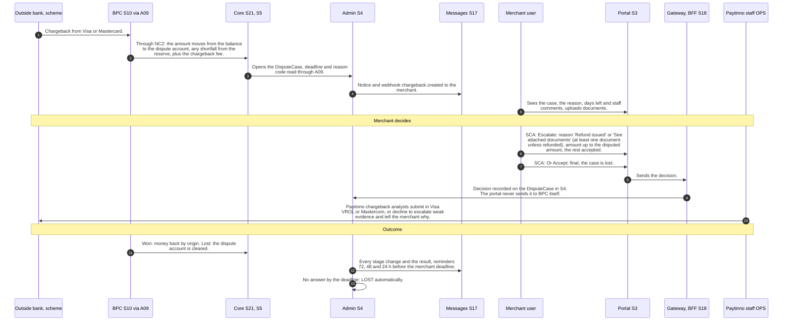
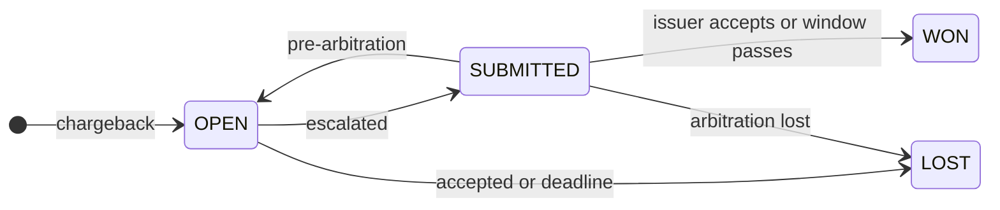

<!-- Generated from src/ by tools/build-docs.ps1. Edit src/workflows.js or src/model.js, not this file. -->

# MP-16 Answer a chargeback

[All workflows](../README.md) | Previous: [MP-12 Refund a payment](MP-12-refund-a-payment.md) | Next: [MP-17 Rolling reserve and reserve top-up](MP-17-rolling-reserve-and-reserve-top-up.md)

The money moves to a dispute account at once. The merchant gets a deadline, can upload documents, then escalates or accepts. Silence by the deadline means lost.

| | |
|---|---|
| Status | v8.1, gaps closed |
| Area | Disputes |
| Source | WF11 steps 11 to 17; PRD WF11 Acquiring v6 |
| Starts when | A card holder's bank disputes a payment. |
| Object | DisputeCase (S4) |
| Systems | Outside (bank, scheme), BPC (S10 via A09), Core (S21, S5), Admin (S4), Messages (S17), Merchant (user), Portal (S3), Gateway, BFF (S18), Paytinno staff (OPS) |
| Portal screens | Disputes, One dispute |

## Sequence

## Steps

| # | From | To | Step | Call | Notes |
|---|---|---|---|---|---|
| 1 | Outside (bank, scheme) | BPC (S10 via A09) | Chargeback from Visa or Mastercard. |  | WF11 11 |
| 2 | BPC (S10 via A09) | Core (S21, S5) | Through NC2: the amount moves from the balance to the dispute account; any shortfall from the reserve; plus the chargeback fee. |  | WF11 12 to 13 Rule: The balance is never negative |
| 3 | Core (S21, S5) | Admin (S4) | Opens the DisputeCase; deadline and reason code read through A09. |  | WF11 14 |
| 4 | Admin (S4) | Messages (S17) | Notice and webhook chargeback.created to the merchant. |  | PRD notifications |
| 5 | Merchant (user) | Portal (S3) | Sees the case, the reason, days left and staff comments; uploads documents. |  | WF11 15 |
| | | | **Merchant decides** | | |
| 6 | Merchant (user) | Portal (S3) | Escalate: reason "Refund issued" or "See attached documents" (at least one document unless refunded); amount up to the disputed amount, the rest accepted. |  | PRD Escalate **SCA** |
| 7 | Merchant (user) | Portal (S3) | Or Accept: final, the case is lost. |  | PRD Accept **SCA** |
| 8 | Portal (S3) | Gateway, BFF (S18) | Sends the decision. | `POST /v1/disputes/{caseId}/escalate \| /accept + Idempotency-Key` | WF11 16 Time: 2 s |
| 9 | Gateway, BFF (S18) | Admin (S4) | Decision recorded on the DisputeCase in S4. The portal never sends it to BPC itself. |  | **Decided:** [MP-Q12](../open-questions.md#mp-q12) |
| 10 | Paytinno staff (OPS) | Outside (bank, scheme) | Paytinno chargeback analysts submit in Visa VROL or Mastercom, or decline to escalate weak evidence and tell the merchant why. |  | PRD **Decided:** [MP-Q13](../open-questions.md#mp-q13) |
| | | | **Outcome** | | |
| 11 | BPC (S10 via A09) | Core (S21, S5) | Won: money back by origin. Lost: the dispute account is cleared. |  |  |
| 12 | Admin (S4) | Messages (S17) | Every stage change and the result; reminders 72, 48 and 24 h before the merchant deadline. |  | PRD notifications |
| 13 | Admin (S4) | Admin (S4) | No answer by the deadline: LOST automatically. |  | **If it fails:** Silence means loss |

## States

| From | When | To |
|---|---|---|
| start | chargeback | OPEN |
| OPEN | escalated | SUBMITTED |
| OPEN | accepted or deadline | LOST |
| SUBMITTED | issuer accepts or window passes | WON |
| SUBMITTED | pre-arbitration | OPEN |
| SUBMITTED | arbitration lost | LOST |

## Rules

- Internal deadline = scheme deadline minus 3 days.
- Visa: 22 days for the merchant; Mastercard: 37 days for second presentment, 22 for pre-arbitration (PRD timers).
- Escalate and Accept are possible only while the stage waits for the merchant and the deadline has not passed.
- Staff comments are shown; internal notes are not.

## Changes v8.1 needs

For the CTO's next version of the architecture (v8.2).

- WF11 14 to 17: the merchant's Escalate or Accept goes to the DisputeCase in S4; chargeback analysts submit in VROL or Mastercom (PRD WF11 v6). Not through A09 at launch (MP-Q12).
- WF11 states: keep OPEN, SUBMITTED, WON, LOST, DECLINED for reporting; the portal shows the PRD stage names (MP-Q12).
- WF11 ledger: use the PRD's dispute (CB) sub-account; a shortfall comes from the reserve, then becomes a receivable from the merchant (MP-Q12).
- CTO question 29 answered: Paytinno chargeback analysts in S4 (MP-Q13).

## Questions

### MP-Q12

The PRD and v8.1 WF11 disagree: states (PRD stages vs OPEN/SUBMITTED/WON/LOST), channel (staff in VROL/Mastercom vs A09 to BPC), ledger (CB sub-account vs reserve and receivable).

**Decision:** Use the PRD for the merchant side and update WF11 in v8.2. The portal shows PRD stages and maps them to the v8.1 states for reporting.

Decided, awaiting sign-off by: CTO

### MP-Q13

Who works disputes at launch? (CTO question 29)

**Decision:** Paytinno chargeback analysts in S4 (PRD), with the merchant answering in the portal.

Decided, awaiting sign-off by: COO
