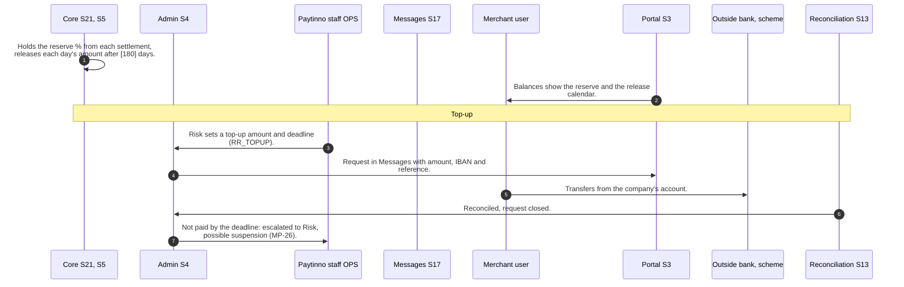
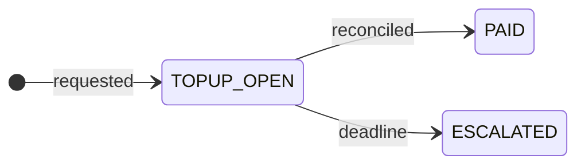

<!-- Generated from src/ by tools/build-docs.ps1. Edit src/workflows.js or src/model.js, not this file. -->

# MP-17 Rolling reserve and reserve top-up

[All workflows](../README.md) | Previous: [MP-16 Answer a chargeback](MP-16-answer-a-chargeback.md) | Next: [MP-13 Balances, settlement and automatic payouts](MP-13-balances-settlement-and-automatic-payouts.md)

A share of each settlement is held for [180] days and released day by day. If Risk asks for more, the merchant transfers it; it is never taken from settlements.

| | |
|---|---|
| Status | Proposed |
| Area | Disputes |
| Source | PRD WF11 (RR, RR_TOPUP); WF10 reserve release 180 days (proposed) |
| Starts when | Each settlement; a dispute larger than what is held; a Risk decision. |
| Object | Reserve account (S21), RR_TOPUP request (S4) |
| Systems | Core (S21, S5), Admin (S4), Paytinno staff (OPS), Messages (S17), Merchant (user), Portal (S3), Outside (bank, scheme), Reconciliation (S13) |
| Portal screens | Balances, Messages |

## Sequence

## Steps

| # | From | To | Step | Call | Notes |
|---|---|---|---|---|---|
| 1 | Core (S21, S5) | Core (S21, S5) | Holds the reserve % from each settlement; releases each day's amount after [180] days. |  | Rule: Reserve % set in underwriting (MP-08) |
| 2 | Portal (S3) | Merchant (user) | Balances show the reserve and the release calendar. |  |  |
| | | | **Top-up** | | |
| 3 | Paytinno staff (OPS) | Admin (S4) | Risk sets a top-up amount and deadline (RR_TOPUP). |  | PRD |
| 4 | Admin (S4) | Portal (S3) | Request in Messages with amount, IBAN and reference. | `POST /admin/v1/rfi + merchant.notify` |  |
| 5 | Merchant (user) | Outside (bank, scheme) | Transfers from the company's account. |  |  |
| 6 | Reconciliation (S13) | Admin (S4) | Reconciled; request closed. |  |  |
| 7 | Admin (S4) | Paytinno staff (OPS) | Not paid by the deadline: escalated to Risk; possible suspension (MP-26). |  | **If it fails:** Top-up overdue |

## States

| From | When | To |
|---|---|---|
| start | requested | TOPUP_OPEN |
| TOPUP_OPEN | reconciled | PAID |
| TOPUP_OPEN | deadline | ESCALATED |

## Rules

- The main balance is never negative.
- Top-ups only by transfer from the merchant.

## Open questions

### MP-Q27

Reserve release: v8.1 proposes 180 days; the PRD says "on schedule" with no number.

**Proposed:** 180 days rolling, daily release, per merchant override set in underwriting.

Owner: CRO
