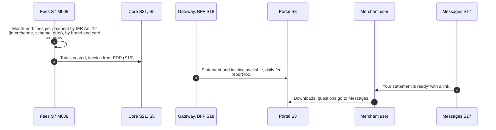
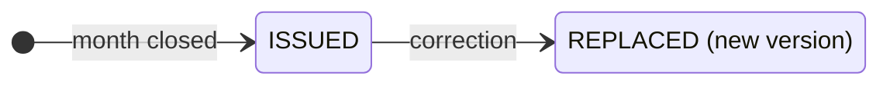

<!-- Generated from src/ by tools/build-docs.ps1. Edit src/workflows.js or src/model.js, not this file. -->

# MP-18 Statements, invoices and fees

[All workflows](../README.md) | Previous: [MP-15 Change the payout account](MP-15-change-the-payout-account.md) | Next: [MP-19 Tariff change notice](MP-19-tariff-change-notice.md)

Monthly statement and invoice, and the fee for every payment split into interchange, scheme fee and our fee.

| | |
|---|---|
| Status | Proposed |
| For | Every merchant |
| Area | Money |
| Source | One-pager S3 item 3; S7 "fee breakdown to S3" (IFR Art. 12); S17 statements |
| Starts when | Month end; or a user opens fees for a period. |
| Object | Statement (S7), invoice (S15) |
| Systems | Fees (S7 M008), Core (S21, S5), Gateway, BFF (S18), Portal (S3), Merchant (user), Messages (S17) |
| Portal screens | Statements and fees |

## Sequence

## Steps

| # | From | To | Step | Call | Notes |
|---|---|---|---|---|---|
| 1 | Fees (S7 M008) | Fees (S7 M008) | Month-end: fees per payment by IFR Art. 12 (interchange, scheme, ours), by brand and card category. |  | **Open gap:** Whether M008 can split per payment was open in v7.1 (MP-Q32). |
| 2 | Fees (S7 M008) | Core (S21, S5) | Totals posted; invoice from ERP (S15). |  |  |
| 3 | Gateway, BFF (S18) | Portal (S3) | Statement and invoice available; daily fee report too. | `GET /v1/statements, GET /v1/statements/{id}.pdf\|csv` |  |
| 4 | Messages (S17) | Merchant (user) | "Your statement is ready" with a link. |  |  |
| 5 | Merchant (user) | Portal (S3) | Downloads; questions go to Messages. |  |  |

## States

| From | When | To |
|---|---|---|
| start | month closed | ISSUED |
| ISSUED | correction | REPLACED (new version) |

## Rules

- Kept 5 years.
- Merchants may ask for the fee split aggregated by brand and category (IFR Art. 12).

## Questions

### MP-Q32

Can M008 give the IFR Art. 12 split per payment?

**Proposed:** Confirm with OraSYS. If not, S7 calculates it from the BPC clearing file.

Owner: OraSYS
