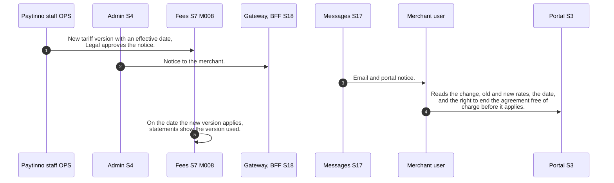
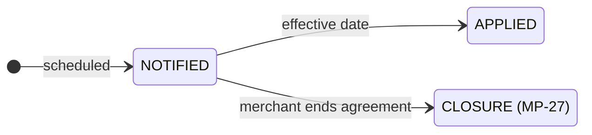

<!-- Generated from src/ by tools/build-docs.ps1. Edit src/workflows.js or src/model.js, not this file. -->

# MP-19 Tariff change notice

[All workflows](../README.md) | Previous: [MP-18 Statements, invoices and fees](MP-18-statements-invoices-and-fees.md) | Next: [MP-20 API keys: create, roll, revoke](MP-20-api-keys-create-roll-revoke.md)

The new version is scheduled with a notice period; the merchant sees old and new side by side and the right to end the agreement.

| | |
|---|---|
| Status | Proposed |
| Area | Money |
| Source | S17 regulatory notices ("tariff change"); admin spec template tariff_change |
| Starts when | Paytinno changes a merchant's tariff. |
| Object | Tariff version (S7) |
| Systems | Paytinno staff (OPS), Admin (S4), Fees (S7 M008), Gateway, BFF (S18), Messages (S17), Merchant (user), Portal (S3) |
| Portal screens | Messages, Statements and fees |

## Sequence

## Steps

| # | From | To | Step | Call | Notes |
|---|---|---|---|---|---|
| 1 | Paytinno staff (OPS) | Fees (S7 M008) | New tariff version with an effective date; Legal approves the notice. |  |  |
| 2 | Admin (S4) | Gateway, BFF (S18) | Notice to the merchant. | `merchant.notify tariff_change {tariff, effectiveAt}` |  |
| 3 | Messages (S17) | Merchant (user) | Email and portal notice. |  |  |
| 4 | Merchant (user) | Portal (S3) | Reads the change, old and new rates, the date, and the right to end the agreement free of charge before it applies. |  |  |
| 5 | Fees (S7 M008) | Fees (S7 M008) | On the date the new version applies; statements show the version used. |  |  |

## States

| From | When | To |
|---|---|---|
| start | scheduled | NOTIFIED |
| NOTIFIED | effective date | APPLIED |
| NOTIFIED | merchant ends agreement | CLOSURE (MP-27) |

## Rules

- Micro-enterprises: at least 2 months' notice (payment services rules); others as the agreement says.

## Questions

### MP-Q33

Notice periods differ for micro-enterprises, but onboarding does not ask whether the merchant is one.

**Decision:** Ask in the application (MP-05) and keep it in S6; S7 refuses an effective date shorter than the notice period.

Decided, awaiting sign-off by: Legal
