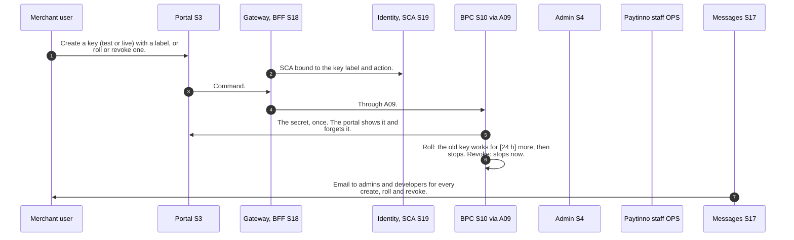
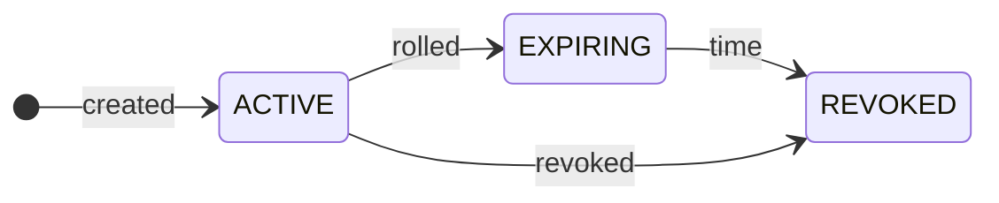

<!-- Generated from src/ by tools/build-docs.ps1. Edit src/workflows.js or src/model.js, not this file. -->

# MP-20 API keys: create, roll, revoke

[All workflows](../README.md) | Previous: [MP-19 Tariff change notice](MP-19-tariff-change-notice.md) | Next: [MP-21 Webhooks](MP-21-webhooks.md)

Secrets are shown once and never kept by Paytinno. Rolling keeps the old key working for [24 h] so the merchant can switch without downtime.

| | |
|---|---|
| Status | Proposed |
| Area | Developers |
| Source | One-pager S3 item 6; WF10 3 (keys through S3, S4 operator until the BPC API covers it) |
| Starts when | A developer needs a key, or a key may be exposed. |
| Object | Gateway key (BPC) |
| Systems | Merchant (user), Portal (S3), Gateway, BFF (S18), Identity, SCA (S19), BPC (S10 via A09), Admin (S4), Paytinno staff (OPS), Messages (S17) |
| Portal screens | Developers |

## Sequence

## Steps

| # | From | To | Step | Call | Notes |
|---|---|---|---|---|---|
| 1 | Merchant (user) | Portal (S3) | Create a key (test or live) with a label, or roll or revoke one. |  |  |
| 2 | Gateway, BFF (S18) | Identity, SCA (S19) | SCA bound to the key label and action. |  | WF02a 22 **SCA** |
| 3 | Portal (S3) | Gateway, BFF (S18) | Command. | `POST /v1/keys {mode, label} \| POST /v1/keys/{id}/roll \| DELETE /v1/keys/{id}` |  |
| 4 | Gateway, BFF (S18) | BPC (S10 via A09) | Through A09. | `IF45 via A09` | **Open gap:** BPC API coverage for keys is open (questions 21, 33). Until then an S4 operator does it (MP-Q10). |
| 5 | BPC (S10 via A09) | Portal (S3) | The secret, once. The portal shows it and forgets it. |  | Rule: Shown once |
| 6 | BPC (S10 via A09) | BPC (S10 via A09) | Roll: the old key works for [24 h] more, then stops. Revoke: stops now. |  |  |
| 7 | Messages (S17) | Merchant (user) | Email to admins and developers for every create, roll and revoke. |  |  |

## States

| From | When | To |
|---|---|---|
| start | created | ACTIVE |
| ACTIVE | rolled | EXPIRING |
| EXPIRING | time | REVOKED |
| ACTIVE | revoked | REVOKED |

## Rules

- Live keys only after go-live (MP-10).
- Secrets never in email, messages or logs.

## Questions

### MP-Q10

If BPC cannot create keys through its API, how does the secret reach the merchant without staff seeing it?

**Proposed:** Do not launch key self-service with an operator in the middle. Either BPC API support, or BPC's own console link for the first key. Confirm with BPC before build.

Owner: BPC
