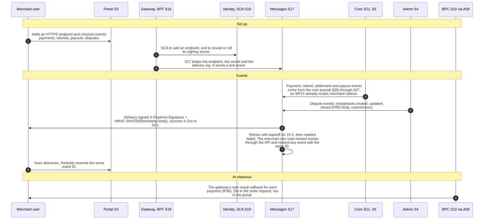
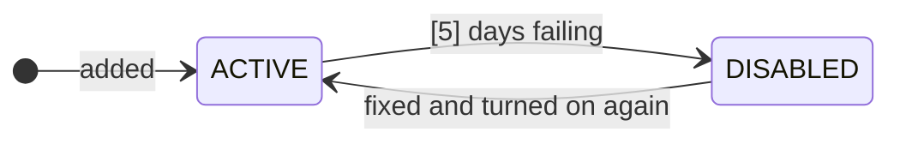

<!-- Generated from src/ by tools/build-docs.ps1. Edit src/workflows.js or src/model.js, not this file. -->

# MP-21 Webhooks

[All workflows](../README.md) | Previous: [MP-20 API keys: create, roll, revoke](MP-20-api-keys-create-roll-revoke.md) | Next: [MP-28 Reports and exports](MP-28-reports-and-exports.md)

One sender, one signature, one retry policy: Paytinno sends every event through S17. Only the result at checkout comes straight from the card processor's gateway, set per order.

| | |
|---|---|
| Status | v8.7, gaps closed |
| For | Every merchant |
| Area | Developers |
| Source | WF10 3 (BPC webhooks); WF21 (merchant notices through Q5, A07, Q4); PRD WF11 (chargeback webhooks through S17); module spec v7.1 |
| Starts when | A developer adds an endpoint; an event happens. |
| Object | Endpoint and delivery log (S17) |
| Systems | Merchant (user), Portal (S3), Gateway, BFF (S18), Identity, SCA (S19), Messages (S17), Core (S21, S5), Admin (S4), BPC (S10 via A09) |
| Portal screens | Developers |

## Sequence

## Steps

| # | From | To | Step | Call | Notes |
|---|---|---|---|---|---|
| | | | **Set up** | | |
| 1 | Merchant (user) | Portal (S3) | Adds an HTTPS endpoint and chooses events: payments, refunds, payouts, disputes. |  |  |
| 2 | Gateway, BFF (S18) | Identity, SCA (S19) | SCA to add an endpoint, and to reveal or roll its signing secret. |  | **SCA** **Decided:** [MP-Q11](../open-questions.md#mp-q11) |
| 3 | Gateway, BFF (S18) | Messages (S17) | S17 keeps the endpoint, the secret and the delivery log. It sends a test event. | `POST /v1/webhooks {url, events[]}` | **Decided:** [MP-Q34](../open-questions.md#mp-q34) |
| | | | **Events** | | |
| 4 | Core (S21, S5) | Messages (S17) | Payment, refund, settlement and payout events come from the core journal (Q5) through A07, as WF21 already routes merchant notices. |  | WF21 **Decided:** [MP-Q34](../open-questions.md#mp-q34) |
| 5 | Admin (S4) | Messages (S17) | Dispute events: chargeback.created, updated, closed (PRD body, caseVersion). |  | PRD |
| 6 | Messages (S17) | Merchant (user) | Delivery signed X-Paytinno-Signature = HMAC-SHA256(timestamp.body); success is 2xx in 10 s. |  | PRD |
| 7 | Messages (S17) | Messages (S17) | Retries with backoff for 24 h, then marked failed. The merchant can read missed events through the API and resend any event with the same ID. | `GET /v1/events?after= ; POST /v1/events/{id}/resend` | **If it fails:** failing for [5] days: endpoint disabled, admins and developers told **Decided:** [MP-Q34](../open-questions.md#mp-q34) |
| 8 | Merchant (user) | Portal (S3) | Sees deliveries; ReNotify resends the same event ID. |  | PRD ReNotify |
| | | | **At checkout** | | |
| 9 | BPC (S10 via A09) | Merchant (user) | The gateway's own result callback for each payment (IF06). Set in the order request, not in the portal. |  | WF10 3 Rule: Needs BPC to accept a callback URL per order (dependency) |

## States

| From | When | To |
|---|---|---|
| start | added | ACTIVE |
| ACTIVE | [5] days failing | DISABLED |
| DISABLED | fixed and turned on again | ACTIVE |

## Rules

- The merchant rejects messages older than 5 min.
- Event IDs are unique; resends keep the ID.
- Payment events from Paytinno follow the core journal, so they can arrive after the gateway's checkout callback.

## Changes v8.7 needs

For the CTO's next version of the architecture.

- WF10 3 and PRD WF11: all merchant webhooks come from Paytinno through S17 with one signature (X-Paytinno-Signature) and one retry policy: backoff for 24 h, then pull through GET /v1/events. Replaces the PRD's "once a day, 3 attempts" (MP-Q34).
- WF10 3: the portal does not register webhooks at BPC. Only the per-order checkout callback stays with the BPC gateway.
- WF02c 1: webhook endpoints and secrets need SCA (MP-Q11).

## Depends on

Confirmations needed from outside Paytinno. Not design gaps.

- BPC: the gateway accepts a result callback URL per order (CTO question 21).

## Questions

### MP-Q11

Is a webhook signing secret a key needing SCA? It lets anyone fake events to the merchant.

**Decision:** Yes: SCA to add an endpoint and to reveal or roll a secret.

Decided, awaiting sign-off by: CTO

### MP-Q34

Two signing schemes and retry policies (BPC payment webhooks and Paytinno chargeback webhooks).

**Decision:** One sender: Paytinno sends all merchant events through S17 from the core journal and S4, with one signature, backoff for 24 h, then pull through the API. BPC webhooks are not taken at launch anyway (WF21); only the per-order checkout callback stays with the gateway.

Decided, awaiting sign-off by: CTO
