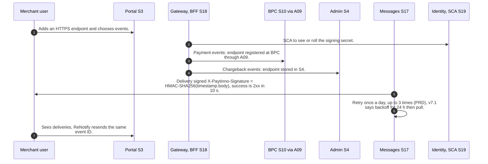
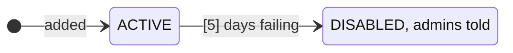

<!-- Generated from src/ by tools/build-docs.ps1. Edit src/workflows.js or src/model.js, not this file. -->

# MP-21 Webhooks

[All workflows](../README.md) | Previous: [MP-20 API keys: create, roll, revoke](MP-20-api-keys-create-roll-revoke.md) | Next: [MP-28 Reports and exports](MP-28-reports-and-exports.md)

Two senders today: BPC for payment events, Paytinno (S17) for chargebacks. Different signatures and retries. Proposed: one scheme for the merchant.

| | |
|---|---|
| Status | v8.1 with gaps |
| Area | Developers |
| Source | WF10 3 (BPC webhooks); PRD WF11 (chargeback webhooks through S17); module spec v7.1 |
| Starts when | A developer adds an endpoint; an event happens. |
| Object | Endpoint, delivery |
| Systems | Merchant (user), Portal (S3), Gateway, BFF (S18), BPC (S10 via A09), Admin (S4), Messages (S17), Identity, SCA (S19) |
| Portal screens | Developers |

## Sequence

## Steps

| # | From | To | Step | Call | Notes |
|---|---|---|---|---|---|
| 1 | Merchant (user) | Portal (S3) | Adds an HTTPS endpoint and chooses events. |  |  |
| 2 | Gateway, BFF (S18) | Identity, SCA (S19) | SCA to see or roll the signing secret. |  | **SCA** **Gap:** Proposed (MP-Q11) |
| 3 | Gateway, BFF (S18) | BPC (S10 via A09) | Payment events: endpoint registered at BPC through A09. |  | **Gap:** BPC API coverage open |
| 4 | Gateway, BFF (S18) | Admin (S4) | Chargeback events: endpoint stored in S4. |  | PRD |
| 5 | Messages (S17) | Merchant (user) | Delivery signed X-Paytinno-Signature = HMAC-SHA256(timestamp.body); success is 2xx in 10 s. |  | PRD |
| 6 | Messages (S17) | Messages (S17) | Retry once a day, up to 3 times (PRD); v7.1 says backoff for 24 h then pull. |  | **Gap:** Two retry policies (MP-Q34) |
| 7 | Merchant (user) | Portal (S3) | Sees deliveries; ReNotify resends the same event ID. |  | PRD ReNotify |

## States

| From | When | To |
|---|---|---|
| start | added | ACTIVE |
| ACTIVE | [5] days failing | DISABLED, admins told |

## Rules

- The merchant rejects messages older than 5 min.
- Event IDs are unique; resends keep the ID.

## Open questions

### MP-Q11

Is a webhook signing secret a key needing SCA? It lets anyone fake events to the merchant.

**Proposed:** Yes: SCA to reveal or roll.

Owner: CTO

### MP-Q34

Two signing schemes and retry policies (BPC payment webhooks and Paytinno chargeback webhooks).

**Proposed:** Merchant sees one: Paytinno relays BPC payment events through S17 with the same signature, retries with backoff for 24 h, then pull through the API.

Owner: CTO
