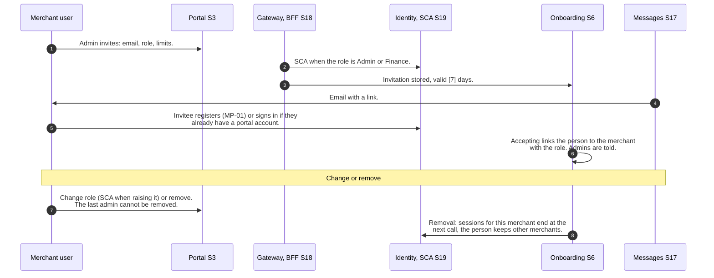
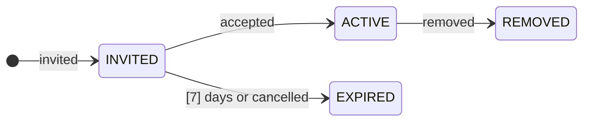

<!-- Generated from src/ by tools/build-docs.ps1. Edit src/workflows.js or src/model.js, not this file. -->

# MP-22 Invite, change and remove users

[All workflows](../README.md) | Previous: [MP-28 Reports and exports](MP-28-reports-and-exports.md) | Next: [MP-23 Approvals by a second person](MP-23-approvals-by-a-second-person.md)

Invitations by email, accepted through the normal registration. Roles that can move money need SCA to grant.

| | |
|---|---|
| Status | Proposed |
| Area | Team |
| Source | One-pager S3 item 7; WF02b 17 ("invites its other users with roles"); WF02a 22 (role above threshold) |
| Starts when | An admin manages the team. |
| Object | Person to merchant link (S6) |
| Systems | Merchant (user), Portal (S3), Gateway, BFF (S18), Identity, SCA (S19), Onboarding (S6), Messages (S17) |
| Portal screens | Team |

## Sequence

## Steps

| # | From | To | Step | Call | Notes |
|---|---|---|---|---|---|
| 1 | Merchant (user) | Portal (S3) | Admin invites: email, role, limits. |  |  |
| 2 | Gateway, BFF (S18) | Identity, SCA (S19) | SCA when the role is Admin or Finance. |  | WF02a 22 **SCA** |
| 3 | Gateway, BFF (S18) | Onboarding (S6) | Invitation stored, valid [7] days. | `POST /v1/team/invitations {email, role, mandate}` |  |
| 4 | Messages (S17) | Merchant (user) | Email with a link. |  |  |
| 5 | Merchant (user) | Identity, SCA (S19) | Invitee registers (MP-01) or signs in if they already have a portal account. |  |  |
| 6 | Onboarding (S6) | Onboarding (S6) | Accepting links the person to the merchant with the role. Admins are told. |  |  |
| | | | **Change or remove** | | |
| 7 | Merchant (user) | Portal (S3) | Change role (SCA when raising it) or remove. The last admin cannot be removed. |  |  |
| 8 | Onboarding (S6) | Identity, SCA (S19) | Removal: sessions for this merchant end at the next call; the person keeps other merchants. |  |  |

## States

| From | When | To |
|---|---|---|
| start | invited | INVITED |
| INVITED | accepted | ACTIVE |
| INVITED | [7] days or cancelled | EXPIRED |
| ACTIVE | removed | REMOVED |

## Rules

- At least one admin; two recommended (recovery, approvals).
- Every change is in the team history.

## Questions

### MP-Q35

Do people with money roles (Admin, Finance) need an identity check?

**Proposed:** Yes: IDV inside the portal when accepting an Admin or Finance invitation.

Owner: Compliance

### MP-Q01

v8.1 names only ONBOARDING_APPLICANT and MERCHANT_ADMIN. There is no role list or permission table.

**Proposed:** Admin, Finance, Developer, Support, Viewer with the table under Roles and rights.

Owner: Product
