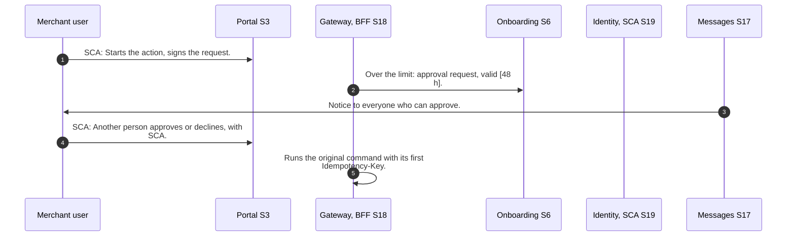
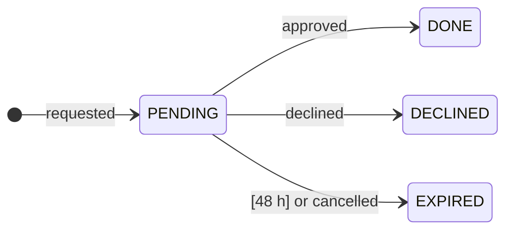

<!-- Generated from src/ by tools/build-docs.ps1. Edit src/workflows.js or src/model.js, not this file. -->

# MP-23 Approvals by a second person

[All workflows](../README.md) | Previous: [MP-22 Invite, change and remove users](MP-22-invite-change-and-remove-users.md) | Next: [MP-34 Activity log](MP-34-activity-log.md)

The merchant's own four eyes. The request waits until someone else with the right role approves with SCA.

| | |
|---|---|
| Status | Proposed |
| For | Every merchant |
| Area | Team |
| Source | One-pager S3 item 7 ("business roles, mandates and approvals"); not modelled in v8.7 |
| Starts when | An action over a person's limit, or one that always needs two people. |
| Object | Approval request (S6) |
| Systems | Merchant (user), Portal (S3), Gateway, BFF (S18), Onboarding (S6), Identity, SCA (S19), Messages (S17) |
| Portal screens | Approvals |

## Sequence

## Steps

| # | From | To | Step | Call | Notes |
|---|---|---|---|---|---|
| 1 | Merchant (user) | Portal (S3) | Starts the action; signs the request. |  | **SCA** |
| 2 | Gateway, BFF (S18) | Onboarding (S6) | Over the limit: approval request, valid [48 h]. | `POST /v1/approvals` |  |
| 3 | Messages (S17) | Merchant (user) | Notice to everyone who can approve. |  |  |
| 4 | Merchant (user) | Portal (S3) | Another person approves or declines, with SCA. |  | **SCA** Rule: Approver is never the requester |
| 5 | Gateway, BFF (S18) | Gateway, BFF (S18) | Runs the original command with its first Idempotency-Key. |  |  |

## States

| From | When | To |
|---|---|---|
| start | requested | PENDING |
| PENDING | approved | DONE |
| PENDING | declined | DECLINED |
| PENDING | [48 h] or cancelled | EXPIRED |

## Rules

- Always two people: payout account change, payout settings, closure, a new admin.
- Over the limit: refunds, payouts.

## Questions

### MP-Q05

Who sets limits, and are there defaults?

**Proposed:** Defaults per role (Support refunds up to [€100]); an admin can lower a person's limit, not raise it above the merchant's limit set by Paytinno.

Owner: Product
