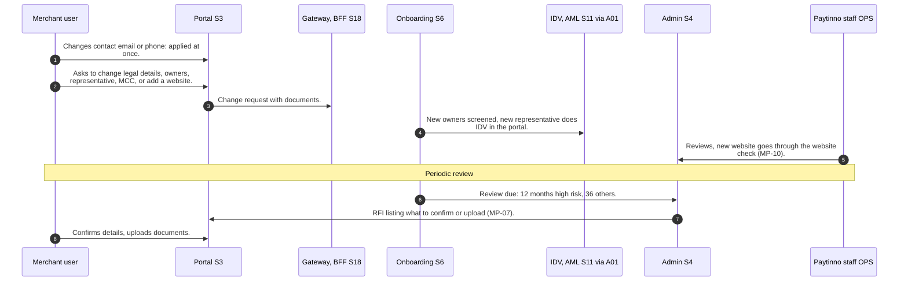
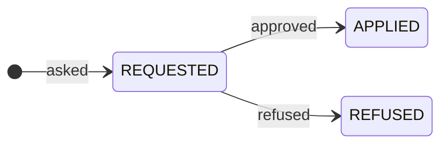

<!-- Generated from src/ by tools/build-docs.ps1. Edit src/workflows.js or src/model.js, not this file. -->

# MP-24 Business details, owners and periodic review

[All workflows](../README.md) | Previous: [MP-34 Activity log](MP-34-activity-log.md) | Next: [MP-25 Messages and notices](MP-25-messages-and-notices.md)

Contact details change at once. Legal name, address, owners, representative, what is sold and new websites are requests that staff check first.

| | |
|---|---|
| Status | Proposed |
| For | Every merchant |
| Area | Business |
| Source | WF02b invariants (KYB refresh 12 or 36 months; owner change opens a case); admin spec application.updated |
| Starts when | The merchant changes details; a review date comes; a document expires. |
| Object | Change request (S6), review case (S4) |
| Systems | Merchant (user), Portal (S3), Gateway, BFF (S18), Onboarding (S6), IDV, AML (S11 via A01), Admin (S4), Paytinno staff (OPS) |
| Portal screens | Business, Messages |

## Sequence

## Steps

| # | From | To | Step | Call | Notes |
|---|---|---|---|---|---|
| 1 | Merchant (user) | Portal (S3) | Changes contact email or phone: applied at once. |  |  |
| 2 | Merchant (user) | Portal (S3) | Asks to change legal details, owners, representative, MCC, or add a website. |  |  |
| 3 | Portal (S3) | Gateway, BFF (S18) | Change request with documents. | `POST /v1/merchant/changes → webhook application.updated` |  |
| 4 | Onboarding (S6) | IDV, AML (S11 via A01) | New owners screened; new representative does IDV in the portal. |  |  |
| 5 | Paytinno staff (OPS) | Admin (S4) | Reviews; new website goes through the website check (MP-10). |  |  |
| | | | **Periodic review** | | |
| 6 | Onboarding (S6) | Admin (S4) | Review due: 12 months high risk, 36 others. |  | WF02b invariant |
| 7 | Admin (S4) | Portal (S3) | RFI listing what to confirm or upload (MP-07). |  |  |
| 8 | Merchant (user) | Portal (S3) | Confirms details, uploads documents. |  |  |

## States

| From | When | To |
|---|---|---|
| start | asked | REQUESTED |
| REQUESTED | approved | APPLIED |
| REQUESTED | refused | REFUSED |

## Rules

- Ongoing sanctions screening runs in the AML system; the merchant sees nothing of it.
- Documents with an expiry date get reminders 30 days before.

## Questions

### MP-Q36

What happens when a periodic review is overdue?

**Proposed:** Reminders, then an S4 decision on restrictions (MP-26). Never automatic.

Owner: Compliance
