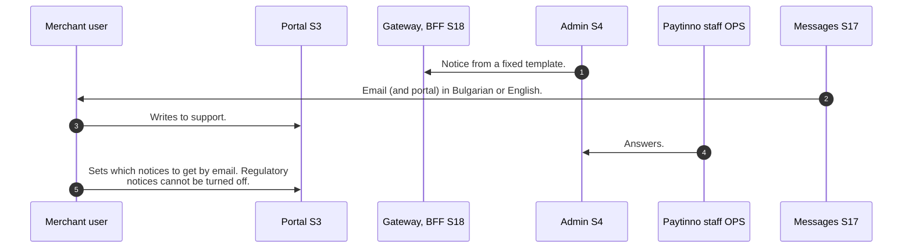

<!-- Generated from src/ by tools/build-docs.ps1. Edit src/workflows.js or src/model.js, not this file. -->

# MP-25 Messages and notices

[All workflows](../README.md) | Previous: [MP-24 Business details, owners and periodic review](MP-24-business-details-owners-and-periodic-review.md) | Next: [MP-26 Suspension and restricted access](MP-26-suspension-and-restricted-access.md)

One inbox for requests, notices and support. Emails carry a link, not the content.

| | |
|---|---|
| Status | v8.1 with gaps |
| Area | Business |
| Source | S17; admin spec 5.3 merchant.notify templates |
| Starts when | Paytinno sends a notice; a user writes to Paytinno. |
| Object | Notice, conversation |
| Systems | Merchant (user), Portal (S3), Gateway, BFF (S18), Admin (S4), Paytinno staff (OPS), Messages (S17) |
| Portal screens | Messages, Settings |

## Sequence

## Steps

| # | From | To | Step | Call | Notes |
|---|---|---|---|---|---|
| 1 | Admin (S4) | Gateway, BFF (S18) | Notice from a fixed template. | `merchant.notify {template, data}` | admin spec 5.3 |
| 2 | Messages (S17) | Merchant (user) | Email (and portal) in Bulgarian or English. |  |  |
| 3 | Merchant (user) | Portal (S3) | Writes to support. | `POST /v1/messages → webhook merchant.message` |  |
| 4 | Paytinno staff (OPS) | Admin (S4) | Answers. |  | **Gap:** Where support conversations live is not decided (MP-Q37). |
| 5 | Merchant (user) | Portal (S3) | Sets which notices to get by email. Regulatory notices cannot be turned off. |  |  |

## States

No states of its own.

## Rules

- Templates: welcome, application received, application rejected, RFI reminder, tariff change, acceptance suspended, acceptance reactivated, account closing, payout account verified (admin spec P5).

## Open questions

### MP-Q37

Where are support conversations handled? The admin has no case management for them.

**Proposed:** A simple inbox in S4 for phase 1; a help desk tool later.

Owner: COO
