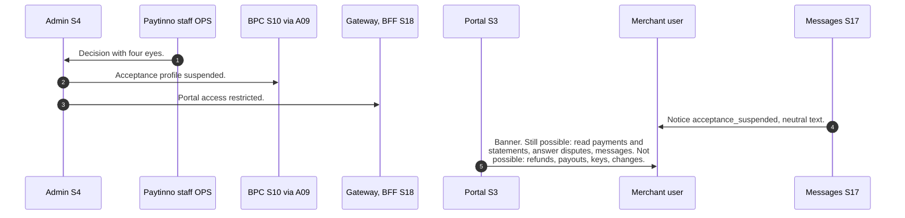
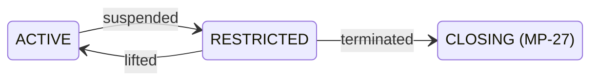

<!-- Generated from src/ by tools/build-docs.ps1. Edit src/workflows.js or src/model.js, not this file. -->

# MP-26 Suspension and restricted access

[All workflows](../README.md) | Previous: [MP-25 Messages and notices](MP-25-messages-and-notices.md) | Next: [MP-27 Close the account](MP-27-close-the-account.md)

Staff decide with four eyes. New payments stop; what the merchant can still do is limited but disputes stay answerable.

| | |
|---|---|
| Status | Proposed |
| For | Every merchant |
| Area | Business |
| Source | Admin spec 5.4 access.revoke and P6; WF11 rule (chargeback ratio above 1%) |
| Starts when | Scheme programme, AML decision, unpaid top-up, overdue review. |
| Object | Merchant access |
| Systems | Admin (S4), Paytinno staff (OPS), BPC (S10 via A09), Gateway, BFF (S18), Portal (S3), Merchant (user), Messages (S17) |
| Portal screens | Home |

## Sequence

## Steps

| # | From | To | Step | Call | Notes |
|---|---|---|---|---|---|
| 1 | Paytinno staff (OPS) | Admin (S4) | Decision with four eyes. |  |  |
| 2 | Admin (S4) | BPC (S10 via A09) | Acceptance profile suspended. |  |  |
| 3 | Admin (S4) | Gateway, BFF (S18) | Portal access restricted. | `POST /admin/v1/merchants/{id}/access/revoke` | admin spec 5.4 |
| 4 | Messages (S17) | Merchant (user) | Notice acceptance_suspended, neutral text. |  |  |
| 5 | Portal (S3) | Merchant (user) | Banner. Still possible: read payments and statements, answer disputes, messages. Not possible: refunds, payouts, keys, changes. |  | **Open gap:** admin spec 5.4 stops all actions; dispute answers must continue (MP-Q38). |

## States

| From | When | To |
|---|---|---|
| ACTIVE | suspended | RESTRICTED |
| RESTRICTED | lifted | ACTIVE |
| RESTRICTED | terminated | CLOSING (MP-27) |

## Rules

- Text never says why when the reason is AML.

## Questions

### MP-Q38

If revoked access stops every action, disputes go unanswered and are lost.

**Proposed:** Two levels: RESTRICTED (disputes and messages work) and REVOKED (read-only, after closure).

Owner: CTO
