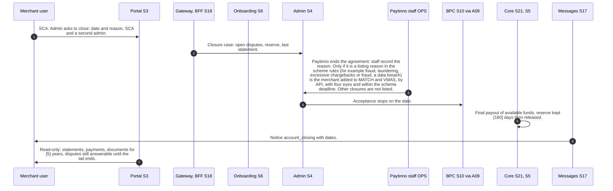

<!-- Generated from src/ by tools/build-docs.ps1. Edit src/workflows.js or src/model.js, not this file. -->

# MP-27 Close the account

[All workflows](../README.md) | Previous: [MP-26 Suspension and restricted access](MP-26-suspension-and-restricted-access.md) | Next: [MP-32 Complaints](MP-32-complaints.md)

Acceptance stops on the date, the balance is paid out, the reserve is kept for the chargeback tail, and the portal stays readable.

| | |
|---|---|
| Status | Proposed |
| For | Every merchant |
| Area | Business |
| Source | S6 lifecycle and S4 closure (one-pager); admin spec P6 (5 years read access) |
| Starts when | The merchant asks to close, or Paytinno ends the agreement. |
| Object | Merchant lifecycle CLOSING to CLOSED |
| Systems | Merchant (user), Portal (S3), Gateway, BFF (S18), Onboarding (S6), Admin (S4), Paytinno staff (OPS), BPC (S10 via A09), Core (S21, S5), Messages (S17) |
| Portal screens | Settings |

## Sequence

## Steps

| # | From | To | Step | Call | Notes |
|---|---|---|---|---|---|
| 1 | Merchant (user) | Portal (S3) | Admin asks to close: date and reason; SCA and a second admin. |  | **SCA** |
| 2 | Gateway, BFF (S18) | Admin (S4) | Closure case: open disputes, reserve, last statement. |  |  |
| 3 | Paytinno staff (OPS) | Admin (S4) | Paytinno ends the agreement: staff record the reason. Only if it is a listing reason in the scheme rules (for example fraud, laundering, excessive chargebacks or fraud, a data breach) is the merchant added to MATCH and VMAS, by API, with four eyes and within the scheme deadline. Other closures are not listed. |  | Rule: Not every termination is a listing **Decided:** [MP-Q66](../open-questions.md#mp-q66) |
| 4 | Admin (S4) | BPC (S10 via A09) | Acceptance stops on the date. |  |  |
| 5 | Core (S21, S5) | Core (S21, S5) | Final payout of available funds; reserve kept [180] days then released. |  |  |
| 6 | Messages (S17) | Merchant (user) | Notice account_closing with dates. |  |  |
| 7 | Portal (S3) | Merchant (user) | Read-only: statements, payments, documents for [5] years; disputes still answerable until the tail ends. |  |  |

## States

| From | When | To |
|---|---|---|
| ACTIVE | requested | CLOSING |
| CLOSING | reserve released and no open disputes | CLOSED (read-only) |

## Rules

- Paytinno-initiated closure follows the agreement's notice, or immediately for cause.
- A MATCH or VMAS listing follows the scheme's reason list, not staff preference: listed when a reason applies, never otherwise.

## Changes v8.1 needs

For the CTO's next version of the architecture (v8.2).

- S4 closure: record the termination reason; add MATCH and VMAS listing by API only for the scheme listing reasons (MP-Q66).

## Questions

### MP-Q39

Who keeps read access after closure, and for how long?

**Proposed:** Admins and Finance, 5 years (AML record keeping), then the users are disabled.

Owner: Legal

### MP-Q66

When does a terminated merchant go on MATCH and VMAS?

**Decision:** Only when the termination reason is one the scheme rules list. When one applies, listing is required, so it is not optional for staff. Commercial reasons, the merchant's own request and inactivity are never listed. Compliance keeps the mapping from our reasons to the scheme reason codes.

Decided, awaiting sign-off by: Compliance
