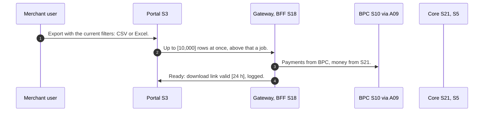
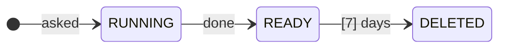

<!-- Generated from src/ by tools/build-docs.ps1. Edit src/workflows.js or src/model.js, not this file. -->

# MP-28 Reports and exports

[All workflows](../README.md) | Previous: [MP-21 Webhooks](MP-21-webhooks.md) | Next: [MP-40 Apple Pay and Google Pay](MP-40-apple-pay-and-google-pay.md)

Small exports download at once; large ones run as a job and are ready to download in the portal.

| | |
|---|---|
| Status | Proposed |
| For | Every merchant |
| Area | Developers |
| Source | Not in v8.7 |
| Starts when | A user exports payments, payouts or a reconciliation file. |
| Object | Export job |
| Systems | Merchant (user), Portal (S3), Gateway, BFF (S18), BPC (S10 via A09), Core (S21, S5) |
| Portal screens | Payments, Payouts |

## Sequence

## Steps

| # | From | To | Step | Call | Notes |
|---|---|---|---|---|---|
| 1 | Merchant (user) | Portal (S3) | Export with the current filters: CSV or Excel. |  |  |
| 2 | Portal (S3) | Gateway, BFF (S18) | Up to [10,000] rows at once; above that a job. | `POST /v1/exports {type, filters} → {exportId}` |  |
| 3 | Gateway, BFF (S18) | BPC (S10 via A09) | Payments from BPC; money from S21. |  |  |
| 4 | Gateway, BFF (S18) | Portal (S3) | Ready: download link valid [24 h], logged. |  |  |

## States

| From | When | To |
|---|---|---|
| start | asked | RUNNING |
| RUNNING | done | READY |
| READY | [7] days | DELETED |

## Rules

- Masked card data only.
- The payout reconciliation file lists every payment, refund, fee and reserve in a payout.

## Questions

None.
