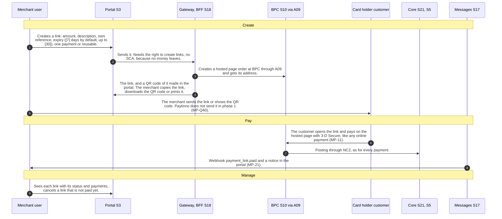
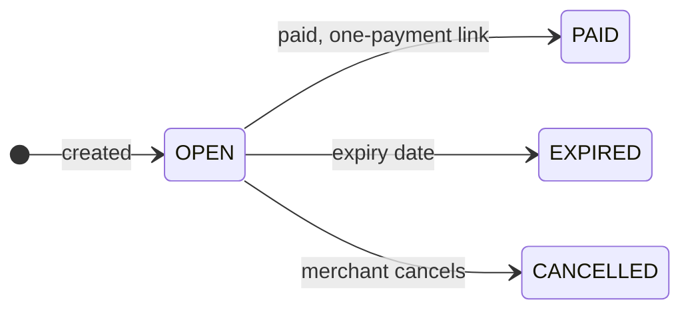

<!-- Generated from src/ by tools/build-docs.ps1. Edit src/workflows.js or src/model.js, not this file. -->

# MP-29 Payment links and QR codes

[All workflows](../README.md) | Previous: [MP-12 Refund a payment](MP-12-refund-a-payment.md) | Next: [MP-30 Card terminals](MP-30-card-terminals.md)

The merchant creates a link for an amount, shares it or shows it as a QR code, and the customer pays on the hosted page. One link, one payment, unless the link is reusable.

| | |
|---|---|
| Status | Proposed |
| For | Only Selling without a checkout (Sales by phone, chat, social media, invoice or at events). Whether each merchant type is in year-one scope is still to decide. |
| Area | Payments |
| Source | WF10 trigger (checkout by "HPP, link, QR, terminal"); module spec v7.1 Merchant API ("payments, links, status") |
| Starts when | A merchant wants to be paid without a checkout: by phone, chat, social media, invoice or at an event. |
| Object | Payment link (a BPC hosted page order) |
| Systems | Merchant (user), Portal (S3), Gateway, BFF (S18), BPC (S10 via A09), Card holder (customer), Core (S21, S5), Messages (S17) |
| Portal screens | Not in the prototype yet. Would sit on: Payments: a Links tab with Create link; a quick action on Home |

## Sequence

## Steps

| # | From | To | Step | Call | Notes |
|---|---|---|---|---|---|
| | | | **Create** | | |
| 1 | Merchant (user) | Portal (S3) | Creates a link: amount, description, own reference, expiry ([7] days by default, up to [30]), one payment or reusable. |  |  |
| 2 | Portal (S3) | Gateway, BFF (S18) | Sends it. Needs the right to create links; no SCA, because no money leaves. | `POST /v1/payment-links {amount, description, reference, expiresAt, reusable} + Idempotency-Key` | Time: 2 s |
| 3 | Gateway, BFF (S18) | BPC (S10 via A09) | Creates a hosted page order at BPC through A09 and gets its address. | `IF45 via A09` | **If it fails:** BPC refuses: the user is told, nothing is created |
| 4 | Gateway, BFF (S18) | Portal (S3) | The link, and a QR code of it made in the portal. The merchant copies the link, downloads the QR code or prints it. |  |  |
| 5 | Merchant (user) | Card holder (customer) | The merchant sends the link or shows the QR code. Paytinno does not send it in phase 1 (MP-Q40). |  |  |
| | | | **Pay** | | |
| 6 | Card holder (customer) | BPC (S10 via A09) | The customer opens the link and pays on the hosted page with 3-D Secure, like any online payment (MP-11). |  | WF10 1 to 3 |
| 7 | BPC (S10 via A09) | Core (S21, S5) | Posting through NC2, as for every payment. |  | WF10 4 to 7 |
| 8 | Messages (S17) | Merchant (user) | Webhook payment_link.paid and a notice in the portal (MP-21). |  |  |
| | | | **Manage** | | |
| 9 | Merchant (user) | Portal (S3) | Sees each link with its status and payments; cancels a link that is not paid yet. | `GET /v1/payment-links; POST /v1/payment-links/{id}/cancel` |  |

## States

| From | When | To |
|---|---|---|
| start | created | OPEN |
| OPEN | paid, one-payment link | PAID |
| OPEN | expiry date | EXPIRED |
| OPEN | merchant cancels | CANCELLED |

## Rules

- The page shows the merchant's trading name, the amount and the description; card details are typed only on the hosted page.
- A one-payment link cannot be paid twice.
- Same limits, risk rules and fees as other online payments; refunds as MP-12.
- High-risk merchant categories get links only if underwriting allows it (MP-38).

## Changes v8.1 needs

For the CTO's next version of the architecture (v8.2).

- WF10: add creating, sharing and cancelling payment links and QR codes in the portal. WF10 lists link and QR as checkout channels but has no flow for them.

## Depends on

Confirmations needed from outside Paytinno. Not design gaps.

- BPC: hosted page orders created through the API with an expiry of up to [30] days (pay by link).

## Questions

### MP-Q40

Should Paytinno send payment links to the merchant's customers by email or SMS?

**Proposed:** Not in phase 1; the merchant shares the link itself. Sending would make Paytinno process the merchant's customer data, and messages with payment links from a payment company are a common phishing pattern.

Owner: Legal

### MP-Q41

Which web address do links use: BPC's hosted page domain or one of ours?

**Proposed:** Our own sub-domain (for example pay.paytinno.com) in front of the BPC hosted page, so customers see a name they can check.

Owner: CTO
