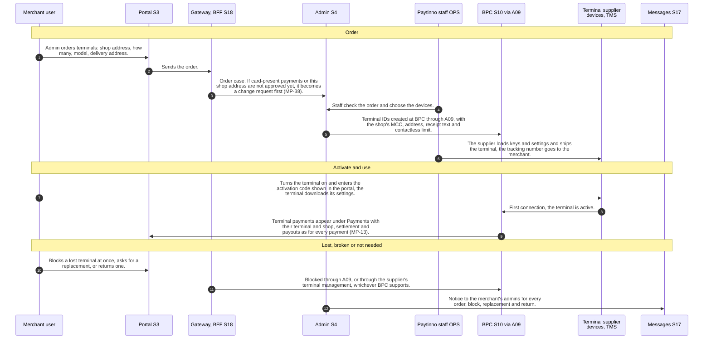
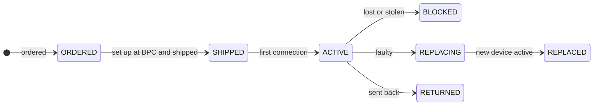

<!-- Generated from src/ by tools/build-docs.ps1. Edit src/workflows.js or src/model.js, not this file. -->

# MP-30 Card terminals

[All workflows](../README.md) | Previous: [MP-29 Payment links and QR codes](MP-29-payment-links-and-qr-codes.md) | Next: [MP-31 Capture later, or in part](MP-31-capture-later-or-in-part.md)

The merchant orders terminals for a shop address; Paytinno sets them up at BPC and ships them; the merchant activates, blocks or returns them in the portal.

| | |
|---|---|
| Status | Proposed |
| For | Only Shops with card terminals (Card-present sales in shops, cafés and restaurants). Whether each merchant type is in year-one scope is still to decide. |
| Area | Payments |
| Source | WF02b 14 (terminals created in BPC); one-pager S4 ("terminals and keys"); S10 gateway (terminals; SoftPOS in phase 2) |
| Starts when | A merchant with a shop wants a terminal, or one is lost, broken or no longer needed. |
| Object | Terminal (a terminal ID at BPC) at a shop location (merchant ID) |
| Systems | Merchant (user), Portal (S3), Gateway, BFF (S18), Admin (S4), Paytinno staff (OPS), BPC (S10 via A09), Terminal supplier (devices, TMS), Messages (S17) |
| Portal screens | Not in the prototype yet. Would sit on: Payments: a Terminals page; terminal payments show the terminal and shop they came from |

## Sequence

## Steps

| # | From | To | Step | Call | Notes |
|---|---|---|---|---|---|
| | | | **Order** | | |
| 1 | Merchant (user) | Portal (S3) | Admin orders terminals: shop address, how many, model, delivery address. |  |  |
| 2 | Portal (S3) | Gateway, BFF (S18) | Sends the order. | `POST /v1/terminals/orders {locationId, model, quantity, deliveryAddress}` |  |
| 3 | Gateway, BFF (S18) | Admin (S4) | Order case. If card-present payments or this shop address are not approved yet, it becomes a change request first (MP-38). |  | Rule: Each shop address is a location with its own merchant ID |
| 4 | Paytinno staff (OPS) | Admin (S4) | Staff check the order and choose the devices. |  |  |
| 5 | Admin (S4) | BPC (S10 via A09) | Terminal IDs created at BPC through A09, with the shop's MCC, address, receipt text and contactless limit. | `IF45 via A09` | WF02b 14 |
| 6 | Paytinno staff (OPS) | Terminal supplier (devices, TMS) | The supplier loads keys and settings and ships the terminal; the tracking number goes to the merchant. |  |  |
| | | | **Activate and use** | | |
| 7 | Merchant (user) | Terminal supplier (devices, TMS) | Turns the terminal on and enters the activation code shown in the portal; the terminal downloads its settings. |  |  |
| 8 | Terminal supplier (devices, TMS) | BPC (S10 via A09) | First connection; the terminal is active. |  |  |
| 9 | BPC (S10 via A09) | Portal (S3) | Terminal payments appear under Payments with their terminal and shop; settlement and payouts as for every payment (MP-13). |  | WF10 |
| | | | **Lost, broken or not needed** | | |
| 10 | Merchant (user) | Portal (S3) | Blocks a lost terminal at once, asks for a replacement, or returns one. | `POST /v1/terminals/{tid}/block \| /replace \| /return` |  |
| 11 | Gateway, BFF (S18) | BPC (S10 via A09) | Blocked through A09, or through the supplier's terminal management, whichever BPC supports. |  | Time: [1 min] |
| 12 | Admin (S4) | Messages (S17) | Notice to the merchant's admins for every order, block, replacement and return. |  |  |

## States

| From | When | To |
|---|---|---|
| start | ordered | ORDERED |
| ORDERED | set up at BPC and shipped | SHIPPED |
| SHIPPED | first connection | ACTIVE |
| ACTIVE | lost or stolen | BLOCKED |
| ACTIVE | faulty | REPLACING |
| REPLACING | new device active | REPLACED |
| ACTIVE | sent back | RETURNED |

## Rules

- Refunds on the terminal are off by default; refunds go through the portal with limits (MP-12).
- A blocked terminal is never unblocked; it is replaced.
- Terminal payments are card-present: chip and PIN or contactless instead of 3-D Secure.
- SoftPOS (a phone as terminal) is phase 2.

## Changes v8.1 needs

For the CTO's next version of the architecture (v8.2).

- WF02b 14 and the S4 module: add how a merchant orders, activates, blocks, replaces and returns terminals, and who ships and supports them.

## Depends on

Confirmations needed from outside Paytinno. Not design gaps.

- BPC: creating terminal IDs and blocking terminals through A09, and how its terminal management works with the device supplier.

## Questions

### MP-Q42

Who supplies, ships and supports terminals, and do merchants rent or buy them?

**Proposed:** Rent through Paytinno from one supplier, delivered by courier, replaced within [2] business days, rent shown in the tariff.

Owner: COO

### MP-Q43

Should shop staff be able to refund on the terminal?

**Proposed:** Off by default. On request: protected by a supervisor PIN and a daily refund limit.

Owner: CRO
