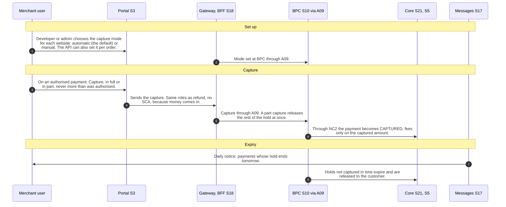
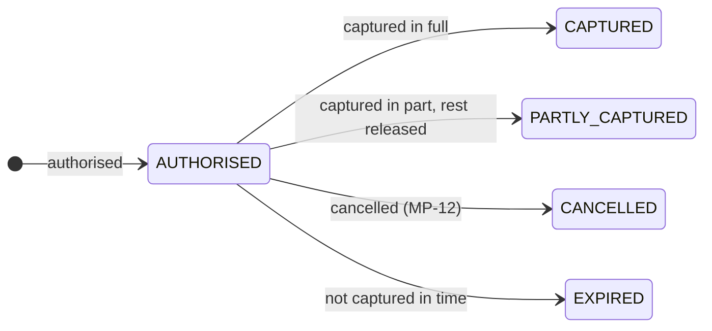

<!-- Generated from src/ by tools/build-docs.ps1. Edit src/workflows.js or src/model.js, not this file. -->

# MP-31 Capture later, or in part

[All workflows](../README.md) | Previous: [MP-30 Card terminals](MP-30-card-terminals.md) | Next: [MP-39 Saved cards and recurring payments](MP-39-saved-cards-and-recurring-payments.md)

With manual capture the card is only held at payment time. The merchant captures all or part later and the rest is released. Holds that are not captured in time expire.

| | |
|---|---|
| Status | Proposed |
| For | Only Charging later (Shops that charge on dispatch, hotels, car rental). Whether each merchant type is in year-one scope is still to decide. |
| Area | Payments |
| Source | WF10 4 (authorisation, capture and clearing are separate states) |
| Starts when | A merchant that charges on dispatch or at check-out authorises first and captures later. |
| Object | AcquiringTransaction from AUTHORISED to CAPTURED |
| Systems | Merchant (user), Portal (S3), Gateway, BFF (S18), BPC (S10 via A09), Core (S21, S5), Messages (S17) |
| Portal screens | Not in the prototype yet. Would sit on: One payment: a Capture button next to Cancel; Payments: an Authorised tab; Developers: capture mode per website |

## Sequence

## Steps

| # | From | To | Step | Call | Notes |
|---|---|---|---|---|---|
| | | | **Set up** | | |
| 1 | Merchant (user) | Portal (S3) | Developer or admin chooses the capture mode for each website: automatic (the default) or manual. The API can also set it per order. | `PUT /v1/websites/{id}/capture-mode` |  |
| 2 | Gateway, BFF (S18) | BPC (S10 via A09) | Mode set at BPC through A09. | `IF45 via A09` |  |
| | | | **Capture** | | |
| 3 | Merchant (user) | Portal (S3) | On an authorised payment: Capture, in full or in part, never more than was authorised. |  |  |
| 4 | Portal (S3) | Gateway, BFF (S18) | Sends the capture. Same roles as refund; no SCA, because money comes in. | `POST /v1/payments/{id}/capture {amount} + Idempotency-Key` | Time: 2 s |
| 5 | Gateway, BFF (S18) | BPC (S10 via A09) | Capture through A09. A part capture releases the rest of the hold at once. | `IF45 via A09` | **If it fails:** hold expired: refused; the customer must pay again |
| 6 | BPC (S10 via A09) | Core (S21, S5) | Through NC2 the payment becomes CAPTURED; fees only on the captured amount. |  | WF10 4 to 7 |
| | | | **Expiry** | | |
| 7 | Messages (S17) | Merchant (user) | Daily notice: payments whose hold ends tomorrow. |  |  |
| 8 | BPC (S10 via A09) | Core (S21, S5) | Holds not captured in time expire and are released to the customer. |  | Rule: [7] days by default; longer for hotels and car rental, by scheme rules |

## States

| From | When | To |
|---|---|---|
| start | authorised | AUTHORISED |
| AUTHORISED | captured in full | CAPTURED |
| AUTHORISED | captured in part, rest released | PARTLY_CAPTURED |
| AUTHORISED | cancelled (MP-12) | CANCELLED |
| AUTHORISED | not captured in time | EXPIRED |

## Rules

- Only captured money becomes payable (WF10).
- The customer sees the hold on the card until it is captured, cancelled or expires.
- Hotels and car rental can raise a hold (incremental authorisation) through the API, where BPC supports it.

## Changes v8.1 needs

For the CTO's next version of the architecture (v8.2).

- WF10 4: add capture and part capture started by the merchant through A09, the capture mode per website, and the expiry of holds that are not captured.

## Depends on

Confirmations needed from outside Paytinno. Not design gaps.

- BPC: manual capture, part capture, incremental authorisation and hold expiry through A09 (CTO question 21).

## Questions

### MP-Q44

Can an order that ships in parts be captured in several parts?

**Proposed:** Yes, if BPC supports several captures on one authorisation; otherwise one capture and the rest released.

Owner: CTO

### MP-Q45

Which capture mode do new merchants get?

**Proposed:** Automatic. Manual only on request, for merchants that ship goods or take deposits, agreed in underwriting.

Owner: Product
