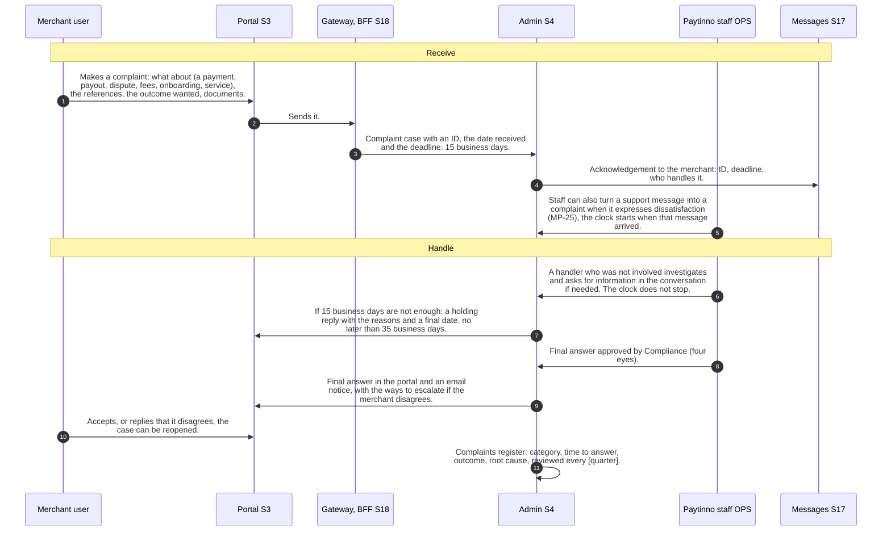
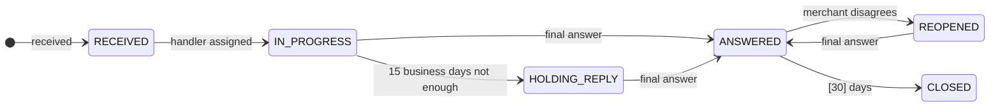

<!-- Generated from src/ by tools/build-docs.ps1. Edit src/workflows.js or src/model.js, not this file. -->

# MP-32 Complaints

[All workflows](../README.md) | Previous: [MP-27 Close the account](MP-27-close-the-account.md) | Next: [MP-36 Incident and maintenance notices](MP-36-incident-and-maintenance-notices.md)

A complaint is not a support question. It gets an ID, a deadline of 15 business days, a handler who was not involved, an answer approved by Compliance, and the ways to escalate.

| | |
|---|---|
| Status | Proposed |
| For | Every merchant |
| Area | Business |
| Source | Module specs (complaint cases in S4); PSD2 Art. 101 (an answer within 15 business days) |
| Starts when | A merchant or applicant is unhappy with Paytinno's service and says so. |
| Object | Complaint case (S4) |
| Systems | Merchant (user), Portal (S3), Gateway, BFF (S18), Admin (S4), Paytinno staff (OPS), Messages (S17) |
| Portal screens | Not in the prototype yet. Would sit on: Messages: Make a complaint; the complaint's status and deadline in the conversation |

## Sequence

## Steps

| # | From | To | Step | Call | Notes |
|---|---|---|---|---|---|
| | | | **Receive** | | |
| 1 | Merchant (user) | Portal (S3) | Makes a complaint: what about (a payment, payout, dispute, fees, onboarding, service), the references, the outcome wanted, documents. |  |  |
| 2 | Portal (S3) | Gateway, BFF (S18) | Sends it. | `POST /v1/complaints {category, refs[], text, wantedOutcome, attachments[docRef]}` |  |
| 3 | Gateway, BFF (S18) | Admin (S4) | Complaint case with an ID, the date received and the deadline: 15 business days. |  | Rule: PSD2 Art. 101 |
| 4 | Admin (S4) | Messages (S17) | Acknowledgement to the merchant: ID, deadline, who handles it. |  |  |
| 5 | Paytinno staff (OPS) | Admin (S4) | Staff can also turn a support message into a complaint when it expresses dissatisfaction (MP-25); the clock starts when that message arrived. |  |  |
| | | | **Handle** | | |
| 6 | Paytinno staff (OPS) | Admin (S4) | A handler who was not involved investigates and asks for information in the conversation if needed. The clock does not stop. |  |  |
| 7 | Admin (S4) | Portal (S3) | If 15 business days are not enough: a holding reply with the reasons and a final date, no later than 35 business days. |  | Rule: Exceptional cases only |
| 8 | Paytinno staff (OPS) | Admin (S4) | Final answer approved by Compliance (four eyes). |  |  |
| 9 | Admin (S4) | Portal (S3) | Final answer in the portal and an email notice, with the ways to escalate if the merchant disagrees. |  |  |
| 10 | Merchant (user) | Portal (S3) | Accepts, or replies that it disagrees; the case can be reopened. |  |  |
| 11 | Admin (S4) | Admin (S4) | Complaints register: category, time to answer, outcome, root cause; reviewed every [quarter]. |  |  |

## States

| From | When | To |
|---|---|---|
| start | received | RECEIVED |
| RECEIVED | handler assigned | IN_PROGRESS |
| IN_PROGRESS | 15 business days not enough | HOLDING_REPLY |
| IN_PROGRESS | final answer | ANSWERED |
| HOLDING_REPLY | final answer | ANSWERED |
| ANSWERED | merchant disagrees | REOPENED |
| REOPENED | final answer | ANSWERED |
| ANSWERED | [30] days | CLOSED |

## Rules

- Free of charge, in Bulgarian or English.
- Kept [5] years.
- A complaint never moves a dispute deadline or an RFI due date.

## Changes v8.7 needs

For the CTO's next version of the architecture.

- Add a merchant complaint workflow to v8.7: S4 complaint cases with a 15 business day timer, a holding reply up to 35, Compliance approval and a complaints register (PSD2 Art. 101).

## Questions

### MP-Q46

Who handles complaints and approves the answers?

**Proposed:** Compliance owns the process and approves every final answer; the handler is never the person or team complained about.

Owner: Compliance

### MP-Q47

Which escalation routes do we give merchants: the BNB, an out-of-court body, and later the UK ombudsman?

**Proposed:** The BNB always; the conciliation committee for payment disputes where it applies to the merchant; the UK Financial Ombudsman only once there are UK merchants.

Owner: Legal
