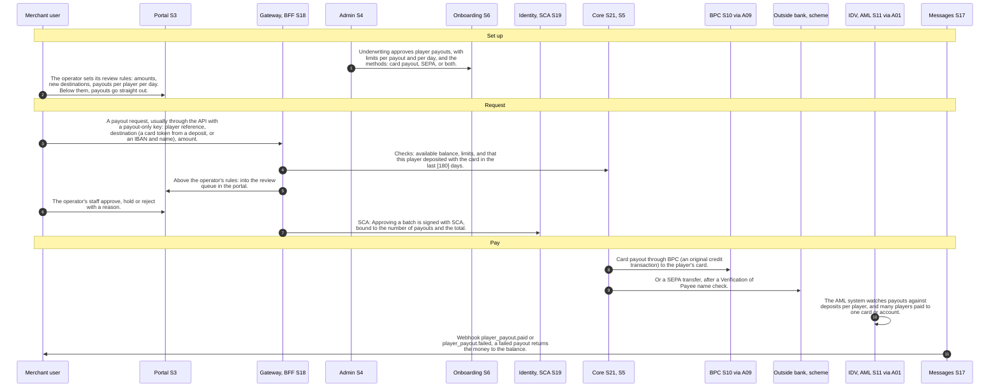
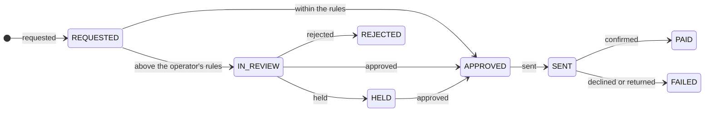

<!-- Generated from src/ by tools/build-docs.ps1. Edit src/workflows.js or src/model.js, not this file. -->

# MP-33 Payouts to players

[All workflows](../README.md) | Previous: [MP-19 Tariff change notice](MP-19-tariff-change-notice.md) | Next: [MP-37 Money the merchant owes](MP-37-money-the-merchant-owes.md)

Paid from the operator's available balance to the card the player deposited with, or to an account in the player's name. The operator's own review rules decide which payouts need a second look.

| | |
|---|---|
| Status | Proposed |
| For | Only Gambling operators (MCC 7995, licensed by the National Revenue Agency). Whether each merchant type is in year-one scope is still to decide. |
| Area | Money |
| Source | WF02b 10 (extra checks for MCC 7995); the design boards (payout approvals for a gambling operator); not in v8.1 |
| Starts when | A gambling operator pays a player's winnings or withdrawal. |
| Object | Player payout (S21): a card payout through BPC or a SEPA transfer |
| Systems | Merchant (user), Portal (S3), Gateway, BFF (S18), Admin (S4), Onboarding (S6), Identity, SCA (S19), Core (S21, S5), BPC (S10 via A09), Outside (bank, scheme), IDV, AML (S11 via A01), Messages (S17) |
| Portal screens | Not in the prototype yet. Would sit on: Money: a Player payouts page with a review queue and review rules; Developers: payout keys |

## Sequence

## Steps

| # | From | To | Step | Call | Notes |
|---|---|---|---|---|---|
| | | | **Set up** | | |
| 1 | Admin (S4) | Onboarding (S6) | Underwriting approves player payouts, with limits per payout and per day, and the methods: card payout, SEPA, or both. |  | MP-08 |
| 2 | Merchant (user) | Portal (S3) | The operator sets its review rules: amounts, new destinations, payouts per player per day. Below them, payouts go straight out. |  |  |
| | | | **Request** | | |
| 3 | Merchant (user) | Gateway, BFF (S18) | A payout request, usually through the API with a payout-only key: player reference, destination (a card token from a deposit, or an IBAN and name), amount. | `POST /v1/player-payouts {playerRef, destination, amount, reference} + Idempotency-Key` |  |
| 4 | Gateway, BFF (S18) | Core (S21, S5) | Checks: available balance, limits, and that this player deposited with the card in the last [180] days. | `A05 / M0391` | Rule: Return to source (MP-Q50) **If it fails:** not enough balance or over a limit: refused |
| 5 | Gateway, BFF (S18) | Portal (S3) | Above the operator's rules: into the review queue in the portal. |  |  |
| 6 | Merchant (user) | Portal (S3) | The operator's staff approve, hold or reject with a reason. |  |  |
| 7 | Gateway, BFF (S18) | Identity, SCA (S19) | Approving a batch is signed with SCA, bound to the number of payouts and the total. |  | **SCA** |
| | | | **Pay** | | |
| 8 | Core (S21, S5) | BPC (S10 via A09) | Card payout through BPC (an original credit transaction) to the player's card. | `IF45 via A09` |  |
| 9 | Core (S21, S5) | Outside (bank, scheme) | Or a SEPA transfer, after a Verification of Payee name check. |  | NC3 |
| 10 | IDV, AML (S11 via A01) | IDV, AML (S11 via A01) | The AML system watches payouts against deposits per player, and many players paid to one card or account. |  |  |
| 11 | Messages (S17) | Merchant (user) | Webhook player_payout.paid or player_payout.failed; a failed payout returns the money to the balance. |  |  |

## States

| From | When | To |
|---|---|---|
| start | requested | REQUESTED |
| REQUESTED | above the operator's rules | IN_REVIEW |
| REQUESTED | within the rules | APPROVED |
| IN_REVIEW | approved | APPROVED |
| IN_REVIEW | held | HELD |
| HELD | approved | APPROVED |
| IN_REVIEW | rejected | REJECTED |
| APPROVED | sent | SENT |
| SENT | confirmed | PAID |
| SENT | declined or returned | FAILED |

## Rules

- Paid only from the operator's available balance; never negative.
- Player data stays minimal: a player reference and a masked card or IBAN.
- Before go-live: the operator's licence from the National Revenue Agency is checked, and the operator is registered with Visa and Mastercard as a high-risk merchant category.

## Changes v8.1 needs

For the CTO's next version of the architecture (v8.2).

- WF02b 10: for gambling (MCC 7995) add the National Revenue Agency licence check and the Visa and Mastercard high-risk merchant registration before activation.
- Add a player payout workflow to v8.1: funded from the merchant balance, card payouts through A09 or SEPA through NC3, with the operator's own review rules.

## Depends on

Confirmations needed from outside Paytinno. Not design gaps.

- BPC: card payouts (original credit transactions) for gambling winnings through A09.
- OraSYS: payout orders to third parties from a merchant balance through M0391.

## Questions

### MP-Q48

Do our licence and the merchant agreement cover paying players from the operator's acquiring balance, and does that make the balance a payment account?

**Proposed:** Legal to confirm before build. If it does, the operator gets a payment account with its own terms.

Owner: Legal

### MP-Q49

Payouts sent through the API cannot be signed with SCA one by one. Is a payout-only key with an IP allow list and daily limits enough?

**Proposed:** Yes, under the exemption for secure corporate payment processes (RTS Art. 17), if the BNB agrees; batches approved in the portal are signed with SCA.

Owner: Compliance

### MP-Q50

Must payouts go back to the card or account the player deposited from?

**Proposed:** Yes: card payouts only to a card that deposited in the last [180] days; otherwise SEPA to an account in the player's name.

Owner: CRO
