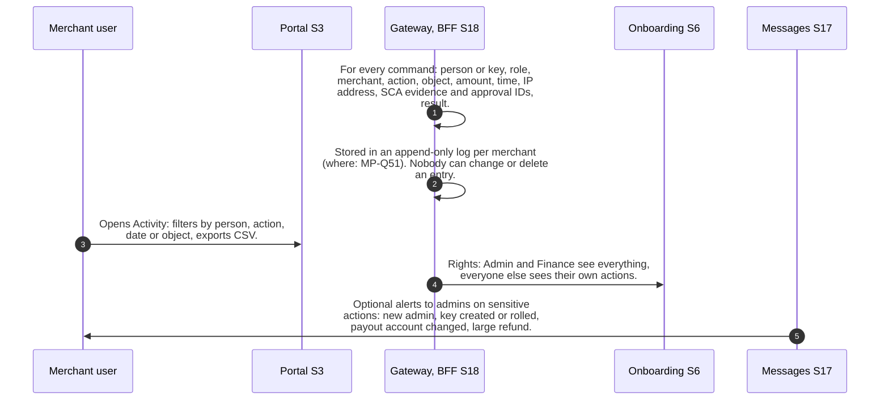

<!-- Generated from src/ by tools/build-docs.ps1. Edit src/workflows.js or src/model.js, not this file. -->

# MP-34 Activity log

[All workflows](../README.md) | Previous: [MP-23 Approvals by a second person](MP-23-approvals-by-a-second-person.md) | Next: [MP-24 Business details, owners and periodic review](MP-24-business-details-owners-and-periodic-review.md)

Every action in the portal and the API is logged with who, what, when and from where. Admin and Finance see all of it; everyone else sees their own.

| | |
|---|---|
| Status | Proposed |
| For | Every merchant |
| Area | Team |
| Source | Not in v8.1; one-pager S3 item 7 (business roles, mandates and approvals) |
| Starts when | Anyone, or any API key, acts for the merchant; an admin wants to see who did what. |
| Object | Activity event (append-only) |
| Systems | Merchant (user), Portal (S3), Gateway, BFF (S18), Onboarding (S6), Messages (S17) |
| Portal screens | Not in the prototype yet. Would sit on: Settings: an Activity page; a History link on each payment, payout, key and user |

## Sequence

## Steps

| # | From | To | Step | Call | Notes |
|---|---|---|---|---|---|
| 1 | Gateway, BFF (S18) | Gateway, BFF (S18) | For every command: person or key, role, merchant, action, object, amount, time, IP address, SCA evidence and approval IDs, result. |  | Rule: Written before the answer is returned |
| 2 | Gateway, BFF (S18) | Gateway, BFF (S18) | Stored in an append-only log per merchant (where: MP-Q51). Nobody can change or delete an entry. |  |  |
| 3 | Merchant (user) | Portal (S3) | Opens Activity: filters by person, action, date or object; exports CSV. | `GET /v1/activity?person&action&from&to` |  |
| 4 | Gateway, BFF (S18) | Onboarding (S6) | Rights: Admin and Finance see everything; everyone else sees their own actions. |  |  |
| 5 | Messages (S17) | Merchant (user) | Optional alerts to admins on sensitive actions: new admin, key created or rolled, payout account changed, large refund. |  |  |

## States

No states of its own.

## Rules

- Covers sign-ins, refunds, captures, links, payouts, keys, webhooks, team and settings changes, exports and statement downloads.
- API actions name the key's label.
- Actions kept [5] years; IP addresses [13] months.

## Changes v8.1 needs

For the CTO's next version of the architecture (v8.2).

- S18: write an activity event for every portal and API command (who, what, when, from where, SCA evidence and approval IDs), readable by the merchant.

## Questions

### MP-Q51

Where does the merchant activity log live, and for how long?

**Proposed:** An append-only store fed by S18, hash-chained like the admin journal; actions [5] years, IP addresses [13] months.

Owner: CTO
