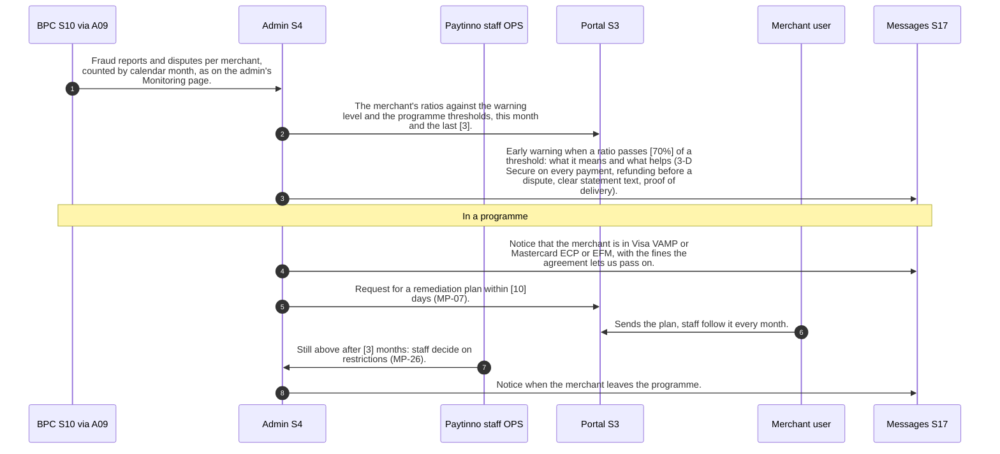
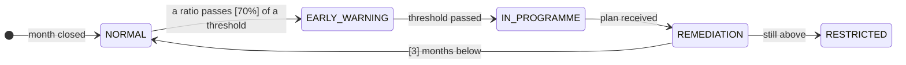

<!-- Generated from src/ by tools/build-docs.ps1. Edit src/workflows.js or src/model.js, not this file. -->

# MP-35 Fraud and dispute ratio warnings

[All workflows](../README.md) | Previous: [MP-17 Rolling reserve and reserve top-up](MP-17-rolling-reserve-and-reserve-top-up.md) | Next: [MP-13 Balances, settlement and automatic payouts](MP-13-balances-settlement-and-automatic-payouts.md)

The merchant sees its own fraud and dispute ratios each month and is warned before it enters a scheme programme, with what to do about it.

| | |
|---|---|
| Status | Proposed |
| For | Every merchant |
| Area | Disputes |
| Source | Paytinno Admin monitoring (Visa VAMP, Mastercard ECP and EFM by calendar month); WF11 rule (chargeback ratio above about 1%) |
| Starts when | A merchant's fraud or dispute ratio rises toward a card scheme programme threshold. |
| Object | The merchant's monthly ratios (S4) |
| Systems | BPC (S10 via A09), Admin (S4), Paytinno staff (OPS), Portal (S3), Merchant (user), Messages (S17) |
| Portal screens | Not in the prototype yet. Would sit on: Disputes: a Your ratios panel; notices in Messages |

## Sequence

## Steps

| # | From | To | Step | Call | Notes |
|---|---|---|---|---|---|
| 1 | BPC (S10 via A09) | Admin (S4) | Fraud reports and disputes per merchant, counted by calendar month, as on the admin's Monitoring page. |  |  |
| 2 | Admin (S4) | Portal (S3) | The merchant's ratios against the warning level and the programme thresholds, this month and the last [3]. | `GET /v1/risk/ratios` |  |
| 3 | Admin (S4) | Messages (S17) | Early warning when a ratio passes [70%] of a threshold: what it means and what helps (3-D Secure on every payment, refunding before a dispute, clear statement text, proof of delivery). | `merchant.notify scheme_warning` |  |
| | | | **In a programme** | | |
| 4 | Admin (S4) | Messages (S17) | Notice that the merchant is in Visa VAMP or Mastercard ECP or EFM, with the fines the agreement lets us pass on. | `merchant.notify scheme_programme` |  |
| 5 | Admin (S4) | Portal (S3) | Request for a remediation plan within [10] days (MP-07). |  |  |
| 6 | Merchant (user) | Portal (S3) | Sends the plan; staff follow it every month. |  |  |
| 7 | Paytinno staff (OPS) | Admin (S4) | Still above after [3] months: staff decide on restrictions (MP-26). |  |  |
| 8 | Admin (S4) | Messages (S17) | Notice when the merchant leaves the programme. | `merchant.notify scheme_exit` |  |

## States

| From | When | To |
|---|---|---|
| start | month closed | NORMAL |
| NORMAL | a ratio passes [70%] of a threshold | EARLY_WARNING |
| EARLY_WARNING | threshold passed | IN_PROGRAMME |
| IN_PROGRAMME | plan received | REMEDIATION |
| REMEDIATION | [3] months below | NORMAL |
| REMEDIATION | still above | RESTRICTED |

## Rules

- Thresholds are the placeholders in Paytinno Admin until the schemes confirm them in writing.
- Scheme fines are passed on only as the agreement allows.
- The merchant sees only its own ratios.

## Changes v8.1 needs

For the CTO's next version of the architecture (v8.2).

- S4 monitoring (VAMP, ECP, EFM): show the merchant its own ratios and send warning, programme and exit notices (new templates scheme_warning, scheme_programme, scheme_exit).

## Questions

### MP-Q52

At what level do we warn merchants, and which scheme fines do we pass on?

**Proposed:** Warn at [70%] of each threshold; pass on scheme fines in full while the merchant is in a programme, as the agreement says.

Owner: CRO
