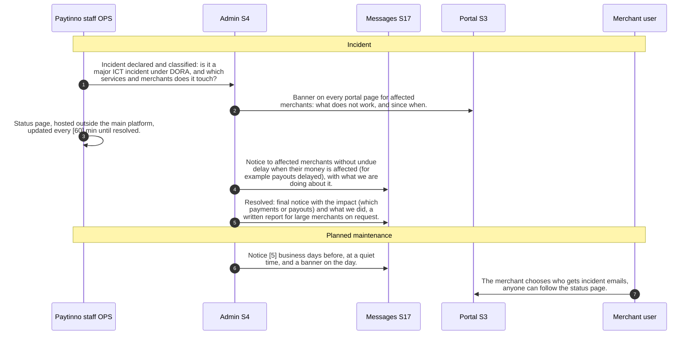
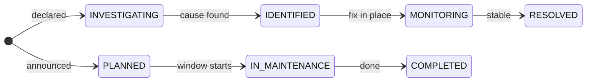

<!-- Generated from src/ by tools/build-docs.ps1. Edit src/workflows.js or src/model.js, not this file. -->

# MP-36 Incident and maintenance notices

[All workflows](../README.md) | Previous: [MP-32 Complaints](MP-32-complaints.md) | Next: [MP-38 Ask for higher limits or new services](MP-38-ask-for-higher-limits-or-new-services.md)

Merchants hear about problems from us first: a banner, a status page and notices, and afterwards what happened and what we changed.

| | |
|---|---|
| Status | Proposed |
| For | Every merchant |
| Area | Business |
| Source | DORA Art. 19(3) (tell clients about major ICT incidents that affect their financial interests); v8.1 incident handling |
| Starts when | Something merchants feel breaks (payments, refunds, payouts, portal, API, webhooks), or maintenance is planned. |
| Object | Incident or maintenance notice |
| Systems | Paytinno staff (OPS), Admin (S4), Messages (S17), Portal (S3), Merchant (user) |
| Portal screens | Not in the prototype yet. Would sit on: A banner on every portal page; a status page outside the platform; Messages |

## Sequence

## Steps

| # | From | To | Step | Call | Notes |
|---|---|---|---|---|---|
| | | | **Incident** | | |
| 1 | Paytinno staff (OPS) | Admin (S4) | Incident declared and classified: is it a major ICT incident under DORA, and which services and merchants does it touch? |  |  |
| 2 | Admin (S4) | Portal (S3) | Banner on every portal page for affected merchants: what does not work, and since when. |  |  |
| 3 | Paytinno staff (OPS) | Paytinno staff (OPS) | Status page, hosted outside the main platform, updated every [60] min until resolved. |  |  |
| 4 | Admin (S4) | Messages (S17) | Notice to affected merchants without undue delay when their money is affected (for example payouts delayed), with what we are doing about it. |  | Rule: DORA Art. 19(3) |
| 5 | Admin (S4) | Messages (S17) | Resolved: final notice with the impact (which payments or payouts) and what we did; a written report for large merchants on request. |  |  |
| | | | **Planned maintenance** | | |
| 6 | Admin (S4) | Messages (S17) | Notice [5] business days before, at a quiet time, and a banner on the day. |  |  |
| 7 | Merchant (user) | Portal (S3) | The merchant chooses who gets incident emails; anyone can follow the status page. |  |  |

## States

| From | When | To |
|---|---|---|
| start | declared | INVESTIGATING |
| INVESTIGATING | cause found | IDENTIFIED |
| IDENTIFIED | fix in place | MONITORING |
| MONITORING | stable | RESOLVED |
| start | announced | PLANNED |
| PLANNED | window starts | IN_MAINTENANCE |
| IN_MAINTENANCE | done | COMPLETED |

## Rules

- Notices never give details that would help an attacker.
- Texts approved by the incident manager; when DORA applies, also by Compliance.
- The status page must work when the platform does not.

## Changes v8.1 needs

For the CTO's next version of the architecture (v8.2).

- v8.1 incident handling: add notices to merchants for major ICT incidents (DORA Art. 19(3)), a status page outside the platform, portal banners and planned maintenance notices.

## Questions

### MP-Q53

Is the status page public or only for signed-in merchants, and who approves the texts?

**Proposed:** Public, without details on causes; the incident manager approves, and Compliance too when DORA applies.

Owner: COO
