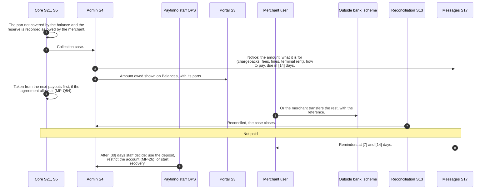
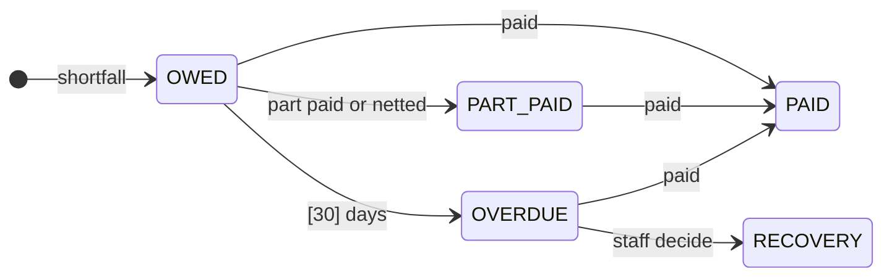

<!-- Generated from src/ by tools/build-docs.ps1. Edit src/workflows.js or src/model.js, not this file. -->

# MP-37 Money the merchant owes

[All workflows](../README.md) | Previous: [MP-33 Payouts to players](MP-33-payouts-to-players.md) | Next: [MP-20 API keys: create, roll, revoke](MP-20-api-keys-create-roll-revoke.md)

When the balance and reserve do not cover what the merchant owes, the merchant sees the amount and why, and pays it by transfer or from the next payouts.

| | |
|---|---|
| Status | Proposed |
| For | Every merchant |
| Area | Money |
| Source | WF11 13 (a shortfall becomes a receivable from the merchant and an S4 case); PRD WF11 (the balance is never negative) |
| Starts when | Chargebacks, fees or fines are larger than the merchant's balance and reserve. |
| Object | Receivable from the merchant (S21), collection case (S4) |
| Systems | Core (S21, S5), Admin (S4), Paytinno staff (OPS), Portal (S3), Merchant (user), Outside (bank, scheme), Reconciliation (S13), Messages (S17) |
| Portal screens | Not in the prototype yet. Would sit on: Balances: an Amount owed card with its history; Messages |

## Sequence

## Steps

| # | From | To | Step | Call | Notes |
|---|---|---|---|---|---|
| 1 | Core (S21, S5) | Core (S21, S5) | The part not covered by the balance and the reserve is recorded as owed by the merchant. |  | WF11 13 |
| 2 | Core (S21, S5) | Admin (S4) | Collection case. |  | WF11 13 |
| 3 | Admin (S4) | Messages (S17) | Notice: the amount, what it is for (chargebacks, fees, fines, terminal rent), how to pay, due in [14] days. | `merchant.notify amount_owed` |  |
| 4 | Admin (S4) | Portal (S3) | Amount owed shown on Balances, with its parts. |  |  |
| 5 | Core (S21, S5) | Core (S21, S5) | Taken from the next payouts first, if the agreement allows it (MP-Q54). |  |  |
| 6 | Merchant (user) | Outside (bank, scheme) | Or the merchant transfers the rest, with the reference. |  |  |
| 7 | Reconciliation (S13) | Admin (S4) | Reconciled; the case closes. |  |  |
| | | | **Not paid** | | |
| 8 | Messages (S17) | Merchant (user) | Reminders at [7] and [14] days. |  |  |
| 9 | Paytinno staff (OPS) | Admin (S4) | After [30] days staff decide: use the deposit, restrict the account (MP-26), or start recovery. |  |  |

## States

| From | When | To |
|---|---|---|
| start | shortfall | OWED |
| OWED | part paid or netted | PART_PAID |
| OWED | paid | PAID |
| PART_PAID | paid | PAID |
| OWED | [30] days | OVERDUE |
| OVERDUE | paid | PAID |
| OVERDUE | staff decide | RECOVERY |

## Rules

- The main balance is never negative; what is owed is shown separately.
- Reserve top-ups (MP-17) stay transfer-only.

## Changes v8.7 needs

For the CTO's next version of the architecture.

- WF11 13: describe the receivable: the notice and amount in the portal, netting from future payouts if the agreement allows, transfer, reminders and escalation.

## Questions

### MP-Q54

May we take what a merchant owes from its next payouts, and do we charge late interest?

**Proposed:** Yes to netting, written into the agreement; no late interest in phase 1.

Owner: Legal
