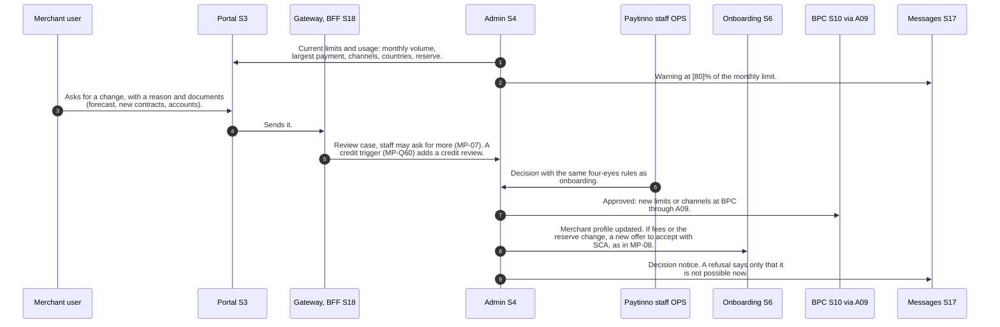
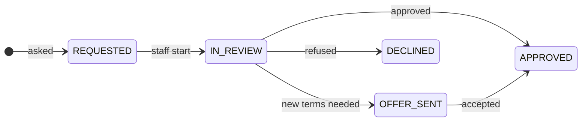

<!-- Generated from src/ by tools/build-docs.ps1. Edit src/workflows.js or src/model.js, not this file. -->

# MP-38 Ask for higher limits or new services

[All workflows](../README.md) | Previous: [MP-36 Incident and maintenance notices](MP-36-incident-and-maintenance-notices.md)

The merchant sees its limits and how much it has used, and asks for changes. Staff review them like the onboarding review; new terms are accepted like the first offer.

| | |
|---|---|
| Status | Proposed |
| For | Every merchant |
| Area | Business |
| Source | WF02b 10 to 12 (the onboarding review sets limits, MCC and channels); not as a merchant request in v8.7 |
| Starts when | A merchant needs a higher limit, a new channel (links, terminals, manual capture, saved cards), new customer countries, or a lower reserve. |
| Object | Change request (S4 review case) |
| Systems | Merchant (user), Portal (S3), Gateway, BFF (S18), Admin (S4), Paytinno staff (OPS), Onboarding (S6), BPC (S10 via A09), Messages (S17) |
| Portal screens | Not in the prototype yet. Would sit on: Business: a Limits and services tab with current limits, usage and Ask for a change |

## Sequence

## Steps

| # | From | To | Step | Call | Notes |
|---|---|---|---|---|---|
| 1 | Admin (S4) | Portal (S3) | Current limits and usage: monthly volume, largest payment, channels, countries, reserve. | `GET /v1/merchant/limits` |  |
| 2 | Admin (S4) | Messages (S17) | Warning at [80]% of the monthly limit. |  |  |
| 3 | Merchant (user) | Portal (S3) | Asks for a change, with a reason and documents (forecast, new contracts, accounts). |  |  |
| 4 | Portal (S3) | Gateway, BFF (S18) | Sends it. | `POST /v1/merchant/requests {type, requested, reason, docRefs}` |  |
| 5 | Gateway, BFF (S18) | Admin (S4) | Review case; staff may ask for more (MP-07). A credit trigger (MP-Q60) adds a credit review. |  | Time: [3] business days |
| 6 | Paytinno staff (OPS) | Admin (S4) | Decision with the same four-eyes rules as onboarding. |  | WF02b 11 |
| 7 | Admin (S4) | BPC (S10 via A09) | Approved: new limits or channels at BPC through A09. | `IF45 via A09` |  |
| 8 | Admin (S4) | Onboarding (S6) | Merchant profile updated. If fees or the reserve change, a new offer to accept with SCA, as in MP-08. |  |  |
| 9 | Admin (S4) | Messages (S17) | Decision notice. A refusal says only that it is not possible now. |  |  |

## States

| From | When | To |
|---|---|---|
| start | asked | REQUESTED |
| REQUESTED | staff start | IN_REVIEW |
| IN_REVIEW | approved | APPROVED |
| IN_REVIEW | new terms needed | OFFER_SENT |
| OFFER_SENT | accepted | APPROVED |
| IN_REVIEW | refused | DECLINED |

## Rules

- Refusals use the same neutral words as onboarding (no tipping off).

## Changes v8.7 needs

For the CTO's next version of the architecture.

- WF02b onboarding review: add a new review on the merchant's request (limits, channels, countries, reserve) with the same four-eyes rules, and new terms accepted like the offer (MP-08).

## Questions

### MP-Q55

Who decides these requests, and how fast?

**Proposed:** The onboarding review team, in [3] business days, with the credit approver when a credit trigger is met (MP-Q60); four eyes above the same thresholds as onboarding.

Owner: CRO
