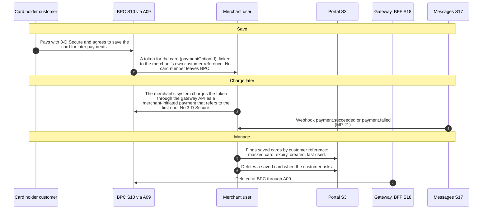
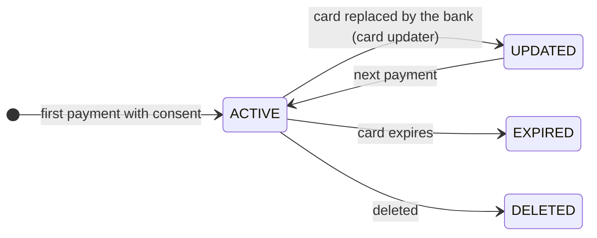

<!-- Generated from src/ by tools/build-docs.ps1. Edit src/workflows.js or src/model.js, not this file. -->

# MP-39 Saved cards and recurring payments

[All workflows](../README.md) | Previous: [MP-31 Capture later, or in part](MP-31-capture-later-or-in-part.md) | Next: [MP-16 Answer a chargeback](MP-16-answer-a-chargeback.md)

The first payment is made by the customer, with 3-D Secure and consent to save the card. Later payments are started by the merchant without the customer. Saved cards can be found and deleted in the portal.

| | |
|---|---|
| Status | Proposed |
| For | Only Subscriptions and saved cards (Customers who pay again without typing their card). Whether each merchant type is in year-one scope is still to decide. |
| Area | Payments |
| Source | PRD WF11 (paymentOptionId, the BPC gateway token); not in v8.1 |
| Starts when | A customer saves a card at checkout, or a merchant charges a subscription. |
| Object | Saved card (BPC token), merchant-initiated payment |
| Systems | Card holder (customer), BPC (S10 via A09), Merchant (user), Portal (S3), Gateway, BFF (S18), Messages (S17) |
| Portal screens | Not in the prototype yet. Would sit on: Payments: a Saved cards tab; each payment shows whether the customer or the merchant started it |

## Sequence

## Steps

| # | From | To | Step | Call | Notes |
|---|---|---|---|---|---|
| | | | **Save** | | |
| 1 | Card holder (customer) | BPC (S10 via A09) | Pays with 3-D Secure and agrees to save the card for later payments. |  | WF10 1 |
| 2 | BPC (S10 via A09) | Merchant (user) | A token for the card (paymentOptionId), linked to the merchant's own customer reference. No card number leaves BPC. |  |  |
| | | | **Charge later** | | |
| 3 | Merchant (user) | BPC (S10 via A09) | The merchant's system charges the token through the gateway API as a merchant-initiated payment that refers to the first one. No 3-D Secure. |  | IF06 |
| 4 | Messages (S17) | Merchant (user) | Webhook payment.succeeded or payment.failed (MP-21). |  |  |
| | | | **Manage** | | |
| 5 | Merchant (user) | Portal (S3) | Finds saved cards by customer reference: masked card, expiry, created, last used. | `GET /v1/saved-cards?customerRef` |  |
| 6 | Merchant (user) | Portal (S3) | Deletes a saved card when the customer asks. | `DELETE /v1/saved-cards/{id}` |  |
| 7 | Gateway, BFF (S18) | BPC (S10 via A09) | Deleted at BPC through A09. | `IF45 via A09` |  |

## States

| From | When | To |
|---|---|---|
| start | first payment with consent | ACTIVE |
| ACTIVE | card replaced by the bank (card updater) | UPDATED |
| UPDATED | next payment | ACTIVE |
| ACTIVE | card expires | EXPIRED |
| ACTIVE | deleted | DELETED |

## Rules

- A card is saved only with the customer's consent, at a payment with 3-D Secure.
- Never try again after a "do not try again" decline; follow the schemes' retry limits (Visa: at most 15 tries in 30 days).
- Subscriptions follow the schemes' rules on free trials and reminders.
- Deleting a saved card refunds nothing.

## Changes v8.1 needs

For the CTO's next version of the architecture (v8.2).

- WF10: add saved cards (stored credentials) and merchant-initiated payments: the first payment with SCA and consent, later payments referring to it, tokens visible and deletable in the portal.

## Depends on

Confirmations needed from outside Paytinno. Not design gaps.

- BPC: tokens that can be deleted through A09, merchant-initiated payment flags, and card updater services (Visa Account Updater, Mastercard ABU).

## Questions

### MP-Q56

Do we offer only saved cards and merchant-initiated payments, or also a subscription engine (plans, schedules, retries)?

**Proposed:** Only saved cards and merchant-initiated payments through the API in phase 1; merchants run their own schedules.

Owner: Product
