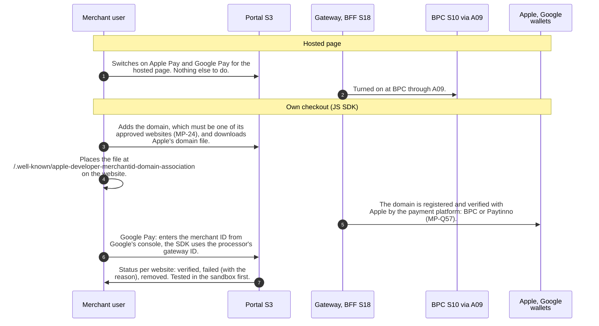
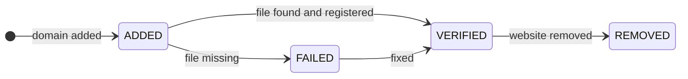

<!-- Generated from src/ by tools/build-docs.ps1. Edit src/workflows.js or src/model.js, not this file. -->

# MP-40 Apple Pay and Google Pay

[All workflows](../README.md) | Previous: [MP-28 Reports and exports](MP-28-reports-and-exports.md) | Next: [MP-41 Shop plugins](MP-41-shop-plugins.md)

On the hosted page the merchant just switches the wallets on. On its own checkout (JS SDK), Apple Pay needs the merchant's domain verified and Google Pay needs the merchant's Google ID.

| | |
|---|---|
| Status | Proposed |
| For | Only Own checkout (Merchants with the JS SDK on their own website). Whether each merchant type is in year-one scope is still to decide. |
| Area | Developers |
| Source | v8.7 names Apple Pay and Google Pay only for card issuing (push provisioning, IF03); S10 gateway |
| Starts when | A merchant wants to offer Apple Pay or Google Pay at its checkout. |
| Object | Wallet set-up per website |
| Systems | Merchant (user), Portal (S3), Gateway, BFF (S18), BPC (S10 via A09), Apple, Google (wallets) |
| Portal screens | Not in the prototype yet. Would sit on: Developers: a Wallets tab with the Apple Pay and Google Pay status of each website |

## Sequence

## Steps

| # | From | To | Step | Call | Notes |
|---|---|---|---|---|---|
| | | | **Hosted page** | | |
| 1 | Merchant (user) | Portal (S3) | Switches on Apple Pay and Google Pay for the hosted page. Nothing else to do. |  |  |
| 2 | Gateway, BFF (S18) | BPC (S10 via A09) | Turned on at BPC through A09. | `IF45 via A09` |  |
| | | | **Own checkout (JS SDK)** | | |
| 3 | Merchant (user) | Portal (S3) | Adds the domain, which must be one of its approved websites (MP-24), and downloads Apple's domain file. |  |  |
| 4 | Merchant (user) | Merchant (user) | Places the file at /.well-known/apple-developer-merchantid-domain-association on the website. |  |  |
| 5 | Gateway, BFF (S18) | Apple, Google (wallets) | The domain is registered and verified with Apple by the payment platform: BPC or Paytinno (MP-Q57). |  |  |
| 6 | Merchant (user) | Portal (S3) | Google Pay: enters the merchant ID from Google's console; the SDK uses the processor's gateway ID. |  |  |
| 7 | Portal (S3) | Merchant (user) | Status per website: verified, failed (with the reason), removed. Tested in the sandbox first. |  |  |

## States

| From | When | To |
|---|---|---|
| start | domain added | ADDED |
| ADDED | file found and registered | VERIFIED |
| ADDED | file missing | FAILED |
| FAILED | fixed | VERIFIED |
| VERIFIED | website removed | REMOVED |

## Rules

- Wallet payments are card payments: same fees, refunds and disputes.
- Only approved websites can be added.

## Changes v8.7 needs

For the CTO's next version of the architecture.

- S10 gateway: add Apple Pay and Google Pay for merchant checkouts; v8.7 mentions them only for card issuing.

## Depends on

Confirmations needed from outside Paytinno. Not design gaps.

- BPC: Apple Pay and Google Pay on the hosted page and in the JS SDK, and whether BPC is Apple's payment platform for merchant domains.

## Questions

### MP-Q57

Who registers merchant domains with Apple: BPC as the processor, or Paytinno as a payment platform?

**Proposed:** BPC, if it is already an Apple Pay payment platform; otherwise Paytinno applies to Apple.

Owner: CTO
