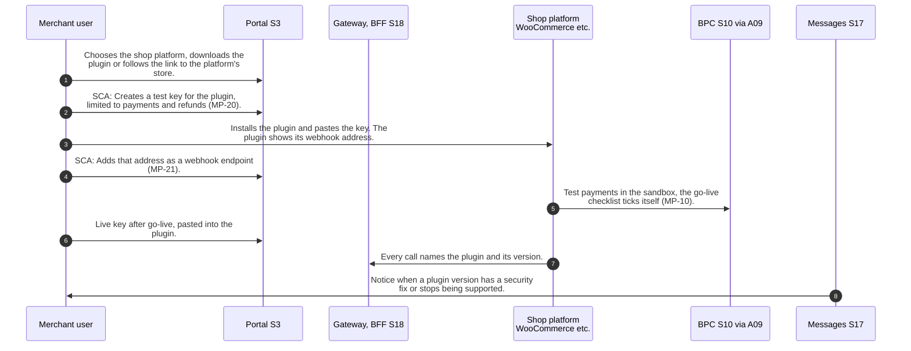
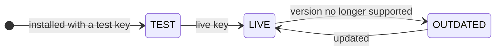

<!-- Generated from src/ by tools/build-docs.ps1. Edit src/workflows.js or src/model.js, not this file. -->

# MP-41 Shop plugins

[All workflows](../README.md) | Previous: [MP-40 Apple Pay and Google Pay](MP-40-apple-pay-and-google-pay.md) | Next: [MP-22 Invite, change and remove users](MP-22-invite-change-and-remove-users.md)

The merchant installs the plugin, makes a key for it, adds the plugin's webhook address in the portal, tests and goes live. Paytinno tells merchants when a plugin needs a security update.

| | |
|---|---|
| Status | Proposed |
| For | Only Shop platforms (WooCommerce, OpenCart, CloudCart and similar). Whether each merchant type is in year-one scope is still to decide. |
| Area | Developers |
| Source | Not in v8.7; module spec v7.1 (sandbox certification of every merchant integration) |
| Starts when | A merchant with a WooCommerce, OpenCart, CloudCart or similar shop connects it to Paytinno. |
| Object | Plugin installation |
| Systems | Merchant (user), Portal (S3), Gateway, BFF (S18), Shop platform (WooCommerce etc.), BPC (S10 via A09), Messages (S17) |
| Portal screens | Not in the prototype yet. Would sit on: Developers: a Plugins tab with downloads, set-up steps and the plugin versions in use |

## Sequence

## Steps

| # | From | To | Step | Call | Notes |
|---|---|---|---|---|---|
| 1 | Merchant (user) | Portal (S3) | Chooses the shop platform; downloads the plugin or follows the link to the platform's store. |  |  |
| 2 | Merchant (user) | Portal (S3) | Creates a test key for the plugin, limited to payments and refunds (MP-20). |  | **SCA** |
| 3 | Merchant (user) | Shop platform (WooCommerce etc.) | Installs the plugin and pastes the key. The plugin shows its webhook address. |  |  |
| 4 | Merchant (user) | Portal (S3) | Adds that address as a webhook endpoint (MP-21). |  | **SCA** |
| 5 | Shop platform (WooCommerce etc.) | BPC (S10 via A09) | Test payments in the sandbox; the go-live checklist ticks itself (MP-10). |  |  |
| 6 | Merchant (user) | Portal (S3) | Live key after go-live, pasted into the plugin. |  |  |
| 7 | Shop platform (WooCommerce etc.) | Gateway, BFF (S18) | Every call names the plugin and its version. | `User-Agent: paytinno-woocommerce/1.4.2` |  |
| 8 | Messages (S17) | Merchant (user) | Notice when a plugin version has a security fix or stops being supported. |  |  |

## States

| From | When | To |
|---|---|---|
| start | installed with a test key | TEST |
| TEST | live key | LIVE |
| LIVE | version no longer supported | OUTDATED |
| OUTDATED | updated | LIVE |

## Rules

- Plugins use the hosted page or the JS SDK; card numbers never reach the shop's server.
- Plugin keys cannot pay out or change settings.

## Changes v8.7 needs

For the CTO's next version of the architecture.

- One-pager S3 item 6 (gateway keys): add restricted keys, payments and refunds only, for plugins.

## Depends on

Confirmations needed from outside Paytinno. Not design gaps.

- BPC: existing plugins for WooCommerce and OpenCart, or an API that a Paytinno plugin can use.

## Questions

### MP-Q58

Who builds and maintains the plugins, and for which platforms first?

**Proposed:** Use BPC's plugins where they exist; otherwise build WooCommerce and OpenCart first, then CloudCart.

Owner: Product

### MP-Q59

Can BPC issue keys limited to payments and refunds?

**Proposed:** Needed for plugins. If BPC cannot, plugins use the hosted page only.

Owner: CTO
